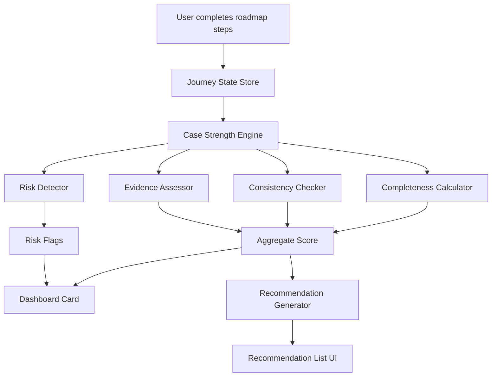

# Case Strength Analysis — IR-1/CR-1 Spouse Visa Journey
**Version:** 1.1 | **Status:** Strategy + Implementation Plan  
**Sources:** USCIS.gov, travel.state.gov, NVC CEAC documentation, ir-1.json roadmap data  

---

## 1. Executive Summary

The Case Strength Analysis is a real-time advisory engine that evaluates a user's IR-1/CR-1 visa case across **three pillars**: completeness, consistency, and evidence quality. It surfaces actionable improvement recommendations and highlights risk factors — all derived from the user's progress through the roadmap.

This is **not** legal advice. It is a structured self-assessment tool designed to help users identify gaps before they reach USCIS, NVC, or the consular officer.

> **Important:** USCIS does not publish a case-strength formula or scoring rubric. There are no official percentages, weights, or point values assigned to individual factors. The assessment framework in this document is the **tool's own design** — structured around what practitioners and published RFE/denial patterns indicate matters most, not official USCIS metrics.

---

## 2. The Three Pillars of Case Strength

The three-pillar framework is how **this tool** organizes a case review. It is not an official USCIS standard. The pillars reflect the three most common failure categories seen in RFEs, NVC rejections, and visa denials:

| Pillar | What It Measures |
|---|---|
| **Completeness** | All required steps done, documents gathered, forms filled — for the user's specific filing path (online or mailing) |
| **Consistency** | Information matches across I-130, I-130A, DS-260, I-864, and supporting civil documents |
| **Evidence Quality** | Bona fide marriage proof depth, financial adequacy, document freshness, translation compliance |

These are weighted differently at each stage. At USCIS (Chapter 1), completeness and evidence quality are primary. At NVC (Chapter 2), consistency and document completeness are primary. At the interview (Chapter 3), evidence quality and interview readiness are primary.

---

## 3. Assessment Methodology

### 3.1 Completeness

Completeness is the only pillar that is **objectively measurable** — a required step is either done or it is not. The tool tracks:

- Required steps completed vs. total required steps, per chapter
- Required documents gathered vs. total required, per document checklist
- Branch-specific steps completed (online path steps vs. mailing path steps — not both)

Each chapter's completeness is assessed independently. A case can be 100% complete at Chapter 1 and 30% complete at Chapter 2 — both numbers are shown separately, not averaged into one score.

**Completeness tiers (per chapter):**

| Range | Label | Meaning |
|---|---|---|
| 100% | Complete | All required items done |
| 75–99% | Nearly There | Minor gaps remain |
| 50–74% | In Progress | Significant steps pending |
| 0–49% | Early Stage | Most work still ahead |

### 3.2 Consistency

Consistency is **not directly observable** until form data is captured. The tool can only flag consistency issues when it has stored values from at least two different forms or documents to compare.

Key consistency checks (flagged as warnings, not scored numerically):

| Check | When It Can Be Run |
|---|---|
| Petitioner name across I-130 and I-864 | After both forms are filled |
| Beneficiary name across I-130, DS-260, passport | After DS-260 prep step |
| Marriage date across all forms and civil docs | After I-130 and DS-260 data captured |
| Prior marriage termination dates across forms | After I-130 and civil doc checklist |
| Address consistency between I-130 and I-864 | After both forms are filled |
| Employment info across I-864 and tax documents | After financial docs step |

Consistency issues are surfaced as **alerts**, not as a numerical score. A mismatch is flagged for user review — the user determines if it is a data entry error or a genuine discrepancy.

### 3.3 Evidence Quality

Evidence quality is **advisory** — there is no official USCIS rubric. The tool provides guidance on what practitioners and common RFE patterns indicate is stronger vs. weaker evidence. See §4 for the tiered evidence framework.

Evidence quality assessment focuses on:
- Bona fide marriage evidence — type and depth of documents provided
- Financial sponsorship — whether income meets the poverty guideline threshold
- Document freshness — whether time-sensitive documents are still valid
- Translation compliance — all non-English documents have certified translations

---

## 4. Evidence Strength Assessment Details

### 4.1 Bona Fide Marriage Evidence Tiers

Financial interdependence evidence is consistently considered stronger by practitioners because it is harder to fabricate than photographs or affidavits. The tier structure below reflects common patterns in RFE responses — **not official USCIS point values** (USCIS does not publish a scoring rubric for bona fide evidence).

| Tier | Evidence Type | Why It Matters |
|---|---|---|
| **Tier 1 — Strong** | Joint tax returns (married filing jointly) | Highest weight — financial interdependence |
| | Joint bank account statements with active usage | Hard to fabricate, shows ongoing shared finances |
| | Joint property deed or mortgage | Shared legal liability — very strong |
| | Joint lease agreement | Shared legal liability |
| | Life insurance with spouse as beneficiary | Ongoing financial commitment |
| **Tier 2 — Moderate** | Photographs (10–30, varied settings, captioned) | Contextual evidence — should support, not lead |
| | Sworn affidavits from family/friends (2+ recommended) | Third-party corroboration |
| | Travel records (joint trips) | Shows relationship continuity |
| | Communication logs (if long-distance relationship) | Documents contact history |
| **Tier 3 — Supporting** | Utility bills at shared address | Establishes cohabitation |
| | Shared subscription or membership records | Supporting cohabitation evidence |
| | Social media evidence | Supplementary only |
| | Birth certificates of children (if any) | Strong if applicable |

**Status tracked per item:** Uploaded / Not uploaded / Not applicable

> [!IMPORTANT]
> USCIS considers a marriage certificate alone as proof of *legality*, not *authenticity*. Cases with only a marriage certificate and photos are the most common target for I-130 RFEs.

### 4.2 Financial Sponsorship Assessment

Based on 2026 HHS federal poverty guidelines. The legal threshold for I-864 is **125% of the poverty guideline** for the household size. This is the only number set by regulation — there is no official USCIS scoring above or below this threshold.

| Household Size | 125% Threshold (2026) |
|---|---|
| 2 | $27,050 |
| 3 | $34,150 |
| 4 | $41,250 |
| 5 | $48,350 |
| 6 | $55,450 |
| Each additional | +$7,100 |

**Assessment logic (tool framework, not official USCIS rubric):**
- Income ≥ 125% of guideline → Meets minimum threshold
- Income < 125% → Does not meet minimum; joint sponsor or asset qualification required
- Joint sponsor added → Acceptable path if petitioner income is below threshold
- Asset-based qualification → Acceptable alternative if assets are 5× the income shortfall

---

## 5. Chapter-by-Chapter Step Analysis & Improvements

### 5.1 Chapter 1: USCIS Petition Filing

Chapter 1 has two distinct paths after the filing method is selected. Both paths converge at the receipt notice step. The table below covers shared steps and then breaks into path-specific steps.

#### Shared Steps (Both Paths)

| Step | Current Roadmap Coverage | Gap / Risk Identified | Improvement |
|---|---|---|---|
| **1.1 Determine Eligibility** | Quest flow checks citizenship, marriage validity, bona fide status, prior marriages | No proactive red flag screening for age gap, short marriage duration, never met in person | Add a **Risk Flag Detector** — if answers indicate potential red flags (married < 6 months, significant age gap, never met in person), surface advisory guidance on how to proactively address these |
| **1.2 Gather Documents** | Checklist with categories and upload support | No tiered evidence quality assessment; treats all documents equally | Implement **Evidence Strength Meter** — categorize uploaded evidence into Tier 1/2/3 and show which high-impact documents are missing |
| **1.3 Filing Method** | Quiz-based selector with comparison cards (online $625 / paper $675) | No average processing time comparison shown | Add **processing time context** — online filing typically generates a receipt faster; paper adds mail transit time on both ends. Surface this in the comparison cards so the user makes an informed choice. |
| **1.4 Fill I-130** | AutoFormFiller integration | No pre-fill data capture for future consistency checking | Add **key field capture** — store petitioner name, beneficiary name, marriage date, and address at form-fill time for consistency checking against DS-260 and I-864 later |
| **1.5 Fill I-130A** | AutoFormFiller integration | Same as 1.4 — no field capture | Capture co-habitant address and employment data for consistency checking at I-864 stage |

#### Online Path Steps

| Step | Current Roadmap Coverage | Gap / Risk Identified | Improvement |
|---|---|---|---|
| **1.6 (Online) Create USCIS Account** | Tutorial + Portal Wallet save | Adequate as-is | No change needed |
| **1.7 (Online) Start Form I-130 on USCIS** | Step-by-step tutorial with screenshots | Adequate as-is | No change needed |
| **1.8 (Online) Upload Forms & Evidence** | USCIS portal upload tutorial with file format requirements | No file format/quality pre-check | Add **document quality pre-check** — warn if files are blurry, wrong format, or exceed the 12 MB limit before the user attempts to upload to USCIS |
| **1.9 (Online) Pay Filing Fee** | Fee display ($625) + USCIS portal payment tutorial | Adequate as-is | No change needed |
| **1.10 (Online) Review & Submit** | Tutorial walkthrough of the USCIS review screen | No final data consistency snapshot | Add **pre-submission snapshot** — surface petitioner name, beneficiary name, marriage date, and address one final time so the user can catch any typo before submitting |

#### Mailing / Paper Path Steps

| Step | Current Roadmap Coverage | Gap / Risk Identified | Improvement |
|---|---|---|---|
| **1.6 (Mailing) Print Hard Copies** | Print and download guide with step-by-step screenshots | No print quality checklist before moving to assembly | Add **print quality reminder** — confirm full-page, unscaled, all pages complete before marking this step done |
| **1.7 (Mailing) Prepare Filing Fee** | G-1450 (card) and G-1650 (ACH) options explained; payment method saved in Rahvana | USCIS fee schedule changes over time — no live fee verification prompt | Add **USCIS fee confirmation reminder** — direct user to uscis.gov/g-1055 to confirm the current paper filing fee before preparing payment |
| **1.8 (Mailing) Assemble Filing Packet** | Packet order guide with recommended section structure | No per-section completeness check before marking done | Add **packet checklist** — require the user to confirm each packet section (payment, forms, evidence, translations) before marking the step complete |
| **1.9 (Mailing) Mail Packet to USCIS** | Address confirmation guide + carrier/tracking number save | USCIS filing address must always be verified before mailing | Add **address verification reminder** — always prompt the user to confirm the current USCIS filing address from uscis.gov/forms/filing-guidance before sealing the envelope |

#### Shared Convergence Steps (Both Paths)

| Step | Current Roadmap Coverage | Gap / Risk Identified | Improvement |
|---|---|---|---|
| **Register Receipt in CEAC** | CEAC portal registration guide + receipt number save | No receipt number format validation | Add **receipt number format check** — I-797C receipt numbers follow a specific format (e.g., MSC2590123456). Warn the user if the entered number does not match the expected pattern |
| **Track Case Status** | CEAC case status tracking guide | Adequate as-is | No change needed |
| **Receive Approval Notice (I-797)** | Upload + approval date save + NVC preparation guidance | Adequate as-is | No change needed |

### 5.2 Chapter 2: NVC/CEAC Processing

| Step | Current Roadmap Coverage | Gap / Risk Identified | Improvement for Case Strength |
|---|---|---|---|
| **2.1 NVC Welcome Letter** | Letter review, CEAC login, Portal Wallet | No NVC case number format validation | Add **case number format validator** and auto-extract key data points from uploaded welcome letter |
| **2.2 Pay NVC Fees** | CEAC payment tutorial | No "payment posted" tracking with timeline expectations | Add **payment posting tracker** with expected timeline (typically 3–5 business days) and reminder to check CEAC weekly |
| **2.3 DS-260** | Preparation flow + answer key | **CRITICAL GAP:** No cross-validation against I-130 answers | Implement **DS-260 ↔ I-130 Consistency Checker** — flag mismatches in names, dates, addresses, employment history, and prior marriages. This is the #1 cause of NVC rejections |
| **2.4 Civil Documents** | Categorized checklist (required / conditional / recommended) | No country-specific document guidance | Add **Pakistan-specific civil document requirements** — reference travel.state.gov reciprocity page for exact document versions needed (e.g., long-form NADRA birth certificate, not short-form) |
| **2.5 Affidavit of Support** | Calculator + dynamic form generation | No income adequacy pre-check before filling | Add **real-time income threshold check** — before user starts I-864, confirm their income meets the 125% poverty guideline for their household size. If not, proactively suggest joint sponsor path |
| **2.6 Financial Documents** | Dynamic checklist based on sponsor structure | No tax return year validation | Add **tax year freshness check** — ensure user is submitting the most recent tax year and warn if transcripts are outdated |
| **2.7 Add Sponsor in CEAC** | Tutorial + relationship checklist | Only appears when needed | Adequate — conditional visibility is correct |
| **2.8 Upload to NVC** | Upload placement guide + PDF processing | No upload completeness verification | Add **upload category matcher** — verify that each required CEAC category has at least one document uploaded before user clicks "Submit" |

### 5.3 Chapter 3: Medical + Interview

| Step | Current Roadmap Coverage | Gap / Risk Identified | Improvement for Case Strength |
|---|---|---|---|
| **3.1 Schedule Medical** | Booking support + date/time capture | No medical exam document preparation checklist | Add **medical prep checklist** — vaccination records, original passport, NVC appointment letter, previous medical records if applicable |
| **3.2 Police Certificate** | Upload + persistent pending status | No freshness countdown | Add **expiry countdown timer** — police certificates are valid for 1 year from issuance. Show days remaining and warn when approaching expiry |
| **3.3 Interview Preparation** | Implied but not fully decomposed | **MAJOR GAP:** No interview simulation or document readiness checklist | Add **Interview Readiness Module**: (1) Document binder checklist — every original doc needed at interview, (2) Common question preparation guide, (3) 221(g) risk factor screening, (4) Logistics guide (no electronics, arrive early, security rules) |
| **3.4 Interview Tracking** | Appointment date/time capture + reminders | No post-interview status tracking | Add **post-interview status tracker** — Approved / 221(g) Administrative Processing / Refused, with next-step guidance for each outcome |

---

## 6. Risk Detection Engine

### 6.1 Red Flags That Trigger Additional Scrutiny

Based on common USCIS RFE and 221(g) patterns:

| Risk Factor | Detection Method | User Action Required |
|---|---|---|
| Marriage duration < 6 months at filing | Calculate from marriage date in I-130 | Advise: strengthen bona fide evidence significantly |
| Never met in person before marriage | Eligibility quest answer | Advise: provide detailed relationship timeline + communication records |
| Significant age gap (>15 years) | Derived from DOBs on forms | Advise: address proactively with relationship context in cover letter |
| Prior petition filed for different spouse | Eligibility quest answer | Advise: consult immigration attorney |
| Income below 125% poverty guideline | Affidavit Support Calculator output | Action: add joint sponsor or asset-based qualification |
| Missing prior marriage termination proof | Document checklist gap | Action: obtain and upload divorce decree / death certificate |
| Police certificate older than 1 year | Upload date vs. issuance date | Action: obtain fresh certificate before interview |
| Inconsistent information across forms | Cross-form validation engine | Action: review and correct before submission |
| No Tier 1 (strong) bona fide evidence | Evidence strength assessment | Advise: add joint financial or property documents |

### 6.2 Risk Severity Levels

| Level | Meaning | UI Treatment |
|---|---|---|
| **Critical** | Pattern commonly associated with RFE or denial based on published USCIS data and practitioner experience | Red banner, prominently surfaced in recommendations |
| **Warning** | Pattern that may cause delays or trigger additional scrutiny | Amber indicator, surfaced in recommendations list |
| **Advisory** | Best practice — not a known risk pattern, but strengthens the case | Subtle suggestion, lower priority in recommendations |

---

## 7. Progress Visualization Strategy

### 7.1 Dashboard Integration

The Case Strength card on the dashboard shows:

```
┌─────────────────────────────────────┐
│  Case Strength                      │
│  ┌─────────────┐                    │
│  │     78%     │  Good — On Track   │
│  │   ███████   │                    │
│  └─────────────┘                    │
│                                     │
│  Completeness    ████████░░  82%    │
│  Consistency     ███████░░░  70%    │
│  Evidence        ████████░░  80%    │
│                                     │
│  ⚠ 2 items need attention           │
│  → View Recommendations             │
└─────────────────────────────────────┘
```

### 7.2 Per-Chapter Progress Rings

Each chapter shows its own mini strength indicator:

- **Ring 1 (outer):** Step completion percentage
- **Ring 2 (inner):** Document upload completion
- **Color:** Matches the tier color (green/teal/amber/red)

### 7.3 Step-Level Indicators

Each step in the roadmap shows a small strength chip:

| State | Chip |
|---|---|
| Complete, no issues | Green checkmark |
| Complete, minor advisory | Teal checkmark + info dot |
| Incomplete, required | Amber circle |
| Critical issue detected | Red warning triangle |

---

## 8. Recommendation Engine

### 8.1 Recommendation Types

| Type | Example | When Shown |
|---|---|---|
| **Missing Document** | "Joint bank statements are a Tier 1 bona fide evidence item. Upload to strengthen your case." | Tier 1 evidence item not uploaded |
| **Consistency Alert** | "Marriage date on DS-260 doesn't match I-130. Review before submitting." | Cross-form mismatch detected |
| **Freshness Warning** | "Police certificate expires in 45 days. Schedule renewal if interview is not yet scheduled." | Document approaching expiry |
| **Financial Gap** | "Income is $2,400 below the required threshold. Consider adding a joint sponsor." | I-864 income < 125% poverty guideline |
| **Strength Booster** | "Adding 2 sworn affidavits from family members strengthens your bona fide evidence." | Only Tier 3 bona fide evidence uploaded |
| **Proactive Defense** | "Your marriage duration is under 1 year. Consider adding a relationship timeline document." | Risk flag detected |

### 8.2 Recommendation Priority

1. Critical risk flags (patterns associated with RFE or denial)
2. Consistency mismatches (cross-form data conflicts)
3. Missing required documents
4. Financial adequacy gaps (income below 125% threshold)
5. Evidence quality improvements (missing Tier 1/2 bona fide evidence)
6. Advisory best practices

---

## 9. Data Requirements

### 9.1 Data Points Consumed by the Engine

| Data Point | Source Step | Used For |
|---|---|---|
| Petitioner citizenship status | 1.1 Eligibility | Eligibility validation |
| Marriage date | 1.1 Eligibility / I-130 | Duration calculation, consistency |
| Prior marriage termination proof | 1.2 Documents | Completeness, risk detection |
| Filing method | 1.3 Filing Method | Branch-specific completeness |
| I-130 field values | 1.4 Fill I-130 | Consistency baseline |
| Receipt number | 1.9 Receipt Notice | Case tracking |
| DS-260 field values | 2.3 DS-260 | Consistency cross-check |
| Civil document statuses | 2.4 Civil Docs | Completeness scoring |
| Household size + income | 2.5 Affidavit Support | Financial adequacy |
| Sponsor structure | 2.5 Affidavit Support | Completeness branching |
| Financial doc statuses | 2.6 Financial Docs | Completeness scoring |
| CEAC upload statuses | 2.8 Upload to NVC | Upload completeness |
| Medical appointment date | 3.1 Schedule Medical | Completeness, timeline |
| Police cert issue date | 3.2 Police Certificate | Freshness calculation |
| Bona fide evidence uploads | 1.2 + 2.4 Documents | Evidence quality scoring |

### 9.2 New Data Points Required

| New Field | Where to Capture | Purpose |
|---|---|---|
| `marriage_date` (normalized) | Eligibility quest or I-130 | Duration + consistency |
| `petitioner_dob` | I-130 form data | Age gap detection |
| `beneficiary_dob` | I-130 form data | Age gap detection |
| `annual_income` | Affidavit Support Calculator | Financial threshold check |
| `household_size` | Affidavit Support Calculator | Poverty guideline lookup |
| `police_cert_issue_date` | Police certificate upload step | Freshness calculation |
| `evidence_tier_tags` | Document upload metadata | Evidence quality scoring |
| `interview_date` | Interview tracking step | Timeline calculations |
| `post_interview_status` | New: post-interview step | Outcome tracking |

---

## 10. Implementation Architecture

### 10.1 Engine Location

```
lib/
  case-strength/
    engine.ts          — Main scoring orchestrator
    completeness.ts    — Chapter/step completion calculator
    consistency.ts     — Cross-form validation checker
    evidence.ts        — Evidence quality assessor
    risk-detector.ts   — Red flag screening
    recommendations.ts — Recommendation generator
    types.ts           — TypeScript interfaces
    constants.ts       — Thresholds, weights, poverty guidelines
```

### 10.2 Component Integration

```
components/
  case-strength/
    CaseStrengthCard.tsx         — Dashboard summary card
    CaseStrengthDetail.tsx       — Full analysis view
    ChapterStrengthRing.tsx      — Per-chapter mini indicator
    StepStrengthChip.tsx         — Per-step indicator
    RecommendationList.tsx       — Prioritized recommendations
    EvidenceStrengthMeter.tsx    — Bona fide evidence visualizer
    FinancialAdequacyGauge.tsx   — I-864 income vs threshold
    ConsistencyReport.tsx        — Cross-form mismatch display
    RiskFlagBanner.tsx           — Critical risk alerts
```

### 10.3 Data Flow



### 10.4 Computation Triggers

The engine recalculates when:
- A step is marked complete
- A document is uploaded or removed
- A form is filled or edited
- The user returns to the dashboard
- A date-sensitive threshold is crossed (police cert expiry)

---

## 11. Entitlements & Access

| Tier | Access Level |
|---|---|
| **Free** | Completeness percentage per chapter + top 2 recommendations visible |
| **Premium** | Full analysis: all 3 pillar assessments, all recommendations, risk flags, consistency alerts, evidence strength meter, financial adequacy gauge |

This follows the existing `ENTITLEMENTS` pattern in `lib/entitlements/config.ts`.

---

## 12. Implementation Phases

### Phase 1 — Completeness Engine (Ship first)
- Step completion tracking per chapter, separated by filing path (online vs. mailing)
- Required vs. optional item counting
- Dashboard card with completeness % per chapter
- Tier label per chapter: Complete / Nearly There / In Progress / Early Stage

### Phase 2 — Evidence Quality
- Bona fide evidence tier tagging on document uploads (Tier 1 / 2 / 3 classification)
- Financial adequacy check: income vs. 125% poverty guideline for household size
- Document freshness checks (police certificate validity, tax return year)
- Evidence Strength Meter component

### Phase 3 — Consistency Checker
- Capture normalized form field values from I-130, DS-260, I-864 at form-fill time
- Cross-form comparison logic (names, dates, addresses)
- Mismatch alerts surfaced as warnings — not blocking, but prominently shown

### Phase 4 — Risk Detection
- Red flag screening rules (marriage duration, age gap, no in-person meeting, prior petitions)
- Proactive defense recommendations
- 221(g) risk factor assessment at interview prep stage

### Phase 5 — Polish
- Assessment history (show how completeness improved over time)
- PDF export of case gap report
- Integration with interview prep module

---

## 13. Key Decisions Needed

| Decision | Options | Recommendation |
|---|---|---|
| Free tier visibility | Completeness only vs. completeness + top recommendations | Completeness + top 2 recommendations (shows value, creates upgrade motivation) |
| Consistency checker data source | Parse form PDFs vs. use stored form field data | Use stored form field data from AutoFormFiller + DS-260 prep — more reliable than PDF parsing |
| Risk flag display | Inline in steps vs. dedicated section | Both — inline chip on step + aggregated in Case Strength detail view |
| Assessment recalculation | Recalculate on every view vs. cache + recalculate on change | Cache with invalidation on state change (better performance) |
| Legal disclaimer placement | One-time modal vs. persistent footer | Persistent subtle footer on every Case Strength view: "Advisory tool only — not legal advice" |
| Scoring vs. no scoring | Show a 0–100 number vs. show pillar assessments separately | Show pillar assessments separately — a single number implies official authority it does not have |

---

## 14. Legal Disclaimer

> [!CAUTION]
> The Case Strength Analysis is an **advisory self-assessment tool**. It does not constitute legal advice, does not guarantee any immigration outcome, and should not be relied upon as a substitute for consultation with a qualified immigration attorney. USCIS adjudication decisions are made on a case-by-case basis and may consider factors not captured by this tool.

This disclaimer must appear on every Case Strength view.
