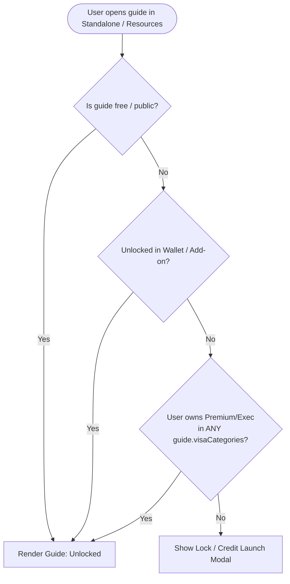
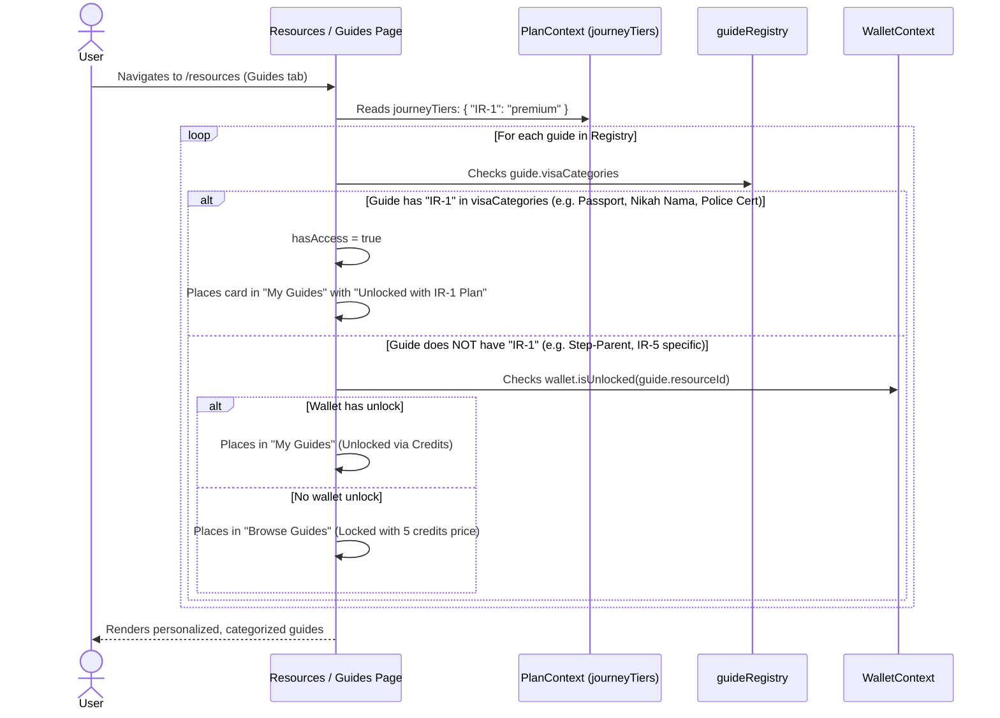
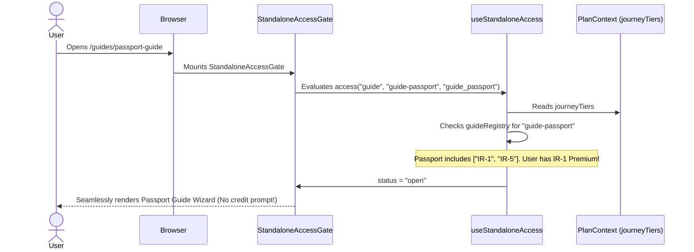
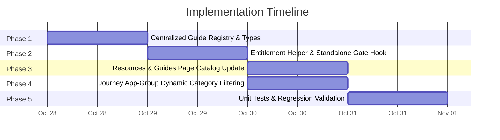

# Scalable Guides-to-Visa Category Mapping — Implementation Plan

**Document Status**: IMPLEMENTATION COMPLETE (Phases 1-5 Fully Implemented & Tested)  
**Date**: 2026-10-27  
**Scope**: Universal Guide Access, Standalone vs. Journey Entitlement Alignment, Scalable Visa Category Mapping (`visaCategories`), Resource Catalog Filtering, Zero-DB Migration  
**Related Documents**:  
- [`docs/journey-ecosystem-implementation-plan.md`](file:///d:/arachnie_work/updated_work/docs/journey-ecosystem-implementation-plan.md)  
- [`docs/rahvana-credit-wallet-system-implementation-plan.md`](file:///d:/arachnie_work/updated_work/docs/rahvana-credit-wallet-system-implementation-plan.md)  

---

## Table of Contents

1. [Executive Summary & Problem Statement](#1-executive-summary--problem-statement)
2. [Current Architecture vs. Target Architecture](#2-current-architecture-vs-target-architecture)
3. [Centralized Guide Registry Architecture](#3-centralized-guide-registry-architecture)
4. [Entitlement & Access Resolution Logic](#4-entitlement--access-resolution-logic)
5. [User Experience & UI Enhancements](#5-user-experience--ui-enhancements)
6. [Detailed Workflows & Sequence Diagrams](#6-detailed-workflows--sequence-diagrams)
7. [Implementation Phases](#7-implementation-phases)
8. [File Change Map](#8-file-change-map)
9. [Edge Cases & Defensive Rules](#9-edge-cases--defensive-rules)
10. [Testing & Verification Strategy](#10-testing--verification-strategy)

---

## 1. Executive Summary & Problem Statement

### 1.1 The Context
In the Rahvana platform, we separated the **Journey Environment** (e.g., `/visa-category/ir1-journey`, `/visa-category/ir5-journey`) from the **Public / Standalone Environment** (`/resources`, `/tools`, `/guides`):
- **Tools** are strictly bifurcated: Standalone tools do not save progress and require credits to run, while journey-embedded tools persist progress to the journey state at no extra cost.
- **Guides**, however, are **universal educational pathways**. Unlike operational tools, guide progress is bidirectionally synchronized across journey and standalone modes using candidate-scoped `guide_sessions`.

### 1.2 The Dilemma
When a user purchases a **Premium** or **Executive** journey plan (e.g. for an IR-1 or IR-5 visa), they are fully entitled to the comprehensive step-by-step guides within that journey. 

However, under current standalone access rules:
1. When the user navigates to `/resources` (Guides tab) or visits a guide directly (`/guides/passport-guide`), `useStandaloneAccess` detects `isInsideJourney === false` and restricts access strictly to wallet credit unlocks.
2. Even though guide progress is synced, the guide appears **locked** in standalone mode unless the user spends wallet credits or buys a standalone add-on.
3. This creates a confusing customer experience: *“I paid for a Premium IR-1 Journey, but on my Resources page the IR-1 guides say locked!”*

### 1.3 The Solution
Map every guide to the visa category/categories it belongs to via a declarative `visaCategories: VisaCategory[]` array:
- If a user has purchased a **Premium** or **Executive** plan for a visa journey (e.g., IR-1), any guide mapped to `IR-1` automatically unlocks in standalone mode (`/resources` and direct guide URLs).
- Guides belonging exclusively to unpurchased journeys (e.g., IR-5-only guides if the user only bought IR-1) **remain locked** in standalone mode.
- Users can still unlock unpurchased guides individually using wallet credits (5 credits).
- The mapping must be **centralized, type-safe, scalable, and zero-DB-migration**, allowing engineers to add future journeys (e.g., CR-1, IR-2, CR-2, F-1, EB-1) or new guides in seconds.

---

## 2. Current Architecture vs. Target Architecture

### 2.1 Current State Audit

```
┌────────────────────────────────────────────────────────────────────────┐
│                              CURRENT STATE                             │
├───────────────────────────────────┬────────────────────────────────────┤
│ Inside Journey Environment        │ Outside Journey (Standalone)       │
│ (/visa-category/*-journey)        │ (/resources, /guides/*)            │
├───────────────────────────────────┼────────────────────────────────────┤
│ • plan.canUse(feature) checked    │ • isInsideJourney === false        │
│ • Premium/Executive unlocks guide │ • Journey subscription is IGNORED  │
│ • Progress saved to guide_sessions│ • ONLY wallet.isUnlocked() unlocks │
│                                   │ • Result: Paid user sees LOCKS     │
└───────────────────────────────────┴────────────────────────────────────┘
```

**Root causes in codebase**:
1. In [`useStandaloneAccess.ts`](file:///d:/arachnie_work/updated_work/lib/wallet/useStandaloneAccess.ts#L53):
   ```typescript
   // Currently forces planAllowed to false outside a journey:
   const planAllowed = isInsideJourney && plan.canUse(feature);
   ```
2. In [`app/(tools)/guides/page.tsx`](file:///d:/arachnie_work/updated_work/app/(tools)/guides/page.tsx#L446-L456):
   ```typescript
   // Ignores user's journey tiers when outside a journey:
   const isOwned = (guide: Guide) => {
     const catalogItem = getGuideCatalogItem(guide.id);
     if (catalogItem && !isInsideJourney) {
       return !wallet.isLoading && wallet.isUnlocked(catalogItem.resourceId, catalogItem.resourceType);
     }
     return !guide.entitlementFeature || (!plan.isLoading && !plan.isLocked(guide.entitlementFeature));
   };
   ```

### 2.2 Target State Architecture

```
┌────────────────────────────────────────────────────────────────────────┐
│                              TARGET STATE                              │
├───────────────────────────────────┬────────────────────────────────────┤
│ Inside Journey Environment        │ Outside Journey (Standalone)       │
│ (/visa-category/*-journey)        │ (/resources, /guides/*)            │
├───────────────────────────────────┼────────────────────────────────────┤
│ • Full access to journey guides   │ • Checks:                          │
│ • Filtered to current category    │   1. Wallet credit unlock? OR      │
│ • Auto-persists progress          │   2. Eligible Journey tier for ANY │
│                                   │      category in guide's mapping?  │
│                                   │ • Matched category → UNLOCKED      │
│                                   │ • Unpurchased category → LOCKED    │
└───────────────────────────────────┴────────────────────────────────────┘
```



---

## 3. Centralized Guide Registry Architecture

Currently, guide metadata is duplicated across `app/(tools)/guides/page.tsx`, `WizardHeader.tsx`, `GuidePageOverlay.tsx`, and `resourceMapping.ts`. 

To ensure **scalability and maintainability**, we create a single, authoritative guide registry:

### 3.1 Registry Location: `lib/guides/guideRegistry.ts`

```typescript
import { VisaCategory } from "@/lib/document-vault/types";

export type GuideCategory = "Pakistan Document" | "Medical & Exam" | "Relationship & Eligibility";

export interface GuideMetadata {
  /** Unique guide slug identifier (e.g., 'passport-guide') */
  id: string;
  /** Catalog resource identifier (e.g., 'guide-passport') */
  resourceId: string;
  /** Entitlement feature key for plan rules (e.g., 'guide_passport') */
  entitlementFeature?: string;
  /** Display title */
  title: string;
  subtitle?: string;
  description: string;
  category: GuideCategory;
  /** Relative route path */
  href: string;
  iconName: string;
  /** Minimum tier required in the mapped journey to unlock (defaults to 'premium') */
  minJourneyTier?: "premium" | "executive";
  /** 
   * Declarative array of Visa Categories this guide belongs to.
   * If user owns a Premium/Executive plan in ANY of these categories, the guide unlocks.
   * Use ['*'] or ['ALL'] if universal across all current and future visa types.
   */
  visaCategories: (VisaCategory | "*" | "ALL")[];
  /** Whether the guide is available as a credit purchase (default: true) */
  creditPayable?: boolean;
  comingSoon?: boolean;
}
```

### 3.2 Authority Mapping Table

Here is the initial scalable mapping across existing guides:

| Guide ID | Route | Resource ID | Entitlement Feature | Mapped Visa Categories | Min Journey Tier |
|:---|:---|:---|:---|:---|:---|
| `passport` | `/guides/passport-guide` | `guide-passport` | `guide_passport` | `["IR-1", "CR-1", "IR-2", "CR-2", "IR-5", "F-1 Student Visa"]` | `premium` |
| `police-verification` | `/guides/police-verification-guide` | `guide-police` | `guide_police` | `["IR-1", "CR-1", "IR-2", "CR-2", "IR-5"]` | `premium` |
| `cnic` | `/guides/cnic-guide` | `guide-cnic` | `guide_cnic` | `["IR-1", "CR-1", "IR-2", "CR-2", "IR-5"]` | `premium` |
| `birth-certificate` | `/guides/birth-certificate-guide` | `guide-birth-cert` | `guide_birth_cert` | `["IR-1", "CR-1", "IR-2", "CR-2", "IR-5"]` | `premium` |
| `marriage-certificate` | `/guides/nikah-nama-guide` | `guide-nikah-nama` | `guide_nikah_nama` | `["IR-1", "CR-1"]` *(Spouse only)* | `premium` |
| `frc` | `/guides/frc-guide` | `guide-frc` | `guide_frc` | `["IR-1", "CR-1", "IR-5"]` | `premium` |
| `vaccinations` | `/guides/polio-vaccination-guide` | `guide-polio` | `polio_certificate` | `["IR-1", "CR-1", "IR-2", "CR-2", "IR-5"]` | `premium` |
| `step-parent` | `/guides/step-parent-guide` | `guide-step-parent` | `undefined` *(Public/Free)* | `["IR-5"]` | `free` |
| `adoptive-parent` | `/guides/adoptive-parent-guide` | `guide-adoption` | `undefined` *(Public/Free)* | `["IR-5"]` | `free` |

### 3.3 Adding a Future Journey (e.g. K-1 Fiance or EB-2 Employment)
Adding a future journey requires **zero architectural refactoring**:
1. Simply add the new category string to the `visaCategories` array of each relevant guide in `guideRegistry.ts`:
   ```typescript
   visaCategories: ["IR-1", "CR-1", "K-1"],
   ```
2. Any user purchasing a `K-1` Premium journey immediately gains standalone access to all mapped guides!

---

## 4. Entitlement & Access Resolution Logic

### 4.1 Access Evaluation Function

Create a pure, reusable helper in `lib/guides/guideAccessService.ts`:

```typescript
import { PlanTier } from "@/lib/entitlements/config";
import { GuideMetadata } from "./guideRegistry";

export interface UserAccessContext {
  /** Record of user's active tiers per visa category from PlanContext */
  journeyTiers: Record<string, PlanTier>;
  /** Function from WalletContext checking if a resource is unlocked */
  isWalletUnlocked: (resourceId: string, resourceType: "guide") => boolean;
  /** Whether the user is currently inside a journey environment */
  isInsideJourney: boolean;
}

/**
 * Checks if a user has unlocked a guide via any purchased journey subscription.
 */
export function hasJourneyEntitlementForGuide(
  guide: GuideMetadata,
  journeyTiers: Record<string, PlanTier>
): { hasAccess: boolean; unlockedViaCategory?: string } {
  // Public/free guides with no entitlement restrictions are always accessible
  if (!guide.entitlementFeature && guide.minJourneyTier === "free") {
    return { hasAccess: true };
  }

  const requiredTier = guide.minJourneyTier || "premium";
  const eligibleTiers: PlanTier[] = 
    requiredTier === "executive" ? ["executive"] : ["premium", "executive"];

  for (const cat of guide.visaCategories) {
    if (cat === "*" || cat === "ALL") {
      // Universal guide: checks if user has premium/exec in ANY journey
      const anyEligible = Object.entries(journeyTiers).some(([_, tier]) => 
        eligibleTiers.includes(tier)
      );
      if (anyEligible) return { hasAccess: true, unlockedViaCategory: "All Journeys" };
      continue;
    }

    const userTier = journeyTiers[cat];
    if (userTier && eligibleTiers.includes(userTier)) {
      return { hasAccess: true, unlockedViaCategory: cat };
    }
  }

  return { hasAccess: false };
}
```

### 4.2 Standalone Access Hook Integration

Update [`lib/wallet/useStandaloneAccess.ts`](file:///d:/arachnie_work/updated_work/lib/wallet/useStandaloneAccess.ts):

```typescript
export function useStandaloneAccess(
  resourceType: WalletResourceType,
  resourceId: string,
  feature: string
): StandaloneAccess {
  // ... hooks (wallet, plan, auth, journeyEnv) ...

  const walletUnlocked = !!catalogItem && wallet.isUnlocked(resourceId, resourceType);

  // Guide-specific journey entitlement check:
  let hasEligibleJourneyPlan = false;
  if (resourceType === "guide") {
    const guideMeta = getGuideMetadataByResourceId(resourceId);
    if (guideMeta) {
      hasEligibleJourneyPlan = hasJourneyEntitlementForGuide(guideMeta, plan.journeyTiers).hasAccess;
    }
  }

  // Inside a journey: standard feature check.
  // Outside a journey: allowed if user has wallet unlock OR has purchased journey plan for this guide.
  const planAllowed = isInsideJourney 
    ? plan.canUse(feature) 
    : hasEligibleJourneyPlan;

  return {
    status: resolveStandaloneAccess({
      hasCatalogItem: !!catalogItem,
      isAuthenticated,
      planLoading: plan.isLoading,
      walletLoading: wallet.isLoading,
      planAllowed,
      walletUnlocked,
    }),
    catalogItem,
    isPreview: searchParams?.get("mode") === "preview",
    unlockedByWallet: walletUnlocked && !planAllowed,
  };
}
```

> [!NOTE]
> This single change immediately fixes direct URL navigation across all guide pages (`/guides/passport-guide`, `/guides/nikah-nama-guide`, etc.) without altering the individual guide wizard components.

---

## 5. User Experience & UI Enhancements

### 5.1 Resources Page (`app/(tools)/guides/page.tsx`)

#### A. Ownership Determination
Update `isOwned(guide)` in `GuidesPage`:
```typescript
const isOwned = (guide: GuideMetadata) => {
  // 1. Check journey tier match across guide.visaCategories
  const { hasAccess } = hasJourneyEntitlementForGuide(guide, plan.journeyTiers);
  if (hasAccess) return true;

  // 2. Check wallet credit unlock / legacy add-on
  if (guide.resourceId && !isInsideJourney) {
    return !wallet.isLoading && wallet.isUnlocked(guide.resourceId, "guide");
  }

  // 3. Fallback: free guide or inside journey evaluation
  return !guide.entitlementFeature || (!plan.isLoading && !plan.isLocked(guide.entitlementFeature));
};
```

#### B. Visual Ownership Indicators
For guides unlocked via a purchased journey plan, display a subtle, elegant badge on the guide card:
```tsx
{unlockedViaCategory && (
  <span className="inline-flex items-center gap-1 text-[11px] font-medium text-teal-700 bg-teal-50 border border-teal-200/60 rounded-full px-2.5 py-0.5">
    <CheckCircle2 size={12} className="text-teal-600" />
    Unlocked with {unlockedViaCategory} Plan
  </span>
)}
```

#### C. Visa Category Filter
Enhance the Guides catalog filter bar:
- In addition to Document Type ("Pakistan Document", "Medical & Exam"), provide an optional **Visa Category Pill Filter**:
  - `[ All Visa Types ]` `[ IR-1 / CR-1 ]` `[ IR-5 Parent ]`
- Users can quickly view all guides relevant to their specific visa category.

### 5.2 Journey Environment App Group Integration
Inside the journey dashboard (`/visa-category/ir1-journey` or `/visa-category/ir5-journey`), when the user clicks the "Guides" App Group:
- Query `getGuidesForVisaCategory(journeyCategory)`.
- The user only sees guides relevant to their journey, keeping the interface focused and uncluttered.

---

## 6. Detailed Workflows & Sequence Diagrams

### Workflow 1: User with IR-1 Premium Plan Visits `/resources`



### Workflow 2: Direct URL Navigation (`/guides/passport-guide`)



---

## 7. Implementation Phases



### Phase 1: Centralized Guide Registry (`lib/guides/guideRegistry.ts`) ✅
- [x] Defined `GuideMetadata` interface with `visaCategories: (VisaCategory | "*" | "ALL" | string)[]`.
- [x] Populated all guides with their metadata, icons, route URLs, minJourneyTier, and visa category mappings.
- [x] Implemented lookup methods: `getAllGuides()`, `getGuideById()`, `getGuideByResourceId()`, `getGuideBySlug()`, `getGuideByHref()`, `getGuidesForVisaCategory()`.

### Phase 2: Standalone Access Gate & Hook Update ✅
- [x] Implemented `hasJourneyEntitlementForGuide()` in `lib/guides/guideAccessService.ts`.
- [x] Updated `lib/wallet/useStandaloneAccess.ts` to evaluate `hasEligibleJourneyPlan` for guide resources.
- [x] Verified `StandaloneAccessGate.tsx` handles unlocked journey plans gracefully with zero flicker.

### Phase 3: Resources & Guides Page Catalog Update ✅
- [x] Refactored `app/(tools)/guides/page.tsx` to consume `GUIDES` from `guideRegistry.ts`.
- [x] Updated `isOwned()` to check `hasJourneyEntitlementForGuide()`.
- [x] Added visual badge indicators (`Included with [Visa Category] Plan` and `Unlocked with Credits`).
- [x] Integrated dynamic icon resolution from registry metadata.

### Phase 4: Journey Engine App-Group Dynamic Category Filtering ✅
- [x] Registered parent-specific guides in `JOURNEY_APP_GROUPS` (`lib/constants/journey-app-groups.ts`).
- [x] Implemented `getJourneyAppGroups(visaCategory)` to dynamically filter Guides by active category.
- [x] Updated `AppGroupGrid.tsx` to resolve `journeyCategory` and memoize category-scoped toolbox folders.

### Phase 5: Automated Testing & Verification ✅
- [x] Unit test suites in `__tests__/guides/visa-category-mapping.test.ts`.
- [x] Updated `__tests__/wallet/resourceMapping.test.ts` to assert zero drift against `WALLET_CATALOG`.
- [x] Verified test matrix: IR-1 Premium, IR-5 exclusive, Basic tier DIY friction, free guides, wildcard categories, and unauthenticated state.


---

## 8. File Change Map

### New Files

| File | Purpose |
|:---|:---|
| [`lib/guides/guideRegistry.ts`](file:///d:/arachnie_work/updated_work/lib/guides/guideRegistry.ts) | Authoritative, centralized metadata and visa category mappings for all guides |
| [`lib/guides/guideAccessService.ts`](file:///d:/arachnie_work/updated_work/lib/guides/guideAccessService.ts) | Pure helper functions for evaluating guide access by plan and wallet state |
| [`__tests__/guides/visa-category-mapping.test.ts`](file:///d:/arachnie_work/updated_work/__tests__/guides/visa-category-mapping.test.ts) | Unit tests verifying access resolution across various plan tiers and categories |

### Modified Files

| File | Change Summary |
|:---|:---|
| [`lib/wallet/useStandaloneAccess.ts`](file:///d:/arachnie_work/updated_work/lib/wallet/useStandaloneAccess.ts) | Add guide-specific journey plan entitlement check to `planAllowed` resolution |
| [`app/(tools)/guides/page.tsx`](file:///d:/arachnie_work/updated_work/app/(tools)/guides/page.tsx) | Import guides from `guideRegistry`; update `isOwned` to respect mapped journey tiers; add badge |
| [`lib/wallet/resourceMapping.ts`](file:///d:/arachnie_work/updated_work/lib/wallet/resourceMapping.ts) | Re-export or align catalog mappings with `guideRegistry` to prevent drift |
| [`app/components/journey-engine/appGroupConfig.ts`](file:///d:/arachnie_work/updated_work/app/components/journey-engine/appGroupConfig.ts) | Filter App Group items dynamically based on active `journeyCategory` |

---

## 9. Edge Cases & Defensive Rules

### Edge Case 1: User with "Basic" Plan Tier
- **Rule**: Basic journey plans are DIY-heavy and do **not** include step-by-step guides (defined in `ENTITLEMENTS.step_guides: lockedUpgrade('premium')`).
- **Enforcement**: `hasJourneyEntitlementForGuide` strictly checks for `["premium", "executive"]`. Basic tier users continue to see guides locked (with option to upgrade journey or buy with credits).

### Edge Case 2: Multi-Candidate Journeys (e.g., IR-5 Mother & Father)
- **Scenario**: User has purchased an IR-5 plan for Mother (candidate-1), but Father (candidate-2) is still in preview/free mode.
- **Rule**: `PlanContext.journeyTiers["IR-5"]` records the best primary journey tier (`premium`).
- **Enforcement**: Standalone guide access is granted. When the user works inside the guide, progress is saved to whichever candidate is currently active in `CandidateContext`.

### Edge Case 3: Universal Guides (e.g. Passport, Police Certificate)
- **Scenario**: Many civil documents are required across almost all immigrant visa categories.
- **Rule**: In `guideRegistry.ts`, these guides list all applicable categories: `["IR-1", "CR-1", "IR-2", "CR-2", "IR-5"]`.
- **Enforcement**: If a user owns a Premium plan for *any* one of those categories, the guide unlocks.

### Edge Case 4: User Cancels or Refunds Subscription
- **Scenario**: User refunds an IR-1 plan.
- **Enforcement**: On next session/refresh, `journeyTiers["IR-1"]` reverts to `free`. The guide immediately locks on `/resources` and direct URLs without manual intervention.

---

## 10. Testing & Verification Strategy

### 10.1 Automated Test Scenarios (`__tests__/guides/visa-category-mapping.test.ts`)

```typescript
describe("Guides Visa Category Mapping & Entitlement", () => {
  it("unlocks IR-1 mapped guides for a user with IR-1 Premium", () => {
    const journeyTiers = { "IR-1": "premium" as const };
    const nikahGuide = getGuideById("marriage-certificate")!;
    expect(hasJourneyEntitlementForGuide(nikahGuide, journeyTiers).hasAccess).toBe(true);
  });

  it("keeps IR-5 exclusive guides locked for an IR-1 only user", () => {
    const journeyTiers = { "IR-1": "premium" as const };
    const stepParentGuide = getGuideById("step-parent")!; // mapped to IR-5 only
    // If not public:
    expect(hasJourneyEntitlementForGuide(stepParentGuide, journeyTiers).hasAccess).toBe(false);
  });

  it("does not unlock guides for Basic tier journey users", () => {
    const journeyTiers = { "IR-1": "basic" as const };
    const passportGuide = getGuideById("passport")!;
    expect(hasJourneyEntitlementForGuide(passportGuide, journeyTiers).hasAccess).toBe(false);
  });

  it("allows wallet unlocks to override locked journey status", () => {
    const isWalletUnlocked = (resId: string) => resId === "guide-nikah-nama";
    expect(isWalletUnlocked("guide-nikah-nama")).toBe(true);
  });
});
```

### 10.2 Manual QA Checklist
1. **IR-1 Premium User**:
   - Navigate to `/resources` -> Guides tab.
   - Verify Passport, PCC, CNIC, Birth Certificate, and Nikah Nama show as unlocked in "My Guides".
   - Verify non-IR-1 exclusive guides (if any) show under "Browse Guides" with a lock icon.
2. **Direct URL Gate**:
   - With an IR-1 Premium account, directly visit `/guides/passport-guide`.
   - Verify wizard opens instantly without the `StandaloneAccessGate` credit prompt.
3. **Free User**:
   - Directly visit `/guides/passport-guide`.
   - Verify `StandaloneAccessGate` displays lock with "Unlock with 5 credits" or "Upgrade".
