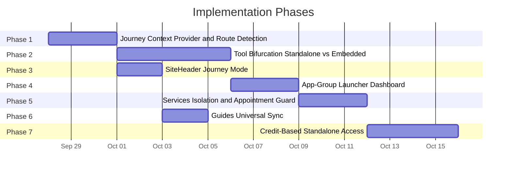
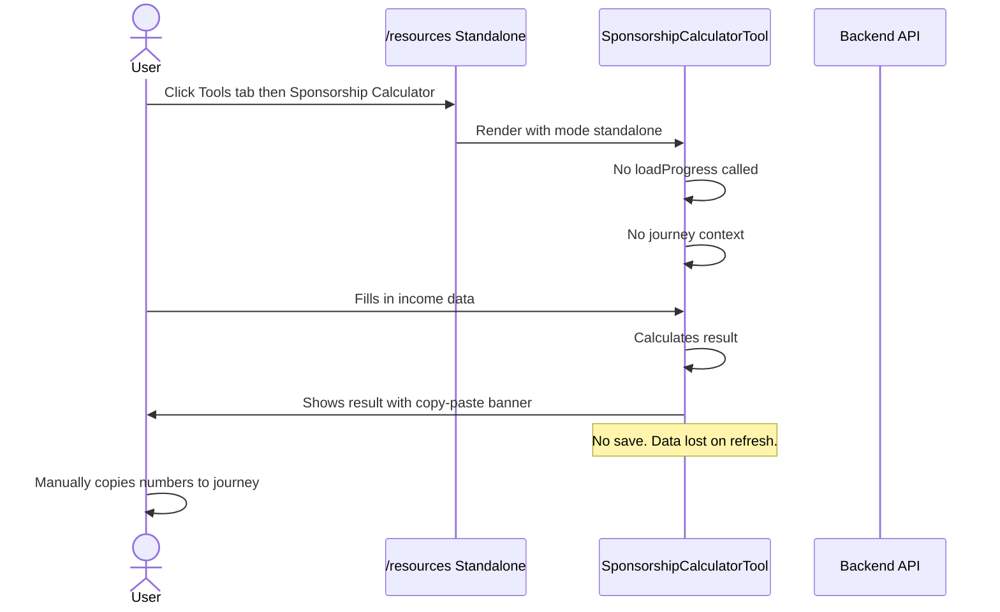
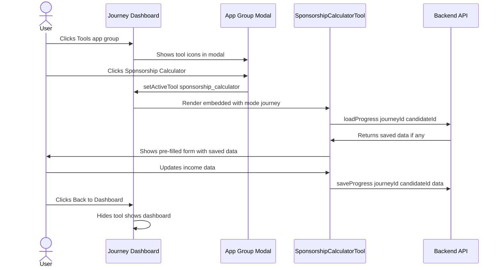
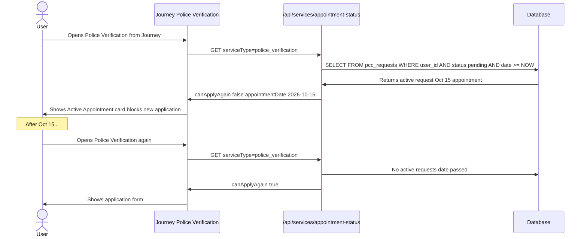
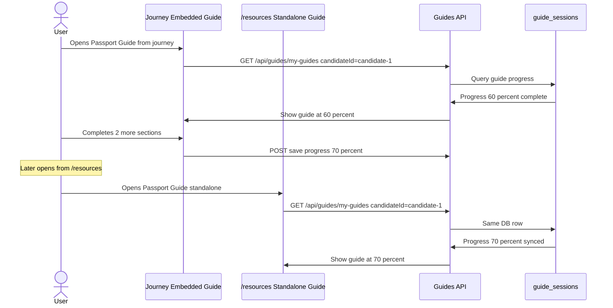

# Journey-Centric Ecosystem — Implementation Plan

**Document Status**: PLANNING SPECIFICATION  
**Date**: 2026-09-26  
**Scope**: Journey Isolation, Standalone vs Embedded Tools, SiteHeader Simplification, App-Group Tool Launcher, Services Isolation, Credit-Based Standalone Access  
**Grounded In**: Meeting notes (2026-09-26) + full codebase audit of current architecture  

---

## Table of Contents

1. [Current Architecture Analysis](#1-current-architecture-analysis)
2. [Target Architecture Overview](#2-target-architecture-overview)
3. [Implementation Phases](#3-implementation-phases)
4. [Phase 1: Journey Environment Isolation](#phase-1-journey-environment-isolation)
5. [Phase 2: Standalone vs Embedded Tool Bifurcation](#phase-2-standalone-vs-embedded-tool-bifurcation)
6. [Phase 3: SiteHeader Journey Mode](#phase-3-siteheader-journey-mode)
7. [Phase 4: App-Group Tool Launcher (Journey Dashboard)](#phase-4-app-group-tool-launcher)
8. [Phase 5: Services Isolation & Appointment Guard](#phase-5-services-isolation--appointment-guard)
9. [Phase 6: Guides Universal Sync](#phase-6-guides-universal-sync)
10. [Phase 7: Credit-Based Standalone Tool Access](#phase-7-credit-based-standalone-tool-access)
11. [Detailed Workflows](#8-detailed-workflows)
12. [Edge Cases & Failure Modes](#9-edge-cases--failure-modes)
13. [Database Changes](#10-database-changes)
14. [File Change Map](#11-file-change-map)

---

## 1. Current Architecture Analysis

### 1.1 Routing Structure

```
app/
├── (tools)/                          # Route group — all tools & journeys
│   ├── (visa)/visa-category/
│   │   ├── [visa-journey]/           # Dynamic: ir1-journey, ir5-journey
│   │   │   ├── page.tsx              # Journey dashboard (client-side, uses useWizard)
│   │   │   ├── layout.tsx            # SEO metadata per journey
│   │   │   └── components/           # ProgressTree, StepDetail, DocumentVault, etc.
│   │   └── components/               # ExploreJourneys, JourneyRouteMap
│   ├── interview-prep/               # Standalone tool page (/interview-prep)
│   ├── affidavit-support-calculator/  # Standalone tool page
│   ├── police-verification/           # Service page (apply sub-route)
│   ├── book-appointment/              # Service page (medical)
│   ├── guides/                        # Guides listing + individual guide pages
│   ├── tools/page.tsx                 # Tool catalog listing
│   └── ...other tools
├── (main)/
│   ├── resources/                     # /resources → tabs: Tools | Guides | Services
│   ├── my-journeys/                   # /my-journeys dashboard (journey tiles)
│   ├── services/                      # Services listing page
│   └── ...
```

### 1.2 Journey Progress System

| Component | File | Role |
|:---|:---|:---|
| `useWizard` | [`useWizard.ts`](file:///d:/arachnie_work/updated_work/app/(main)/dashboard/hooks/useWizard.ts) | Central hook: loads/saves journey state, scoped by `userId` + `journeyId` + `candidateId` |
| `journeyProgressService` | [`journeyProgressService.ts`](file:///d:/arachnie_work/updated_work/lib/journey/journeyProgressService.ts) | Supabase CRUD for `journeys` table — load, save, list, reset |
| `RoadmapLayoutEngine` | [`RoadmapLayoutEngine.tsx`](file:///d:/arachnie_work/updated_work/app/components/journey-engine/RoadmapLayoutEngine.tsx) | IR-5+ chapters-schema renderer: Dashboard → Chapter → Step views |
| `StepView` | [`StepView.tsx`](file:///d:/arachnie_work/updated_work/app/components/journey-engine/StepView.tsx) | 271KB — renders each step, embeds tools (SponsorshipCalculator, PhotoBooth, InterviewPrep, etc.) |

### 1.3 How Tools Currently Work

**Currently, ALL tools exist as both:**
1. **Standalone pages** under `app/(tools)/` — e.g. `/interview-prep`, `/passport`, `/affidavit-support-calculator`
2. **Embedded components** inside `StepView.tsx` — e.g. `<SponsorshipCalculatorTool>`, `<PassportPhotoTool>`, `<InterviewPrepTool>`

**Critical finding**: Currently, BOTH standalone and embedded tools share the same progress/session APIs. There is NO context-awareness differentiating "launched from journey" vs "launched from /resources".

### 1.4 Tools Already Embedded in Journey Engine

These tools are already rendered inline within `StepView.tsx` (no page navigation needed):

| Tool | Component Import | Step Key |
|:---|:---|:---|
| Sponsorship Calculator | `SponsorshipCalculatorTool` | step_2_5 |
| Passport Photo Booth | `PassportPhotoTool` | step_2_10 (Biometric Photo) |
| Interview Prep | `InterviewPrepTool` | step_3_7 |
| Interview Day | `InterviewDayTool` | step_3_8 |
| Interview Outcome | `InterviewOutcomeTool` | step_3_9 |
| Interview Scheduling | `InterviewSchedulingTool` | step_2_11 |
| AP Tracking | `APTrackingTool` | step_3_9 (221g outcome) |
| Document Translation | (via ActionStepRenderer) | Various |
| Police Verification | (via StepToolRenderer) | step_2_9 |
| Medical Appointment | (via StepToolRenderer) | step_2_10 |

### 1.5 SiteHeader Structure

[`SiteHeader.tsx`](file:///d:/arachnie_work/updated_work/app/components/layout/SiteHeader.tsx) (2312 lines) renders:
- **Left**: Logo (links to `/`)
- **Center**: Nav links — Explore Journeys, My Resources, Blog, Pricing, Contact
- **Right**: Notification bell, Profile dropdown (with CandidateSwitcherTray)

It is rendered via [`ClientHeader.tsx`](file:///d:/arachnie_work/updated_work/app/components/layout/ClientHeader.tsx) in the root `layout.tsx`. Currently NO journey-mode awareness exists.

### 1.6 Resources Page

[`ResourcesContent.tsx`](file:///d:/arachnie_work/updated_work/app/(main)/resources/ResourcesContent.tsx) renders three tabs:
- **Tools** → embeds `<ToolsPage isEmbedded />`
- **Guides** → embeds `<GuidesPage isEmbedded />`
- **Services** → embeds `<ServicesPage isEmbedded />`

Tools in the catalog link to their standalone pages (e.g., `/interview-prep`).

### 1.7 CandidateContext

[`CandidateContext.tsx`](file:///d:/arachnie_work/updated_work/app/context/CandidateContext.tsx) manages multi-candidate (Mother/Father for IR-5). Each candidate has a `visaCategory`, `relation`, and journey-scoped progress. The "candidate-1/candidate-2" dropdown is what the meeting wants to **scrap** in favor of the "My Journeys" dashboard.

### 1.8 My Journeys Page

[`my-journeys/page.tsx`](file:///d:/arachnie_work/updated_work/app/(main)/my-journeys/page.tsx) already renders journey tiles with names, progress, and navigation to `/visa-category/ir1-journey` or `/visa-category/ir5-journey`. This is the **foundation** for the new "My Journeys Dashboard".

---

## 2. Target Architecture Overview

```
┌──────────────────────────────────────────────────────────────────────┐
│                        RAHVANA PLATFORM                              │
├──────────────────────────┬───────────────────────────────────────────┤
│   PUBLIC / STANDALONE    │         JOURNEY ENVIRONMENT               │
│   (/resources, /tools)   │   (/visa-category/ir1-journey, etc.)     │
│                          │                                           │
│  ┌────────────────────┐  │  ┌─────────────────────────────────────┐ │
│  │ Tool Catalog        │  │  │ Journey Dashboard                   │ │
│  │ (browse & launch)   │  │  │ ┌──────────┐ ┌──────────┐          │ │
│  │                     │  │  │ │ App Group │ │ App Group │          │ │
│  │ ⚠ NO progress save  │  │  │ │ (Tools)  │ │ (Guides) │ ...      │ │
│  │ ⚠ NO journey data   │  │  │ └────┬─────┘ └────┬─────┘          │ │
│  │ ⚠ Copy-paste only   │  │  │      │            │                 │ │
│  └────────────────────┘  │  │  ┌───▼────────────▼───────────────┐ │ │
│                          │  │  │ Embedded Tool (in-page modal)   │ │ │
│  ┌────────────────────┐  │  │  │ ✅ Progress auto-saved          │ │ │
│  │ Guides (sync OK)   │◄─┼──┼─►│ ✅ Journey-scoped data          │ │ │
│  │ Progress saved     │  │  │  │ ✅ No page navigation            │ │ │
│  └────────────────────┘  │  │  └────────────────────────────────┘ │ │
│                          │  │                                       │ │
│  ┌────────────────────┐  │  │  ┌────────────────────────────────┐ │ │
│  │ Services           │  │  │  │ Services (Journey-embedded)    │ │ │
│  │ (standalone access) │  │  │  │ ⚠ 1 appointment at a time     │ │ │
│  │ (no journey link)   │  │  │  │ ⚠ Re-apply after date passes  │ │ │
│  └────────────────────┘  │  │  └────────────────────────────────┘ │ │
│                          │  │                                       │ │
│  SiteHeader: FULL NAV    │  │  SiteHeader: MINIMAL (logo + profile)│ │
│  (Journeys, Resources,  │  │  (no Explore, no Resources, no Blog, │ │
│   Blog, Pricing, Contact)│  │   no Pricing, no Contact)             │ │
└──────────────────────────┴──┴───────────────────────────────────────┘
```

### Key Principles

1. **Journey = Isolated Universe**: When a user is inside `/visa-category/*-journey`, they see ONLY journey-relevant UI. The SiteHeader strips down to logo + notifications + profile.

2. **Tools Bifurcation**: Each tool has TWO modes:
   - **Embedded (Journey)**: Rendered as a component within the journey page. Progress is saved to the journey's Supabase row. User stays on the same URL.
   - **Standalone (Resources)**: Rendered on its own `/tool-name` page. NO progress saving. NO journey data fetching. Forces manual copy-paste → drives upgrade.

3. **Guides are Universal**: Guide progress syncs between standalone and journey contexts. Guides are the ONE exception to isolation.

4. **Services are Standalone When Outside Journey**: From `/resources`, services work normally. From within a journey, services are embedded and subject to appointment cooldown guards.

5. **Credit System for Standalone**: Standalone tools consume credits. Journey plans unlock embedded tools at no additional credit cost.

---

## 3. Implementation Phases



---

## Phase 1: Journey Environment Isolation

### Goal
Create a `JourneyContext` that tells every component whether it's running inside a journey environment, and which journey it belongs to.

### 1.1 Create `JourneyEnvironmentContext`

**New file**: `app/context/JourneyEnvironmentContext.tsx`

```typescript
// Provides journey environment awareness to all child components
interface JourneyEnvironmentContextType {
  /** Whether the current page is inside a journey environment */
  isInsideJourney: boolean;
  /** The journey slug if inside (e.g., "ir1-journey", "ir5-journey") */
  journeySlug: string | null;
  /** The base visa category (e.g., "IR-1", "IR-5") */
  journeyCategory: string | null;
  /** The candidate ID scoped to this journey */
  candidateId: string | null;
  /** The backend journey UUID (from journeys table) */
  journeyBackendId: string | null;
}
```

**Detection logic**: Check `pathname` against `/visa-category/*-journey` pattern.

### 1.2 Wrap Journey Layout with Provider

**Modify**: [`app/(tools)/(visa)/visa-category/[visa-journey]/layout.tsx`](file:///d:/arachnie_work/updated_work/app/(tools)/(visa)/visa-category/[visa-journey]/layout.tsx)

- Wrap `{children}` with `<JourneyEnvironmentProvider>` passing the slug from `params`.
- This ensures every component rendered inside a journey URL has access to `useJourneyEnvironment()`.

### 1.3 Create `useJourneyEnvironment` Hook

**New file**: `lib/hooks/useJourneyEnvironment.ts`

```typescript
export function useJourneyEnvironment() {
  const context = useContext(JourneyEnvironmentContext);
  return context ?? { isInsideJourney: false, journeySlug: null, ... };
}
```

### 1.4 Standalone Detection

Any component NOT wrapped by `JourneyEnvironmentProvider` will get `isInsideJourney: false`. This is the default for all `/resources`, `/tools`, and standalone tool pages.

---

## Phase 2: Standalone vs Embedded Tool Bifurcation

### Goal
Every tool that currently saves progress must have TWO variants:
1. **Journey-embedded variant**: Has progress API calls, receives journey context props.
2. **Standalone variant**: NO progress APIs, no journey data, no fetch-on-load.

### 2.1 Strategy: Wrapper Pattern (NOT Duplication)

> [!IMPORTANT]
> Instead of duplicating entire tool codebases, we use a **wrapper pattern**: the core tool component accepts a `mode` prop that controls whether progress APIs are called.

```
components/tools/
├── SponsorshipCalculatorTool.tsx    # Core component (mode-aware)
├── PassportPhotoTool.tsx            # Core component (mode-aware)
├── ...
```

Each tool's core component gets a new prop:

```typescript
interface ToolModeProps {
  /** 'journey' = save/load progress; 'standalone' = no persistence */
  mode: 'journey' | 'standalone';
  /** Journey context (only provided when mode='journey') */
  journeyContext?: {
    journeyId: string;
    candidateId: string;
    backendId: string;
  };
}
```

### 2.2 Tool-by-Tool Changes

| Tool | Current File | Embedded Location | Change Required |
|:---|:---|:---|:---|
| Sponsorship Calculator | [`SponsorshipCalculatorTool.tsx`](file:///d:/arachnie_work/updated_work/components/tools/SponsorshipCalculatorTool.tsx) | StepView (step_2_5) | Add `mode` prop; gate `saveProgress()` / `loadProgress()` behind `mode === 'journey'` |
| Photo Booth | [`PassportPhotoTool.tsx`](file:///d:/arachnie_work/updated_work/components/tools/PassportPhotoTool.tsx) | StepView (biometric photo step) | Add `mode` prop; gate progress persistence |
| Interview Prep | [`interview-prep/page.tsx`](file:///d:/arachnie_work/updated_work/app/(tools)/interview-prep/page.tsx) (standalone) + `InterviewPrepTool` (embedded) | StepView (step_3_7) | Standalone page: strip all progress API calls. Embedded component: keep progress. |
| 221(g) Planner | `221g-action-planner/` | StepView (outcome step) | Same pattern |
| Smart Form Filler | `visa-forms/` | StepView (form steps) | Same pattern |
| Document Translation | [`DocumentTranslationTool.tsx`](file:///d:/arachnie_work/updated_work/components/tools/DocumentTranslationTool.tsx) | ActionStepRenderer | Same pattern |
| Passport OCR | [`PassportOcrTool.tsx`](file:///d:/arachnie_work/updated_work/components/tools/PassportOcrTool.tsx) | StepView | Same pattern |

### 2.3 Standalone Tool Pages (Resources Path)

Standalone tool pages under `app/(tools)/` remain as-is for **routing** but their tool components are instantiated with `mode="standalone"`:

```tsx
// app/(tools)/interview-prep/page.tsx (standalone version)
<InterviewPrepComponent mode="standalone" />
// No progress API calls, no journey data, no save/load
```

### 2.4 Embedded Tool Rendering (Journey Path)

Inside `StepView.tsx` and the journey engine, tools are rendered with `mode="journey"`:

```tsx
// StepView.tsx — within journey context
<SponsorshipCalculatorTool
  mode="journey"
  journeyContext={{
    journeyId: state.backendId,
    candidateId: activeCandidateId,
    backendId: state.backendId,
  }}
/>
```

### 2.5 Access Control: Executive Plan + Resources Page

> [!WARNING]
> Even if a user has an Executive plan, accessing a tool from `/resources` must NOT show journey progress. The tool runs in standalone mode regardless of plan tier.

**Implementation**: The `mode` is determined by the **launch context** (URL/component tree), NOT by the user's plan tier. The `useJourneyEnvironment()` hook provides this automatically.

```typescript
// In any tool wrapper:
const { isInsideJourney, journeySlug } = useJourneyEnvironment();
const toolMode = isInsideJourney ? 'journey' : 'standalone';
```

---

## Phase 3: SiteHeader Journey Mode

### Goal
When the user is inside a journey URL (`/visa-category/*-journey`), the SiteHeader hides all navigation links except:
- ✅ Logo (links to `/` — homepage)
- ✅ Notification bell
- ✅ Profile dropdown (with tray)
- ❌ ~~Explore Journeys~~
- ❌ ~~My Resources~~
- ❌ ~~Blog~~
- ❌ ~~Pricing~~
- ❌ ~~Contact~~

### 3.1 Detection Mechanism

**Modify**: [`SiteHeader.tsx`](file:///d:/arachnie_work/updated_work/app/components/layout/SiteHeader.tsx)

```typescript
const pathname = usePathname();

// Detect journey environment: any /visa-category/*-journey path
const isJourneyEnvironment = /^\/visa-category\/[a-z0-9-]+-journey/.test(pathname ?? '');
```

### 3.2 Conditional Rendering

All desktop nav links (lines ~960-1210) and mobile nav items (lines ~2000-2270) will be wrapped with:

```tsx
{!isJourneyEnvironment && (
  <>
    {/* Explore Journeys button */}
    {/* My Resources link */}
    {/* Blog link */}
    {/* Pricing link */}
    {/* Contact link */}
  </>
)}
```

### 3.3 Mobile Hamburger Menu

In journey mode, the hamburger menu should show only:
- "Back to My Journeys" (link to `/my-journeys`)
- Profile / Settings
- Sign Out

### 3.4 Journey Title in Header (Optional Enhancement)

Add a subtle journey name indicator in the header when in journey mode:

```
[Logo]                     "Mother's IR-5 Journey"        [🔔] [👤]
```

---

## Phase 4: App-Group Tool Launcher

### Goal
Inside the journey dashboard, tools/guides/services are grouped into compact "app groups" (like Android app folders). Clicking a group opens a modal showing tool icons + names. Clicking a tool launches it **embedded** within the journey page (no navigation).

### 4.1 Group Data Structure

```typescript
interface AppGroup {
  id: string;
  label: string;
  icon: React.ReactNode;
  items: AppGroupItem[];
}

interface AppGroupItem {
  id: string;
  label: string;
  icon: string; // Icon path or Lucide name
  toolType: 'tool' | 'guide' | 'service';
  componentKey: string; // Maps to lazy-loaded component
  entitlementFeature?: string;
}
```

### 4.2 Groups Definition

```typescript
const JOURNEY_APP_GROUPS: AppGroup[] = [
  {
    id: 'tools',
    label: 'Tools',
    icon: <Wrench />,
    items: [
      { id: 'sponsorship-calc', label: 'Sponsorship Calculator', componentKey: 'sponsorship_calculator' },
      { id: 'photo-booth', label: 'Photo Booth', componentKey: 'passport_photo' },
      { id: 'interview-prep', label: 'Interview Prep', componentKey: 'interview_prep' },
      { id: 'smart-form-filler', label: 'Smart Form Filler', componentKey: 'visa_forms' },
      { id: '221g-planner', label: '221(g) Planner', componentKey: 'action_221g' },
      { id: 'pdf-toolkit', label: 'PDF Tool Kit', componentKey: 'pdf_toolkit' },
      { id: 'snap-sign', label: 'Snap and Sign', componentKey: 'snap_sign' },
      { id: 'dq-status', label: 'DQ Status Check', componentKey: 'dq_status' },
    ],
  },
  {
    id: 'guides',
    label: 'Guides',
    icon: <BookOpen />,
    items: [
      { id: 'passport-guide', label: 'Passport Guide', componentKey: 'passport_guide' },
      { id: 'pcc-guide', label: 'Police Cert Guide', componentKey: 'pcc_guide' },
    ],
  },
  {
    id: 'services',
    label: 'Services',
    icon: <Briefcase />,
    items: [
      { id: 'police-verification', label: 'Police Verification', componentKey: 'police_verification' },
      { id: 'medical-appointment', label: 'Medical Appointment', componentKey: 'medical_appointment' },
      { id: 'doc-translation', label: 'Document Translation', componentKey: 'doc_translation' },
    ],
  },
];
```

### 4.3 UI Components

**New files**:
- `app/components/journey-engine/AppGroupGrid.tsx` — Renders the group icons on the dashboard
- `app/components/journey-engine/AppGroupModal.tsx` — Modal showing items when a group is clicked
- `app/components/journey-engine/EmbeddedToolContainer.tsx` — Full-screen overlay/panel that renders the selected tool component inside the journey page

### 4.4 Embedded Tool Container

When a tool is selected from the app group modal:
1. The modal closes
2. `EmbeddedToolContainer` renders as a full-width panel within the journey page
3. The tool component is lazy-loaded with `mode="journey"` and full journey context
4. A "Back to Dashboard" button returns to the journey dashboard view
5. The URL does NOT change — user stays on `/visa-category/ir5-journey`

```tsx
// Inside RoadmapLayoutEngine / journey page
{activeTool && (
  <EmbeddedToolContainer
    toolKey={activeTool}
    journeyContext={journeyContext}
    onClose={() => setActiveTool(null)}
  />
)}
```

### 4.5 Dashboard Integration

Modify [`DashboardView.tsx`](file:///d:/arachnie_work/updated_work/app/components/journey-engine/DashboardView.tsx) to include the `AppGroupGrid` below the chapter cards or in a sidebar section:

```tsx
<AppGroupGrid
  groups={JOURNEY_APP_GROUPS}
  onSelectItem={(item) => setActiveTool(item.componentKey)}
/>
```

---

## Phase 5: Services Isolation and Appointment Guard

### Goal
- Services accessed from the journey are embedded (in-page)
- Services accessed from `/resources` are standalone (separate page, no journey link)
- Police Verification and Medical Appointment have a **cooldown guard**: once an appointment is scheduled, the user cannot apply again until the appointment date passes

### 5.1 Service Mode Detection

Same pattern as tools — check `useJourneyEnvironment()`:

```typescript
const { isInsideJourney } = useJourneyEnvironment();
// Journey: embedded rendering, scoped to journey
// Standalone: full page, no journey context
```

### 5.2 Appointment Cooldown Guard

**New API**: `GET /api/services/appointment-status`

```typescript
// Request
{ serviceType: 'police_verification' | 'medical_appointment', userId: string }

// Response
{
  hasActiveAppointment: boolean,
  appointmentDate: string | null,     // ISO date
  appointmentPassed: boolean,         // true if date < now
  canApplyAgain: boolean,             // true if no active OR date passed
}
```

**Database check**: Query `pcc_requests` / `medical_appointments` tables for:
- `user_id = ?` AND `status NOT IN ('cancelled', 'completed')` AND `appointment_date >= NOW()`

### 5.3 UI Enforcement

When `canApplyAgain === false`, show in the service form:

```
┌──────────────────────────────────────────────────────────────┐
│  Active Appointment                                          │
│                                                               │
│ You already have a scheduled appointment on Oct 15, 2026.     │
│ You can apply for a new appointment after this date passes.   │
│                                                               │
│ [View Current Appointment]                                    │
└──────────────────────────────────────────────────────────────┘
```

### 5.4 Service Embedding in Journey

Inside `EmbeddedToolContainer`, service components receive the same `mode="journey"` treatment. They render inside the journey page without URL navigation.

---

## Phase 6: Guides Universal Sync

### Goal
Guide progress is saved and synced regardless of access context (standalone or journey).

### 6.1 Current State

Guides already have their own progress system via `api/guides/my-guides` with `candidateId` scoping. The guides API uses the `guide_sessions` table.

### 6.2 Required Change

**NO fundamental change needed** — guides already save progress universally. The key adjustment:

- When accessed from a journey, the `candidateId` is passed from `JourneyEnvironmentContext`
- When accessed standalone, the `candidateId` falls back to the active candidate (or "candidate-1")
- Since guides share data across both contexts by design, progress appears in both places

### 6.3 Sync Mechanism

```
Journey Guide Access:        candidateId = journey.candidateId -> guides API
Standalone Guide Access:     candidateId = activeCandidateId   -> same guides API

Both hit the same DB rows -> progress is synced.
```

> [!NOTE]
> If the user has multiple candidates (Mother and Father), each candidate's guides are scoped separately. The journey context provides the correct candidate ID automatically.

---

## Phase 7: Credit-Based Standalone Tool Access

### Goal
Standalone tools from `/resources` consume credits from the user's account-level credit wallet. Journey-embedded tools do NOT consume credits (they're included in journey plans).

### 7.1 Integration with Existing Credit Architecture

This phase builds on the existing [`standalone-tools-credit-pricing-architecture.md`](file:///d:/arachnie_work/updated_work/docs/standalone-tools-credit-pricing-architecture.md) spec.

### 7.2 Credit Check Flow

```
User clicks tool on /resources
  -> Tool renders in standalone mode
  -> Before execution: check credit balance via /api/credits/check
  -> If credits available: deduct 1 credit, proceed
  -> If no credits: show purchase modal
  -> Tool runs WITHOUT saving progress
  -> Result shown (user must copy-paste)
```

### 7.3 Journey Plan Bypass

```
User opens tool from journey dashboard (embedded)
  -> Tool renders in journey mode
  -> Check: does journey plan include this tool?
  -> If included in plan: proceed (no credit deduction)
  -> If NOT in plan: show upgrade modal (not credit purchase)
  -> Tool runs WITH progress saving
```

---

## 8. Detailed Workflows

### Workflow 1: User Opens Sponsorship Calculator from /resources



### Workflow 2: User Opens Sponsorship Calculator from Journey



### Workflow 3: SiteHeader Behavior in Journey vs Standalone

```
Standalone (/resources, /tools, homepage):
┌──────────────────────────────────────────────────────────────────┐
│ [Logo]  Explore Journeys  My Resources  Blog  Pricing  Contact  │  [🔔] [👤]
└──────────────────────────────────────────────────────────────────┘

Journey (/visa-category/ir5-journey):
┌──────────────────────────────────────────────────────────────────┐
│ [Logo]                    Mother's IR-5 Journey                   │  [🔔] [👤]
└──────────────────────────────────────────────────────────────────┘
```

### Workflow 4: Service Appointment Cooldown



### Workflow 5: Guide Sync Between Journey and Standalone



---

## 9. Edge Cases and Failure Modes

### Edge Case 1: User Bookmarks a Standalone Tool URL While Having a Journey

**Scenario**: User has an Executive IR-5 plan. They bookmark `/interview-prep`. They open the bookmark.

**Expected Behavior**: The tool opens in **standalone mode**. No progress loaded. No journey data. They must access it from the journey dashboard to get journey-mode features.

**Why**: The URL determines the mode, NOT the plan. This enforces the "journey is the premium experience" principle.

---

### Edge Case 2: User Opens Journey URL Without a Purchased Plan

**Scenario**: User navigates to `/visa-category/ir5-journey` but has no IR-5 plan.

**Expected Behavior**: The journey dashboard loads (it's lazily created as `free` tier). Entitlement checks on individual steps/tools still apply. Free-tier tools work; premium tools show the upgrade modal.

**No change needed** — current entitlement system already handles this.

---

### Edge Case 3: Browser Back Button After Embedded Tool Launch

**Scenario**: User opens journey dashboard -> clicks tool group -> launches embedded tool -> presses browser Back.

**Expected Behavior**: Since the URL never changed (tool was rendered in-page), browser Back navigates away from the journey entirely (to whatever page they were on before).

**Mitigation**: Use `history.pushState` to add a "virtual" history entry when a tool opens, and `popstate` to close the tool instead of navigating away:

```typescript
// On tool open:
window.history.pushState({ toolOpen: true }, '');

// On popstate:
window.addEventListener('popstate', () => {
  if (activeTool) {
    setActiveTool(null);
    // Don't actually navigate — we handled it
  }
});
```

---

### Edge Case 4: User Has Two IR-5 Journeys (Mother and Father)

**Scenario**: User bought plans for both parents. Separate journey rows in DB. The "My Journeys" page shows two tiles. They click "Mother's Journey".

**Expected Behavior**: Inside Mother's journey, all tools load/save Mother's data. The candidate switcher (if still visible in profile tray) does NOT exist inside the journey. Switching candidates requires going back to "My Journeys" and clicking Father's tile.

**Implementation**: `JourneyEnvironmentContext` locks the `candidateId` to the one associated with this journey URL. No switcher inside journey.

---

### Edge Case 5: Concurrent Tool Sessions Across Tabs

**Scenario**: User opens Mother's journey in Tab 1 and Father's journey in Tab 2. Both tabs open the Sponsorship Calculator.

**Expected Behavior**: Each tab's tool saves to its own journey row (different `journeyId` / `candidateId`). No conflict.

**Risk**: If using `CandidateContext` globally, switching in Tab 2 could affect Tab 1. **Mitigation**: The `JourneyEnvironmentContext` (URL-derived) takes precedence over `CandidateContext` for tool data scoping.

---

### Edge Case 6: Service Re-Application Race Condition

**Scenario**: User's police verification appointment is TODAY. They try to apply again. The server date check passes (appointment_date = today = NOW()), but the appointment hasn't actually occurred yet.

**Mitigation**: Use `appointment_date > NOW()` (strict future), not `>=`. An appointment ON today's date is still active. The user can re-apply starting tomorrow.

---

### Edge Case 7: Tool Progress Data Leaked Between Modes

**Scenario**: Bug where standalone mode accidentally loads journey progress.

**Mitigation**: Standalone tool components MUST NOT call any progress API. The `mode='standalone'` prop completely removes the `useEffect` that triggers `loadProgress()`. Additionally, standalone pages should NOT have access to `JourneyEnvironmentProvider` (since they're outside its tree).

---

### Edge Case 8: User Navigates Directly to a Tool Step URL Inside Journey

**Scenario**: User shares `/visa-category/ir5-journey#step_2_5` (a deeplink to the sponsorship calculator step).

**Expected Behavior**: Journey loads normally. The URL fragment can be used to auto-navigate to the step. The tool is embedded. `JourneyEnvironmentContext` is active because the URL matches.

---

### Edge Case 9: Offline/Network Failure During Journey Tool Save

**Scenario**: User fills in sponsorship data in journey mode. Network drops. Save fails.

**Expected Behavior**: Debounced retry. Local state preserved. Error toast shown. Data is NOT lost (it's still in React state). On reconnect, the next save attempt succeeds.

**Current behavior already handles this** via `useWizard`'s debounced sync + error states.

---

### Edge Case 10: Standalone Tool Result Exceeds What User Can Copy-Paste

**Scenario**: Smart Form Filler generates a 10-page PDF. User can't "copy-paste" a PDF.

**Expected Behavior**: Standalone tools that produce files (PDFs, photos) allow **download** of the file. The "no progress save" restriction means:
- The generated PDF can be downloaded immediately
- But the form inputs/configuration are NOT saved for next time
- If they close the page, they must re-enter all data

This is the **intentional friction** that drives journey upgrades.

---

## 10. Database Changes

### 10.1 No New Tables Required

The existing architecture supports this plan without new tables:

| Table | Used For | Change |
|:---|:---|:---|
| `journeys` | Journey progress (steps, answers, metadata) | No change — already scoped by `user_id` + `journey_type` |
| `guide_sessions` | Guide progress | No change — already has `candidate_id` column |
| `pcc_requests` | Police verification requests | Add `appointment_date` column if not present |
| `medical_appointments` | Medical bookings | Add `appointment_date` column if not present |
| `user_credits` | Credit wallet (from credit pricing spec) | New table — see credit pricing doc |
| `credit_transactions` | Credit usage log | New table — see credit pricing doc |

### 10.2 Appointment Date Columns

**Migration**: `20261001_add_appointment_dates.sql`

```sql
-- Add appointment_date to pcc_requests if not exists
ALTER TABLE pcc_requests
ADD COLUMN IF NOT EXISTS appointment_date TIMESTAMPTZ;

-- Add appointment_date to medical_appointments if not exists
ALTER TABLE medical_appointments
ADD COLUMN IF NOT EXISTS appointment_date TIMESTAMPTZ;

-- Index for cooldown check queries
CREATE INDEX IF NOT EXISTS idx_pcc_active_appointments
ON pcc_requests (user_id, status, appointment_date)
WHERE status NOT IN ('cancelled', 'completed');

CREATE INDEX IF NOT EXISTS idx_medical_active_appointments
ON medical_appointments (user_id, status, appointment_date)
WHERE status NOT IN ('cancelled', 'completed');
```

---

## 11. File Change Map

### New Files

| File | Purpose |
|:---|:---|
| `app/context/JourneyEnvironmentContext.tsx` | Journey detection context provider |
| `lib/hooks/useJourneyEnvironment.ts` | Consumer hook for journey detection |
| `app/components/journey-engine/AppGroupGrid.tsx` | App group grid on journey dashboard |
| `app/components/journey-engine/AppGroupModal.tsx` | Modal showing tools in an app group |
| `app/components/journey-engine/EmbeddedToolContainer.tsx` | Container for rendering embedded tools in-page |
| `app/components/journey-engine/appGroupConfig.ts` | App group data configuration |
| `app/api/services/appointment-status/route.ts` | Appointment cooldown check API |
| `supabase/migrations/20261001_add_appointment_dates.sql` | Appointment date columns |

### Modified Files

| File | Change Summary |
|:---|:---|
| [`SiteHeader.tsx`](file:///d:/arachnie_work/updated_work/app/components/layout/SiteHeader.tsx) | Add `isJourneyEnvironment` detection; hide nav links in journey mode |
| [`ClientHeader.tsx`](file:///d:/arachnie_work/updated_work/app/components/layout/ClientHeader.tsx) | Pass journey context to SiteHeader if needed |
| [`[visa-journey]/layout.tsx`](file:///d:/arachnie_work/updated_work/app/(tools)/(visa)/visa-category/[visa-journey]/layout.tsx) | Wrap children with `JourneyEnvironmentProvider` |
| [`RoadmapLayoutEngine.tsx`](file:///d:/arachnie_work/updated_work/app/components/journey-engine/RoadmapLayoutEngine.tsx) | Add `activeTool` state, render `EmbeddedToolContainer` |
| [`DashboardView.tsx`](file:///d:/arachnie_work/updated_work/app/components/journey-engine/DashboardView.tsx) | Add `AppGroupGrid` component to dashboard |
| [`SponsorshipCalculatorTool.tsx`](file:///d:/arachnie_work/updated_work/components/tools/SponsorshipCalculatorTool.tsx) | Add `mode` prop, gate progress APIs |
| [`PassportPhotoTool.tsx`](file:///d:/arachnie_work/updated_work/components/tools/PassportPhotoTool.tsx) | Add `mode` prop, gate progress APIs |
| [`DocumentTranslationTool.tsx`](file:///d:/arachnie_work/updated_work/components/tools/DocumentTranslationTool.tsx) | Add `mode` prop, gate progress APIs |
| [`interview-prep/page.tsx`](file:///d:/arachnie_work/updated_work/app/(tools)/interview-prep/page.tsx) | Force `mode="standalone"` — remove all progress persistence |
| [`ResourcesContent.tsx`](file:///d:/arachnie_work/updated_work/app/(main)/resources/ResourcesContent.tsx) | Ensure tool links do NOT carry journey context |
| [`tools/page.tsx`](file:///d:/arachnie_work/updated_work/app/(tools)/tools/page.tsx) | Tool cards navigate to standalone URLs (no journey context) |
| [`police-verification/apply/page.tsx`](file:///d:/arachnie_work/updated_work/app/(tools)/police-verification/apply/page.tsx) | Add appointment cooldown guard |
| [`book-appointment/page.tsx`](file:///d:/arachnie_work/updated_work/app/(tools)/book-appointment/page.tsx) | Add appointment cooldown guard |
| [`CandidateContext.tsx`](file:///d:/arachnie_work/updated_work/app/context/CandidateContext.tsx) | Allow `JourneyEnvironmentContext` to override `activeCandidateId` inside journey |
| [`StepView.tsx`](file:///d:/arachnie_work/updated_work/app/components/journey-engine/StepView.tsx) | Pass `mode="journey"` + `journeyContext` to all embedded tools |

### Files Intentionally NOT Changed

| File | Reason |
|:---|:---|
| `my-journeys/page.tsx` | Already serves as the "My Journeys Dashboard" foundation — just needs UI polish, no architecture change |
| `journeyProgressService.ts` | Already scoped correctly by `user_id` + `journey_type` — no change needed |
| `useWizard.ts` | Already candidate-scoped — no change needed (it provides the data tools consume) |
| Root `layout.tsx` | `ClientHeader` already renders site-wide — the header's journey mode is self-detecting |

---

## Summary of Strategic Decisions

| Decision | Rationale |
|:---|:---|
| **Wrapper pattern over duplication** | Meeting suggested duplicating tools. This plan uses a `mode` prop instead — same component, different behavior. Eliminates maintenance burden of keeping two copies in sync. |
| **URL-derived context over prop drilling** | `JourneyEnvironmentContext` auto-detects from the URL. Components don't need to be told their mode — they discover it. |
| **No DB migration for tool isolation** | Tool progress is already saved through `useWizard` state and `journeys` table. Standalone simply doesn't call those APIs. |
| **Guides are the exception** | Universal sync for guides is intentional — guides are educational content, not operational tools. No friction needed. |
| **Appointment cooldown is server-side** | Client-side guards can be bypassed. The API checks the DB and returns `canApplyAgain`. |
| **History API for back-button safety** | Embedded tools don't change the URL, so browser Back would leave the journey. Virtual history entries prevent this. |

---

> [!IMPORTANT]
> **Core philosophy**: *"Drive the user toward buying the complete journey over a standalone tool. Introduce intentional friction in the standalone experience."*
> 
> Every technical decision in this plan serves this business goal. Standalone tools are useful but uncomfortable. Journey tools are seamless and persistent. The gap is the conversion driver.
