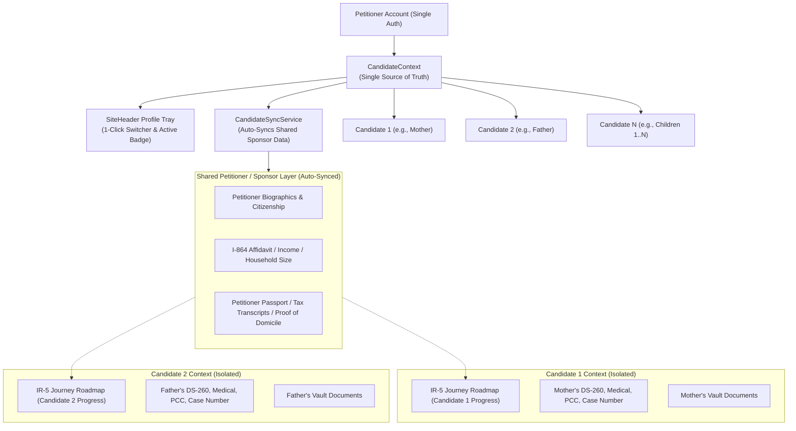

# Multi-Candidate / Beneficiary Profile Architecture (IR-5 & IR-2)

## 1. Executive Summary & Problem Context

In U.S. immigration petitions for immediate relatives, a single petitioner (e.g. a U.S. citizen adult child or parent) frequently files petitions for multiple beneficiaries under the same visa category:
- **IR-5 Visa**: Petitioner sponsors **both parents** (Mother and Father). Each parent requires a separate Form I-130, individual DS-260, distinct NVC case number, separate medical exam, police clearance certificate, and consular interview.
- **IR-2 Visa**: Petitioner sponsors **multiple children** (Child 1, Child 2, Child 3...).

### The Architectural Challenge
1. **Separation**: Beneficiary-specific data (case numbers, receipt numbers, personal IDs, DS-260 answers, stage progress, roadmap milestones) must be strictly isolated per candidate so that progress on one parent/child does not overwrite or corrupt the other.
2. **Reusability & Syncing**: Petitioner/Sponsor data (U.S. citizenship proofs, annual income, I-864 Affidavit of Support household calculations, tax returns, and address history) is identical across all petitions. The user must **not** have to re-enter sponsor information multiple times.
3. **Single Account & Seamless UX**: The user manages all candidates from a single account without logging out, switching active candidate profiles via the **SiteHeader Profile Tray** with real-time UI synchronization across all pages, roadmaps, tools, and guides.

---

## 2. Architectural Overview



---

## 3. Detailed Breakdown of Files Created & Modified

### A. Core Types & Data Models

#### 1. [types/candidate.ts](file:///d:/arachnie_work/updated_work/types/candidate.ts) `[NEW]`
Defines the core TypeScript types for multi-candidate management:
- **`CandidateProfile`**:
  ```ts
  export interface CandidateProfile {
    id: string; // e.g. "candidate-1", "candidate-2"
    label: string; // e.g. "Candidate 1 (Mother)", "Candidate 2 (Father)"
    relation: "Mother" | "Father" | "Child" | "Spouse" | "Other";
    fullName: string;
    name?: PersonName;
    dateOfBirth?: string;
    placeOfBirth?: { city?: string; state?: string; country?: string };
    cnic?: string;
    passportNumber?: string;
    visaCategory: string; // e.g. "IR-5", "IR-2"
    tier: "free" | "basic" | "premium" | "executive";
    isPrimary: boolean;
    isPreview?: boolean; // True if added for free testing/preview
    receiptNumber?: string; // USCIS IOE...
    caseNumber?: string; // NVC ISL...
    caseStatus?: string;
    interviewDate?: string;
    createdAt: string;
    colorTag?: "teal" | "purple" | "blue" | "amber" | "rose" | "emerald";
  }
  ```
- **`CandidateSyncConfig`**: Configuration for automated background syncing of sponsor information.

#### 2. [types/profile.ts](file:///d:/arachnie_work/updated_work/types/profile.ts) `[MODIFIED]`
- Extended `MasterProfile` with candidate fields:
  - `activeCandidateId?: string;`
  - `candidates?: CandidateProfile[];`
  - `candidateSync?: CandidateSyncConfig;`
- Re-exports all types from `types/candidate.ts` for backward compatibility.

---

### B. Business Logic & Sync Engine

#### 3. [lib/candidate/candidateSyncService.ts](file:///d:/arachnie_work/updated_work/lib/candidate/candidateSyncService.ts) `[NEW]`
Governs data synchronization and boundary enforcement:
- **`SHARED_PETITIONER_FIELDS`**:
  Explicit list of sponsor/petitioner fields that are automatically shared:
  - `sponsor`, `citizenshipStatus`, `naturalizationInfo`, `annualIncome`, `financialProfile`, `householdSize`, `sponsorStatus`, `isMilitary`, `taxDependents`, `intendedUSState`, `currentAddress`, `addressHistory`, `employer`, `occupation`.
- **`CANDIDATE_SPECIFIC_FIELDS`**:
  Explicit list of beneficiary-specific fields that are strictly isolated:
  - `beneficiary`, `dateOfBirth`, `placeOfBirth`, `passportNumber`, `passportIssueDate`, `passportExpiry`, `cnic`, `nativeFullName`, `caseNumber`, `receiptNumber`, `priorityDate`, `approvalDate`, `dqDate`, `interviewDate`, `medicalDate`, `pccDate`, `actionPlanner`.
- **`getDefaultCandidatesForVisa(visaCategory, tier, bothParents)`**:
  Generates initial candidate profiles for IR-5 (Mother & Father) or IR-2 (Child 1).
- **`getVisaCategoryForRelation(relation, fallbackVisa)`**:
  Maps candidate relationships directly to their official visa category (`Mother`/`Father`/`Stepparent`/`AdoptiveParent` -> `IR-5`, `Spouse` -> `IR-1`, `Child` -> `IR-2`).
- **`createNewCandidate(existingCandidates, params)`**:
  Constructs a new candidate profile with sequential numbering (`candidate-2`, `candidate-3`), automatically derived visa category based on relation, distinct avatar color tagging, and tier assignment.
- **`getCandidateJourneyKey(baseJourneyType, candidateId)`**:
  Generates idempotent database journey keys (`ir5` for candidate-1, `ir5_candidate2` for candidate-2).

#### 4. [lib/autoFill/journeyProfileBridge.ts](file:///d:/arachnie_work/updated_work/lib/autoFill/journeyProfileBridge.ts) `[MODIFIED]`
- Updated `BENEFICIARY_SPECIFIC_KEYS` to include `cnic`, `nativeFullName`, `dateOfBirth`, and case identifiers.
- Ensures `syncCaseDataToProfile` and `syncProfileToCaseData` store candidate-specific data scoped under `journeys.${journeyId}` while syncing sponsor data globally.

---

### C. State & Context Management

#### 5. [app/context/CandidateContext.tsx](file:///d:/arachnie_work/updated_work/app/context/CandidateContext.tsx) `[NEW]`
Provides the central `useCandidate()` React hook used across the entire application:
- **State**:
  - `candidates: CandidateProfile[]`: Array of candidate profiles on the account.
  - `activeCandidate: CandidateProfile`: The currently selected candidate.
  - `activeCandidateId: string`: ID of the active candidate.
  - `isMultiCandidate: boolean`: Boolean indicating whether 2+ candidates exist.
  - `activeCandidateTier: CandidateTier`: Effective subscription tier of the active candidate (`free` if preview, or the account tier).
- **Actions**:
  - `setActiveCandidateId(id: string)`: Switches the active candidate, updates profile, persists to session storage, and displays a feedback toast.
  - `addCandidate(params)`: Adds a new candidate profile (e.g. 2nd parent preview).
  - `updateCandidate(id, updates)`: Updates candidate metadata.
  - `removeCandidate(id)`: Removes candidate profile (safeguarded against removing primary).
- Persists state seamlessly through `UserProfileContext.updateProfile()` with server-side encryption.

#### 6. [app/layout.tsx](file:///d:/arachnie_work/updated_work/app/layout.tsx) `[MODIFIED]`
- Imported `CandidateProvider` and wrapped the application component tree inside `UserProfileProvider`.

---

### D. UI Components & Profile Tray

#### 7. [app/components/candidate/CandidateSwitcherTray.tsx](file:///d:/arachnie_work/updated_work/app/components/candidate/CandidateSwitcherTray.tsx) `[NEW]`
The candidate switcher menu rendered inside the SiteHeader profile dropdown:
- Displays all candidate profiles with:
  - Relation-specific avatar icons (Heart for Mother, Users for Father/Stepparent, Baby for Child).
  - Distinct pastel color styling (Purple, Teal, Blue, etc.).
  - Candidate label and full name.
  - "Preview" badge for unpaid/preview candidates.
  - Active checkmark for the currently selected profile.
- 1-click profile switching.
- "+ Add 2nd Parent (Preview)" or "+ Add Child Profile" action button.
- "Sponsor synced" confirmation indicator with tooltip.

#### 8. [app/components/candidate/ActiveCandidateBadge.tsx](file:///d:/arachnie_work/updated_work/app/components/candidate/ActiveCandidateBadge.tsx) `[NEW]`
Navbar indicator rendered next to the user avatar in the header:
- Shows the active candidate relation (e.g. `Mother`, `Father`, `Child`) with relation icon.
- Visible across all pages so the petitioner always knows which candidate's file is currently active.
- Clicking the badge opens the profile dropdown tray.

#### 9. [app/components/candidate/AddCandidateModal.tsx](file:///d:/arachnie_work/updated_work/app/components/candidate/AddCandidateModal.tsx) `[NEW]`
Interactive modal for adding a 2nd parent (IR-5) or additional children (IR-2):
- Relationship selector (Mother, Father, Stepparent, Adoptive Parent, Child).
- Beneficiary full name input.
- Notice explaining free preview mode and automatic sponsor data synchronization.

#### 10. [app/components/layout/SiteHeader.tsx](file:///d:/arachnie_work/updated_work/app/components/layout/SiteHeader.tsx) `[MODIFIED]`
- Integrated `ActiveCandidateBadge` into the navbar header.
- Embedded `CandidateSwitcherTray` at the top of the profile dropdown menu (`activeMenu === "profile"`).

---

### E. Journey Engine & Data Isolation

#### 11. [app/(main)/dashboard/hooks/useWizard.ts](file:///d:/arachnie_work/updated_work/app/(main)/dashboard/hooks/useWizard.ts) `[MODIFIED]`
- Integrated `useCandidate()` hook.
- Added `candidateId?: string` to `UseWizardOptions`.
- Scopes journey initialization (`/api/journeys/initialize`) and cache busting requests with `candidate_id: effectiveCandidateId`.
- Added `effectiveCandidateId` to the load progress dependency array so that switching candidate profiles immediately reloads the active candidate's roadmap progress and steps.

#### 12. [app/api/journeys/initialize/route.ts](file:///d:/arachnie_work/updated_work/app/api/journeys/initialize/route.ts) `[MODIFIED]`
- Accepts `candidate_id` in POST request body.
- Resolves `effectiveJourneyType` (e.g. `ir5` for Candidate 1, `ir5_candidate-2` for Candidate 2).
- Finds or creates candidate-isolated journey rows in the database.

#### 13. [lib/journey/service.ts](file:///d:/arachnie_work/updated_work/lib/journey/service.ts) `[MODIFIED]`
- Added `journey_type?: string` to `createJourneyFromConfig` overrides parameter to persist candidate-scoped journey keys into the database.

### F. Document Vault Isolation & Profile Switching

#### 14. [lib/document-vault/useInitDocumentVault.ts](file:///d:/arachnie_work/updated_work/lib/document-vault/useInitDocumentVault.ts) `[MODIFIED]`
- Integrated `useCandidate()` to scope vault initialization by `${backendId}_${activeCandidateId}`.
- Sets `beneficiaryName: activeCandidate.fullName || activeCandidate.label` and `journeyId: backendId`.
- Calls `reloadDocuments(backendId)` whenever the candidate profile switches in the journey roadmap.

#### 15. [app/(tools)/document-vault/page.tsx](file:///d:/arachnie_work/updated_work/app/(tools)/document-vault/page.tsx) `[MODIFIED]`
- Connected standalone Document Vault page to `CandidateContext`.
- Automatically maps active candidate to candidate-specific journey (e.g. `ir5` vs `ir5_candidate-2`).
- Re-fetches candidate-scoped documents via `reloadDocuments(activeCandidateJourneyId)` upon profile switch.
- Renders an active candidate badge in the top header with relation and name (e.g., `Mother — Fatima Bibi` or `Father — Mohammad Ali`) so the user always has clear visual context of whose vault they are managing.

#### 16. [app/components/document-vault/DocumentUploadModal.tsx](file:///d:/arachnie_work/updated_work/app/components/document-vault/DocumentUploadModal.tsx) `[MODIFIED]`
- Ensured uploaded documents attach `effectiveActiveJourneyId`, tagging files with the active candidate's journey in Supabase storage and database.

---

## 4. How the Flow Works in Practice

### Scenario 1: User Buying IR-5 for Both Parents
1. The user purchases an IR-5 journey for both parents.
2. Two candidate profiles are initialized: `Candidate 1 (Mother)` and `Candidate 2 (Father)`.
3. The petitioner enters their U.S. citizenship, income, tax transcripts, and household size once.
4. When `Candidate 1 (Mother)` is active:
   - The roadmap displays Mother's I-130, DS-260, medical exam, and interview steps.
   - The Document Vault displays Mother's civil documents (Mother's Birth Certificate, CNIC, Passport).
   - All sponsor financial info is auto-filled.
5. The petitioner clicks **SiteHeader > Profile Tray > Candidate 2 (Father)**:
   - The navbar badge immediately switches to `Father`.
   - The roadmap updates to Father's I-130 and DS-260 steps.
   - The Document Vault re-initializes to show Father's documents (Father's Birth Certificate, CNIC, Passport).
   - Father's case numbers (IOE... / ISL...) and civil documents are tracked separately.
   - The petitioner does **not** have to re-enter sponsor income or tax documents.

### Scenario 2: User on Free Plan or Single-Parent Plan (Previewing Multi-Candidate)
1. A user who bought a plan for 1 parent opens the Profile Tray.
2. They click **"+ Add 2nd Parent (Preview)"**.
3. `Candidate 2 (Father)` is added in **Free Preview mode** (`tier: 'free'`).
4. When switching to Candidate 2, the user can explore the roadmap structure and separate document vault, but paid step tools trigger the standard paywall, protecting revenue while showcasing the platform's multi-candidate capabilities.

### Scenario 3: Expanding to IR-2 (Multiple Children)
1. The architecture uses dynamic arrays and sequential candidate IDs (`candidate-1`, `candidate-2`, `candidate-3`...).
2. For an IR-2 case with 3 children, the petitioner can add `Child 1`, `Child 2`, and `Child 3`.
3. Each child has an independent journey roadmap and document vault while sharing the parent's sponsor financial profile.

---

## 5. Automated Tests

Unit tests are located in [__tests__/candidate/candidate-sync.test.ts](file:///d:/arachnie_work/updated_work/__tests__/candidate/candidate-sync.test.ts).

### Test Coverage Summary:
- **Default Profile Generation**: Verified default profiles for IR-5 (single parent & both parents), IR-2, and IR-1.
- **Candidate Creation**: Verified sequential ID generation, relation tagging, and preview tier assignment.
- **Journey Key Derivation**: Verified root keys for primary candidate and candidate-isolated keys for subsequent candidates.
- **Data Boundary Integrity**: Verified that `SHARED_PETITIONER_FIELDS` and `CANDIDATE_SPECIFIC_FIELDS` have strictly zero overlap.
- **Document Vault Scoping**: Verified independent journey key derivation and vault isolation for IR-5 parents and multi-child IR-2 cases.
