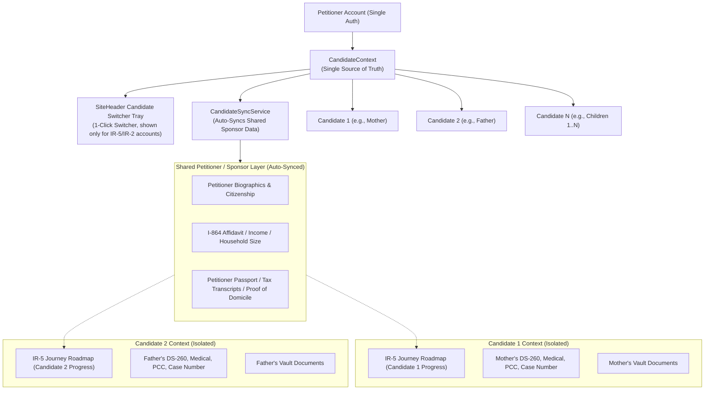

# Multi-Candidate / Beneficiary Profile Architecture (IR-5 & IR-2)

## 1. Executive Summary & Problem Context

In U.S. immigration petitions for immediate relatives, a single petitioner (e.g. a U.S. citizen adult child or parent) frequently files petitions for multiple beneficiaries under the same visa category:
- **IR-5 Visa**: Petitioner sponsors **both parents** (Mother and Father). Each parent requires a separate Form I-130, individual DS-260, distinct NVC case number, separate medical exam, police clearance certificate, and consular interview.
- **IR-2 Visa**: Petitioner sponsors **multiple children** (Child 1, Child 2, Child 3...).

### The Architectural Challenge
1. **Separation**: Beneficiary-specific data (case numbers, receipt numbers, personal IDs, DS-260 answers, stage progress, roadmap milestones) must be strictly isolated per candidate so that progress on one parent/child does not overwrite or corrupt the other.
2. **Reusability & Syncing**: Petitioner/Sponsor data (U.S. citizenship proofs, annual income, I-864 Affidavit of Support household calculations, tax returns, and address history) is identical across all petitions. The user must **not** have to re-enter sponsor information multiple times.
3. **Single Account & Seamless UX**: The user manages all candidates from a single account without logging out, switching active candidate profiles via the **Candidate Switcher Tray in the global SiteHeader profile dropdown** with real-time UI synchronization across all pages, roadmap, tools, vault, and guides. This is a whole-journey feature (one account can hold multiple beneficiary journeys), so it is app-wide - not a Document-Vault-only widget.

> **Current-behavior note (2026-09).** The switcher lives in the **global SiteHeader profile dropdown**, but it is shown **only for accounts that have an IR-5/IR-2 journey** (gated on the user's actual journeys, never on a defaulted candidate). It **never appears for IR-1**, which is a separate single-beneficiary journey kept fully outside the candidate system. There is **no** navbar "Active Candidate" badge and **no** per-candidate "Free Preview" upsell (every candidate is a real beneficiary, treated equally). Default candidate labels are generic ("Candidate 1", "Candidate 2", ...) and never assume Mother/Father. The Add flow offers only IR-5 parent relations or IR-2 Child - **never IR-1 Spouse**. Cross-candidate document sharing is restricted to siblings of the **same base visa category** (IR-1 is never a share target). See sections D and 4 for details.

---

## 2. Architectural Overview



---

## 3. Detailed Breakdown of Files Created & Modified

### A. Core Types & Data Models

#### 1. [types/candidate.ts](file:///d:/arachnie_work/updated_work/types/candidate.ts) `[NEW]`
Defines the core TypeScript types for multi-candidate management:
- **`CandidateProfile`**:
  ```ts
  export interface CandidateProfile {
    id: string; // e.g. "candidate-1", "candidate-2"
    label: string; // generic: "Candidate 1", "Candidate 2", ... (no baked-in relation)
    relation: "Mother" | "Father" | "Stepparent" | "AdoptiveParent" | "Child" | "Spouse" | "Other";
    fullName: string; // "" until the user enters a real name; defaults are NOT prefilled with the relation
    name?: PersonName;
    dateOfBirth?: string;
    placeOfBirth?: { city?: string; state?: string; country?: string };
    cnic?: string;
    passportNumber?: string;
    visaCategory: string; // e.g. "IR-5", "IR-2"
    tier: "free" | "basic" | "premium" | "executive";
    isPrimary: boolean;
    isPreview?: boolean; // DEPRECATED - kept in the type but always treated as false (no per-candidate preview/upsell). Legacy true values are normalized to false on load.
    receiptNumber?: string; // USCIS IOE...
    caseNumber?: string; // NVC ISL...
    caseStatus?: string;
    interviewDate?: string;
    createdAt: string;
    colorTag?: "teal" | "purple" | "blue" | "amber" | "rose" | "emerald";
  }
  ```
- **`CandidateSyncConfig`**: Configuration for automated background syncing of sponsor information.

#### 2. [types/profile.ts](file:///d:/arachnie_work/updated_work/types/profile.ts) `[MODIFIED]`
- Extended `MasterProfile` with candidate fields:
  - `activeCandidateId?: string;`
  - `candidates?: CandidateProfile[];`
  - `candidateSync?: CandidateSyncConfig;`
- Re-exports all types from `types/candidate.ts` for backward compatibility.

---

### B. Business Logic & Sync Engine

#### 3. [lib/candidate/candidateSyncService.ts](file:///d:/arachnie_work/updated_work/lib/candidate/candidateSyncService.ts) `[NEW]`
Governs data synchronization and boundary enforcement:
- **`SHARED_PETITIONER_FIELDS`**:
  Explicit list of sponsor/petitioner fields that are automatically shared:
  - `sponsor`, `citizenshipStatus`, `naturalizationInfo`, `annualIncome`, `financialProfile`, `householdSize`, `sponsorStatus`, `isMilitary`, `taxDependents`, `intendedUSState`, `currentAddress`, `addressHistory`, `employer`, `occupation`.
- **`CANDIDATE_SPECIFIC_FIELDS`**:
  Explicit list of beneficiary-specific fields that are strictly isolated:
  - `beneficiary`, `dateOfBirth`, `placeOfBirth`, `passportNumber`, `passportIssueDate`, `passportExpiry`, `cnic`, `nativeFullName`, `caseNumber`, `receiptNumber`, `priorityDate`, `approvalDate`, `dqDate`, `interviewDate`, `medicalDate`, `pccDate`, `actionPlanner`.
- **`getDefaultCandidatesForVisa(visaCategory, tier, bothParents)`**:
  Generates initial candidate profiles with generic labels ("Candidate 1", "Candidate 2"), empty `fullName`, and no assumed parent relation (IR-5 primary uses `relation: "Other"`; IR-2 uses "Child"; IR-1 uses "Spouse"). It does NOT bake Mother/Father into defaults - the sponsored parent may be a step or adoptive parent.
- **`getVisaCategoryForRelation(relation, fallbackVisa)`**:
  Maps candidate relationships directly to their official visa category (`Mother`/`Father`/`Stepparent`/`AdoptiveParent` -> `IR-5`, `Spouse` -> `IR-1`, `Child` -> `IR-2`).
- **`createNewCandidate(existingCandidates, params)`**:
  Constructs a new candidate profile with sequential numbering (`candidate-2`, `candidate-3`), automatically derived visa category based on relation, distinct avatar color tagging, and tier assignment.
- **`getCandidateJourneyKey(baseJourneyType, candidateId)`**:
  Generates idempotent database journey keys (`ir5` for candidate-1, `ir5_candidate2` for candidate-2).

#### 4. [lib/autoFill/journeyProfileBridge.ts](file:///d:/arachnie_work/updated_work/lib/autoFill/journeyProfileBridge.ts) `[MODIFIED]`
- Updated `BENEFICIARY_SPECIFIC_KEYS` to include `cnic`, `nativeFullName`, `dateOfBirth`, and case identifiers.
- Ensures `syncCaseDataToProfile` and `syncProfileToCaseData` store candidate-specific data scoped under `journeys.${journeyId}` while syncing sponsor data globally.

---

### C. State & Context Management

#### 5. [app/context/CandidateContext.tsx](file:///d:/arachnie_work/updated_work/app/context/CandidateContext.tsx) `[NEW]`
Provides the central `useCandidate()` React hook used across the entire application:
- **State**:
  - `candidates: CandidateProfile[]`: Array of candidate profiles on the account.
  - `activeCandidate: CandidateProfile`: The currently selected candidate.
  - `activeCandidateId: string`: ID of the active candidate.
  - `isMultiCandidate: boolean`: Boolean indicating whether 2+ candidates exist.
  - `activeCandidateTier: CandidateTier`: Effective subscription tier of the active candidate (the account/candidate tier; there is no per-candidate preview downgrade anymore).
- **Actions**:
  - `setActiveCandidateId(id: string)`: Switches the active candidate, updates profile, persists to session storage, and displays a feedback toast.
  - `addCandidate(params)`: Adds a new candidate profile (e.g. 2nd parent preview).
  - `updateCandidate(id, updates)`: Updates candidate metadata.
  - `removeCandidate(id)`: Removes candidate profile (safeguarded against removing primary).
- **Legacy normalization on load.** The `candidates` memo repairs older saved data with no
  migration: any `isPreview: true` is cleared, and UNTOUCHED default names (empty, equal to
  the relation, or a baked-in default like "Child 1"/"Mother"/"Father"/"Spouse") are made
  generic ("Candidate N", empty `fullName`). For the PRIMARY candidate an assumed parent
  relation is dropped to "Other" (its relation was always system-assigned). A real name the
  user typed is preserved.
- **Hydrate-once active candidate.** A ref guard hydrates `activeCandidateId` a single time
  from profile/session; after that an explicit switch wins, so a profile re-emit
  (optimistic/debounced save) cannot snap the active candidate back.
- Persists state seamlessly through `UserProfileContext.updateProfile()` with server-side encryption.

#### 6. [app/layout.tsx](file:///d:/arachnie_work/updated_work/app/layout.tsx) `[MODIFIED]`
- Imported `CandidateProvider` and wrapped the application component tree inside `UserProfileProvider`.

---

### D. UI Components & Profile Tray

#### 7. [app/components/candidate/CandidateSwitcherTray.tsx](file:///d:/arachnie_work/updated_work/app/components/candidate/CandidateSwitcherTray.tsx) `[NEW]`
The candidate switcher, rendered in the **global `SiteHeader` profile dropdown** (whole-journey
feature, app-wide). It is gated on the account's **actual journeys**: shown only when the user
has an IR-5/IR-2 journey (`fetchUserJourneysCached` + `getBaseVisaCategory`) or already has more
than one candidate - so it **never appears for IR-1**. (Gating on the journeys, not on a
defaulted `activeCandidate.visaCategory`, avoids the old IR-1 leak.) The earlier in-card copies
on the vault page / `RoadmapLayoutEngine` were removed.
- Displays all candidate profiles with:
  - Relation-specific avatar icons (Heart for Mother, Users for Father/Stepparent, Baby for Child).
  - Distinct pastel color styling (Purple, Teal, Blue, etc.).
  - Generic candidate label plus the real name if the user entered one; the chosen relation
    is shown in the subtitle only when it is specified (relation "Other" is hidden).
  - Active checkmark for the currently selected profile.
- 1-click profile switching + inline name editing (pencil/check/cancel).
- "+ Add 2nd Parent" or "+ Add Child Profile" action button (no "Preview" wording).
- "Sponsor synced" confirmation indicator with tooltip.

#### 8. Active-candidate badge on the header bar
A small pill on the SiteHeader bar (next to the avatar) shows the active beneficiary
(`activeCandidate.fullName || label`) so the user always sees which candidate/journey is
active **without opening the profile tray**. It is gated exactly like the switcher
(`showCandidateSwitcher`, IR-5/IR-2 accounts only, never IR-1) and clicking it opens the
profile tray to switch. (This replaces the old standalone `ActiveCandidateBadge.tsx`
component, which is not rendered; the new badge is inline in `SiteHeader` and uses the
generic candidate label/name, no relation.)

#### 9. [app/components/candidate/AddCandidateModal.tsx](file:///d:/arachnie_work/updated_work/app/components/candidate/AddCandidateModal.tsx) `[NEW]`
Interactive modal for adding a 2nd parent (IR-5) or additional children (IR-2):
- Relationship selector filtered by the current journey's visa category: **IR-5 offers only
  parent relations (Mother, Father, Stepparent, Adoptive Parent); IR-2 offers Child.**
  **There is NO IR-1 Spouse option** - a candidate can never be IR-1 (IR-1 is a separate,
  single-beneficiary journey, kept outside the candidate system).
- Optional beneficiary full name input (blank is fine; the profile stays "Candidate N").
- A plain "Multi-Profile Support" notice about automatic sponsor-data syncing (no preview
  upsell, no decorative icon).
- The modal is **portaled to `document.body`** (`createPortal`) so its fixed overlay escapes
  any sticky/`overflow-hidden` ancestor - otherwise the page behind bled through the modal.

#### 10. [app/components/layout/SiteHeader.tsx](file:///d:/arachnie_work/updated_work/app/components/layout/SiteHeader.tsx) `[MODIFIED]`
- Renders `CandidateSwitcherTray` in the profile dropdown, **gated to IR-5/IR-2 accounts**:
  `showCandidateSwitcher = hasCandidateJourney`, where `hasCandidateJourney` is derived from
  the user's actual journeys via `fetchUserJourneysCached` + `getBaseVisaCategory` (only
  fetched when a user is signed in). It deliberately does NOT fall back to defaulted
  candidates / `isMultiCandidate`, so IR-1 users never see it.
- Also renders a small **active-candidate badge on the header bar** (same `showCandidateSwitcher`
  gate) showing `activeCandidate.fullName || label`, so the active beneficiary is visible
  without opening the tray; clicking it opens the tray.

---

### E. Journey Engine & Data Isolation

#### 11. [app/(main)/dashboard/hooks/useWizard.ts](file:///d:/arachnie_work/updated_work/app/(main)/dashboard/hooks/useWizard.ts) `[MODIFIED]`
- Integrated `useCandidate()` hook.
- Added `candidateId?: string` to `UseWizardOptions`.
- Scopes journey initialization (`/api/journeys/initialize`) and cache busting requests with `candidate_id: effectiveCandidateId`.
- Added `effectiveCandidateId` to the load progress dependency array so that switching candidate profiles immediately reloads the active candidate's roadmap progress and steps.

#### 12. [app/api/journeys/initialize/route.ts](file:///d:/arachnie_work/updated_work/app/api/journeys/initialize/route.ts) `[MODIFIED]`
- Accepts `candidate_id` in POST request body.
- Resolves `effectiveJourneyType` (e.g. `ir5` for Candidate 1, `ir5_candidate-2` for Candidate 2).
- Finds or creates candidate-isolated journey rows in the database.

#### 13. [lib/journey/service.ts](file:///d:/arachnie_work/updated_work/lib/journey/service.ts) `[MODIFIED]`
- Added `journey_type?: string` to `createJourneyFromConfig` overrides parameter to persist candidate-scoped journey keys into the database.

### F. Document Vault Isolation & Profile Switching

#### 14. [lib/document-vault/useInitDocumentVault.ts](file:///d:/arachnie_work/updated_work/lib/document-vault/useInitDocumentVault.ts) `[MODIFIED]`
- Integrated `useCandidate()` to scope vault initialization by `${backendId}_${activeCandidateId}`.
- Sets `beneficiaryName: activeCandidate.fullName || activeCandidate.label` and `journeyId: backendId`.
- Calls `reloadDocuments(backendId)` whenever the candidate profile switches in the journey roadmap.

#### 15. [app/(tools)/document-vault/page.tsx](file:///d:/arachnie_work/updated_work/app/(tools)/document-vault/page.tsx) `[MODIFIED]`
- Connected standalone Document Vault page to `CandidateContext`.
- Automatically maps active candidate to candidate-specific journey (e.g. `ir5` vs `ir5_candidate-2`).
- Re-fetches candidate-scoped documents via `reloadDocuments(activeCandidateJourneyId)` upon profile switch.
- Renders an active candidate badge in the top header with relation and name (e.g., `Mother — Fatima Bibi` or `Father — Mohammad Ali`) so the user always has clear visual context of whose vault they are managing.

#### 16. [app/components/document-vault/DocumentUploadModal.tsx](file:///d:/arachnie_work/updated_work/app/components/document-vault/DocumentUploadModal.tsx) `[MODIFIED]`
- Ensured uploaded documents attach `effectiveActiveJourneyId`, tagging files with the active candidate's journey in Supabase storage and database.

#### 17. Cross-candidate sharing, delete safety, and scoping robustness `[document-vault]`
- **Cross-candidate document sharing** rides the existing **cross-journey** share
  (`shareWithJourneyIds`), since each candidate is its own journey. Both upload modals
  (`DocumentUploadModal`, `MultipleDocumentUploadModal`) default share targets to
  **unchecked (opt-in)** and only offer **other candidates within the SAME base visa
  category** (siblings, via `getBaseVisaCategory`). A different-category journey - notably
  **IR-1** - is never offered as a share target, so IR-1 stays fully isolated from the
  candidate system. Between siblings, only documents passing
  `isDocumentShareableAcrossCandidates` (`lib/document-vault/candidate-sharing.ts`) are
  offered: petitioner / joint-sponsor / household docs are shareable by default, any
  BENEFICIARY-role doc is candidate-specific (passport, CNIC, birth, medical are never
  offered between parents), and an explicit `shareableAcrossCandidates` flag on a
  `DocumentDefinition` overrides.
- **Delete safety:** `DELETE /api/documents/[id]` reference-counts `storage_path` (via
  `getDocumentsByStoragePath`, user-scoped) before removing the blob, so deleting one shared
  copy never orphans the file for the other candidate's journey; only the metadata row is
  removed when a sibling row still references the same blob.
- **Vault journey picker dedupe.** The Document Vault's "choose a journey" picker
  (`app/(tools)/document-vault/page.tsx`) shows **one card per base visa category**
  (`dedupeJourneysByBaseCategory`), not one per journey row. Candidate-scoped journeys
  (`ir5_candidate-2`, ...) and any leftover/duplicate rows (e.g. an old `ir1_candidate-*` from
  when Spouse could be added as a candidate) collapse into a single card, preferring the base
  (non-candidate) journey - so IR-1 can never show as two/many cards. When only one base
  category exists (even with several candidate rows), the vault auto-selects it instead of
  showing a one-card picker; candidate switching then happens via the header switcher. Stray
  `ir1_candidate-*` rows in the DB (from when Spouse could be added) are removed by the one-off
  `scripts/cleanup-invalid-ir1-candidate-journeys.sql` (run manually in the Supabase SQL editor).
- **Candidate -> journey scoping (vault page).** The effect that maps the active candidate to
  its journey (`app/(tools)/document-vault/page.tsx`): (a) never matches a journey from a
  different base visa category; (b) for the primary candidate, excludes **any**
  candidate-scoped journey (`!normJ.includes("candidate")`) so a 5th+ sibling can't be
  mis-adopted by the primary; (c) only pins `lastResolvedCandidateRef` once a real journey is
  matched - a missing sibling journey (freshly added parent) is left unpinned so the effect
  re-runs and adopts the journey once the candidate-scoped wizard/`userJourneys` produce it,
  instead of permanently freezing on the previous candidate's journey.

---

## 4. How the Flow Works in Practice

### Scenario 1: User Buying IR-5 for Both Parents
1. The user purchases an IR-5 journey for both parents.
2. Two candidate profiles are initialized: `Candidate 1 (Mother)` and `Candidate 2 (Father)`.
3. The petitioner enters their U.S. citizenship, income, tax transcripts, and household size once.
4. When `Candidate 1 (Mother)` is active:
   - The roadmap displays Mother's I-130, DS-260, medical exam, and interview steps.
   - The Document Vault displays Mother's civil documents (Mother's Birth Certificate, CNIC, Passport).
   - All sponsor financial info is auto-filled.
5. The petitioner clicks **SiteHeader > Profile Tray > Candidate 2 (Father)**:
   - The navbar badge immediately switches to `Father`.
   - The roadmap updates to Father's I-130 and DS-260 steps.
   - The Document Vault re-initializes to show Father's documents (Father's Birth Certificate, CNIC, Passport).
   - Father's case numbers (IOE... / ISL...) and civil documents are tracked separately.
   - The petitioner does **not** have to re-enter sponsor income or tax documents.

### Scenario 2: Adding a 2nd Parent (No Per-Candidate Preview)
1. From the in-journey Candidate Switcher Tray the user clicks **"+ Add 2nd Parent"**.
2. The Add modal offers only IR-5 parent relations. The user picks one (e.g. Father) and
   optionally types a name.
3. `Candidate 2` is added as a full, equal beneficiary (no "preview" flag or downgrade).
   Plan/entitlement gating still applies exactly as it does for the primary candidate -
   there is no separate per-candidate preview tier.
4. Switching to Candidate 2 loads its own roadmap and Document Vault, scoped by its own
   journey (`ir5_candidate-2`).

### Scenario 3: Expanding to IR-2 (Multiple Children)
1. The architecture uses dynamic arrays and sequential candidate IDs (`candidate-1`, `candidate-2`, `candidate-3`...).
2. For an IR-2 case with 3 children, the petitioner can add `Child 1`, `Child 2`, and `Child 3`.
3. Each child has an independent journey roadmap and document vault while sharing the parent's sponsor financial profile.

---

## 5. Automated Tests

Unit tests are located in [__tests__/candidate/candidate-sync.test.ts](file:///d:/arachnie_work/updated_work/__tests__/candidate/candidate-sync.test.ts).

### Test Coverage Summary:
- **Default Profile Generation**: Verified generic default profiles for IR-5 (single and both), IR-2, and IR-1 - generic "Candidate N" labels, empty `fullName`, and no assumed parent relation.
- **Candidate Creation**: Verified sequential ID generation, relation tagging, and generic labeling.
- **Journey Key Derivation**: Verified root keys for primary candidate and candidate-isolated keys for subsequent candidates.
- **Data Boundary Integrity**: Verified that `SHARED_PETITIONER_FIELDS` and `CANDIDATE_SPECIFIC_FIELDS` have strictly zero overlap.
- **Document Vault Scoping**: Verified independent journey key derivation and vault isolation for IR-5 parents and multi-child IR-2 cases.
