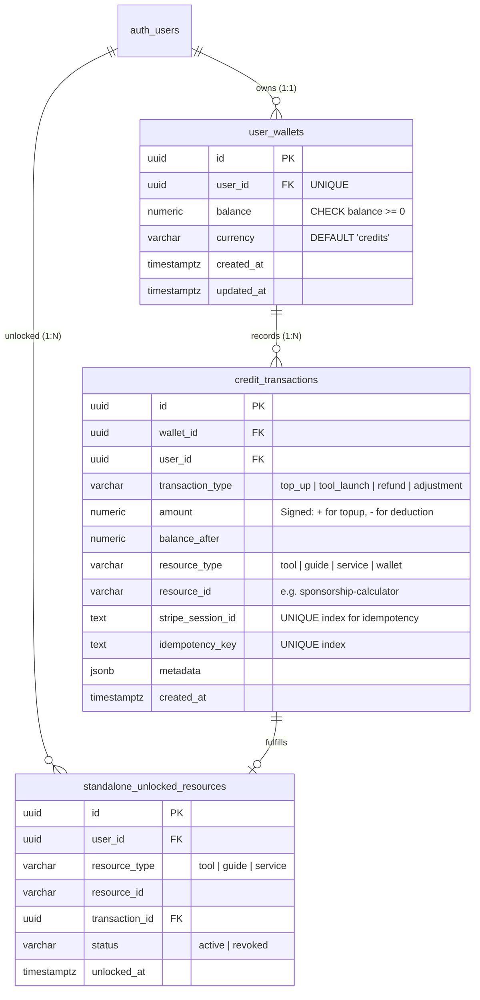
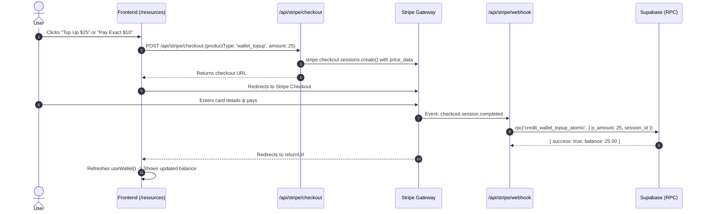
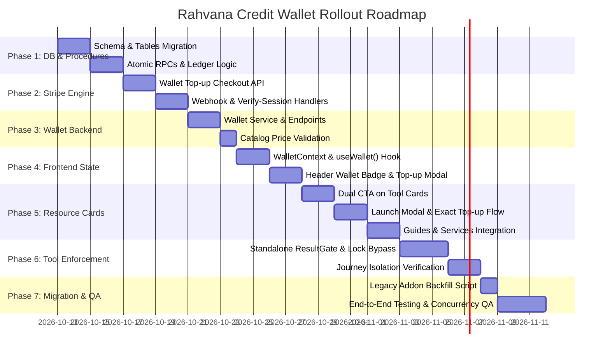

# Rahvana Credit-Based Wallet & Standalone Resources: Full Implementation Plan

**Document Version:** 1.0.0  
**Target Architecture:** Account-Wide Rahvana Wallet ($1 USD = 1 Credit), Standalone Resources Dual-CTA Flow, and Preserved Journey Subscriptions  
**Author:** Senior Full-Stack & System Architecture Team  
**Status:** READY FOR TEAM REVIEW & STAKEHOLDER APPROVAL  
**Date:** October 12, 2026

---

## Table of Contents

1. [Executive Summary & Strategic Vision](#1-executive-summary--strategic-vision)
2. [Current-State Codebase Audit & Gap Analysis](#2-current-state-codebase-audit--gap-analysis)
3. [Resource Catalog & Compatibility Matrix](#3-resource-catalog--compatibility-matrix)
4. [Confirmed Decisions vs. Open Decisions Requiring Sign-Off](#4-confirmed-decisions-vs-open-decisions-requiring-sign-off)
5. [Target Architecture & Data Engineering](#5-target-architecture--data-engineering)
6. [API Specifications & Payment Processing](#6-api-specifications--payment-processing)
7. [Frontend & UX Architecture](#7-frontend--ux-architecture)
8. [Phased Step-by-Step Implementation Roadmap](#8-phased-step-by-step-implementation-roadmap)
9. [Legacy Migration & Backward Compatibility Strategy](#9-legacy-migration--backward-compatibility-strategy)
10. [Security, Concurrency & Financial Integrity Verification](#10-security-concurrency--financial-integrity-verification)
11. [Work Breakdown Structure & Effort Estimates](#11-work-breakdown-structure--effort-estimates)

---

## 1. Executive Summary & Strategic Vision

### 1.1 Business Objective

Rahvana is transitioning its standalone monetization model from fragmented, single-tool Stripe checkouts (such as purchasing a standalone $15 Sponsorship Calculator or a $39 Form Filler pass) to a unified **Rahvana Wallet**.

Under this system:

- **Exchange Rate:** **$1.00 USD = 1 Rahvana Credit**.
- **Unified Balance:** A single petitioner-level credit balance allows users to store and spend credits across all standalone tools, guides, and services.
- **Frictionless Experience:** Users top up their wallet once (or top up the exact remaining deficit when launching a tool) instead of repeatedly checking out through Stripe for each individual resource.
- **Strict Ecosystem Isolation:** **Journey subscription plans (`Basic`, `Premium`, `Executive`) remain completely unchanged.** Tools launched inside an active journey remain covered by that journey's subscription tier and **never consume credits**. Credits are strictly spent for **standalone access** outside of a journey.
- **Resource Card Dual-CTA Experience:** On the `/resources` page, each tool card will feature two clear actions:
  1. **"Preview Tool"**: Grants free access to experience the tool in trial/preview mode (already implemented across tools).
  2. **"Launch Tool"**: Evaluates access. If unpurchased, displays a confirmation modal: _"This tool requires XX credits. If you continue, XX credits will be deducted from your Rahvana Wallet."_ Upon confirmation, credits are atomically deducted, permanent standalone access is granted, and the tool launches with full functionality.

```
+-----------------------------------------------------------------------------------------+
|                                    RAHVANA PLATFORM                                     |
+-----------------------------------------------------------------------------------------+
                                             |
                   +-------------------------+-------------------------+
                   |                                                   |
                   v                                                   v
      [ JOURNEY ECOSYSTEM ]                               [ STANDALONE ECOSYSTEM ]
   (IR-1, IR-5, IR-2 Roadmaps)                         (Catalog at /resources)
   * Subscription Tiers:                               * Account-Wide Rahvana Wallet
     Basic / Premium / Executive                       * 1 USD = 1 Rahvana Credit
   * Tools bundled with tier:                          * Top-ups: $10, $25, $50, $100 & Exact Deficit
     FREE access, NO credit spend                      * Tool Cards on /resources:
   * Vault & Case Pre-population                         - "Preview Tool" (Free Preview)
   * Progress saved to Journey                           - "Launch Tool" (Consumes XX Credits)
   * Multi-candidate scoped                            * Fully isolated from Journey Data
```

---

## 2. Current-State Codebase Audit & Gap Analysis

A comprehensive audit of the active codebase was conducted to establish what exists today and what needs to be refactored.

### 2.1 Existing Database Schema & Entitlements

- **Addon Storage:** Currently, individual addon purchases are appended as raw strings into `user_profiles.profile_details.purchased_addons` (e.g., `["sponsor", "smart", "photo"]`) via `lib/payments/addon-purchase-ledger.ts`.
- **Usage Counting:** The `feature_usage` table (`supabase/migrations/20260430_feature_usage.sql`) tracks counts via `increment_feature_usage_atomic`, separating plan credits from addon credits (`photo_booth:addon`). However, this is hardcoded per feature and lacks a shared currency or financial ledger.
- **Roadmap Sessions:** `tool_sessions` (`supabase/migrations/20260403_02_tool_sessions.sql`) has a strict foreign key `journey_id UUID NOT NULL`, meaning it was built strictly for roadmap journeys and cannot store standalone executions without a journey.
- **Missing Elements:**
  - No `user_wallets` table.
  - No `credit_transactions` financial ledger.
  - No `standalone_unlocked_resources` table to record that a user has paid credits for a tool.
  - No atomic wallet top-up or credit deduction stored procedures (RPCs).

### 2.2 Stripe & Payment Flows

- **Stripe Configuration:** `lib/stripe/config.ts` maintains hardcoded price IDs for individual addons (`STRIPE_PRICES.ADDONS["sponsor"]`, etc.).
- **Checkout Route:** `app/api/stripe/checkout/route.ts` creates Stripe sessions for subscriptions and individual addons (`productType: 'addon'`).
- **Webhook & Verify Session:**
  - `app/api/stripe/webhook/route.ts` acknowledges Stripe events.
  - `app/api/stripe/verify-session/route.ts` acts as a self-healing activation endpoint.
- **Gaps:** Needs support for `product_type: 'wallet_topup'`, accepting either pre-set credit pack quantities ($10, $25, $50, $100) or dynamic custom top-up amounts (exact-replenishment).

### 2.3 Standalone vs. Journey Isolation Architecture

- **Tool Mode Hook:** `lib/hooks/useResolveToolMode.ts` already cleanly detects whether a tool is executing in `standalone` or `journey` mode.
- **Isolated Storage Keys:** Tools like `SponsorshipCalculatorTool` and `PassportPhotoTool` already maintain separated storage keys:
  - Journey mode: `journey_${slug}_${candidateId}_sponsorship_draft`
  - Standalone mode: `standalone_sponsorship_calc` / `standalone_sponsorship_calc_draft`
- **Gaps:** Standalone tools still evaluate against `ResultGate` and `usePlan()`, which look up `purchased_addons` or subscription tiers, rather than checking if the tool was unlocked via wallet credits.

### 2.4 Resources Page (`/resources`) & Tool Card UI

- **Components:**
  - `app/(main)/resources/ResourcesContent.tsx` hosts three tabs: Tools (`app/(tools)/tools/page.tsx`), Guides (`app/(tools)/guides/page.tsx`), and Services (`app/(main)/services/page.tsx`).
  - `ToolCard` in `app/(tools)/tools/page.tsx` renders a single clickable card that either navigates to the tool or opens the `UpgradeModal`.
- **Gaps:** Tool cards currently lack the dual CTA buttons ("Preview Tool" and "Launch Tool"), wallet balance indicator, and the credit deduction confirmation modal.

---

## 3. Resource Catalog & Compatibility Matrix

Every resource currently offered has a defined dollar price that directly maps to **1 Credit = $1 USD**. Once launched with credits, standalone tools grant **unlimited access** to that tool for the user account.

| Resource Name                   | Resource ID / Addon Key                | Catalog Price (USD) | New Wallet Cost (Credits) | Existing Preview Capability                        | Result / Paid Behavior                                                     | Standalone Progress Storage                                      |
| ------------------------------- | -------------------------------------- | :-----------------: | :-----------------------: | -------------------------------------------------- | -------------------------------------------------------------------------- | ---------------------------------------------------------------- |
| **Sponsorship Calculator**      | `sponsorship-calculator` (`sponsor`)   |       $15.00        |      **15 Credits**       | Inputs 1-8 free; Steps 9-10 & results gated        | Full poverty threshold calculation, form selection, joint sponsor analysis | `localStorage` (`standalone_sponsorship_calc`) + `user_profiles` |
| **Smart Form Filler**           | `form-forge` (`smart`)                 |       $39.00        |      **39 Credits**       | Free preview of form fields & instructions         | Complete form autofill, validation & official USCIS PDF generation         | Local draft state + downloadable PDF                             |
| **221(g) Action Planner**       | `221g-planner` (`221g`)                |       $199.00       |      **199 Credits**      | Administrative processing wizard preview           | Full action plan, customized evidence checklist, recovery roadmap          | `localStorage` (`standalone_221g_plan`)                          |
| **Interview Prep**              | `interview-prep` (`interview-prep`)    |       $200.00       |      **200 Credits**      | Category selection & sample questions preview      | Complete mock interview simulation, rapid-fire mode, answer analysis       | Account-level interview sessions                                 |
| **Photo Booth**                 | `photo-booth` (`photo`)                |       $15.00        |      **15 Credits**       | Upload image, facial detection & alignment preview | High-res background removal, 2x2 inch printable biometric compliance sheet | `standalone_passport_photos` in `localStorage` & profile         |
| **PDF Tool Kit**                | `pdf-toolkit` (`pdf`)                  |       $69.00        |      **69 Credits**       | Tool interface preview                             | Unlimited PDF merge, split, compress & convert                             | Client-side execution                                            |
| **Passport Guide**              | `guide-passport`                       |        $5.00        |       **5 Credits**       | TOC and overview visible                           | Full DGIP step-by-step roadmap & submission guides                         | Unlocked guide view                                              |
| **Police Verification Guide**   | `guide-police`                         |        $5.00        |       **5 Credits**       | TOC and overview visible                           | Province-wise PCC workflow & document requirements                         | Unlocked guide view                                              |
| **CNIC Guide**                  | `guide-cnic`                           |        $5.00        |       **5 Credits**       | TOC and overview visible                           | NADRA CNIC issuance & modification procedures                              | Unlocked guide view                                              |
| **Birth Certificate Guide**     | `guide-birth-cert`                     |        $5.00        |       **5 Credits**       | TOC and overview visible                           | Municipal / Union Council issuance procedures                              | Unlocked guide view                                              |
| **FRC Guide**                   | `guide-frc`                            |        $5.00        |       **5 Credits**       | TOC and overview visible                           | Family Registration Certificate issuance workflow                          | Unlocked guide view                                              |
| **Marriage Guide (Nikah Nama)** | `guide-nikah-nama`                     |        $5.00        |       **5 Credits**       | TOC and overview visible                           | NADRA computerized marriage certificate steps                              | Unlocked guide view                                              |
| **Book Medical Appointment**    | `book-medical-appointment` (`medical`) |        $5.00        |       **5 Credits**       | Service description & clinic list                  | Panel physician appointment scheduling by Rahvana                          | `medical_appointments` table                                     |
| **PCC Filing (Sindh Only)**     | `pcc-filing-service` (`pcc`)           |       $25.00        |      **25 Credits**       | Service details & document checklist               | End-to-end filing handling by Rahvana operational team                     | `police_verification_requests` table                             |
| **Document Translation**        | `document-translation` (`translate`)   |       $25.00        |      **25 Credits**       | Submission form & pricing info                     | Certified Urdu-to-English translation request                              | `translation_documents` table                                    |
| **Expert Consultation**         | `book-a-consultation` (`consultation`) |       $99.00        |      **99 Credits**       | Specialist profiles & calendar preview             | 30-minute 1-on-1 video consultation booking                                | `consultation_bookings` table                                    |

---

## 4. Confirmed Decisions vs. Open Decisions Requiring Sign-Off

### 4.1 Confirmed System Rules

1. **Exchange Rate:** Strictly fixed at **$1.00 USD = 1 Rahvana Credit**.
2. **Account-Level Ownership:** One wallet per primary user account (`auth.users.id`). Multiple journeys (e.g., IR-1 Spouse and IR-5 Parents) share the same credit balance.
3. **Journey Plan Non-Interference:** Existing `Basic`, `Premium`, and `Executive` journey subscriptions are untouched. Tools launched from a journey roadmap continue to use the journey tier and consume 0 credits.
4. **Standard Top-Up Packs:** $10 (10 credits), $25 (25 credits), $50 (50 credits), $100 (100 credits).
5. **Exact Replenishment:** If a user with 5 credits launches a 15-credit tool, the system provides a 1-click option to purchase the exact missing 10 credits ($10).
6. **Dual CTA on Tool Cards:** "Preview Tool" for free exploration, "Launch Tool" for paid unlock.
7. **Unlimited Access Post-Launch:** When a user confirms the credit deduction for a tool (e.g., Sponsorship Calculator for 15 credits), the tool is permanently unlocked for that user's standalone use.

### 4.2 Open Decisions & Recommendations for the Team

```
+-------------------------------------------------------------------------------------------------------------------+
| DECISION ITEM                  | OPTION A (RECOMMENDED)              | OPTION B (ALTERNATIVE)                     |
+-------------------------------------------------------------------------------------------------------------------+
| 1. Form Filler / Photo Re-use  | Unlimited runs for that tool        | Per-form or per-output tokens              |
|    Abuse Protection            | (Single unlock per account)         | (Deduct 39 credits per form generated)     |
|                                | Tradeoff: Lowest friction, adheres  | Tradeoff: Prevents excessive API costs     |
|                                | to user specification.              | but complicates the mental model.          |
+-------------------------------------------------------------------------------------------------------------------+
| 2. Legacy Purchased Addons     | Grandfather as Unlocked             | Credit Backfill                            |
|                                | Retain existing tools as unlocked   | Convert legacy purchases to equivalent     |
|                                | in standalone_unlocked_resources.   | wallet credits.                            |
|                                | Tradeoff: Safe, preserves intent,   | Tradeoff: User might spend converted       |
|                                | zero user confusion.                | credits on different tools.                |
+-------------------------------------------------------------------------------------------------------------------+
| 3. Minimum Top-Up Floor        | $5.00 Minimum Top-Up                | No minimum (exact down to $1)              |
|                                | Tradeoff: Protects against Stripe   | Tradeoff: Stripe fixed fee ($0.30) eats    |
|                                | flat processing fee erosion ($0.30).| margin on very low dollar transactions.    |
+-------------------------------------------------------------------------------------------------------------------+
| 4. Credit Expiration           | Credits Never Expire                | 12-Month Inactivity Expiry                 |
|                                | Tradeoff: Builds user trust and     | Tradeoff: Encourages faster consumption    |
|                                | reduces support tickets.            | but creates user frustration.              |
+-------------------------------------------------------------------------------------------------------------------+
```

---

## 5. Target Architecture & Data Engineering

### 5.1 Database Schema Definition (`supabase/migrations/`)

We introduce three dedicated tables with strict constraints, foreign keys, row-level security (RLS), and atomic PostgreSQL functions.



#### SQL Implementation Specification

```sql
-- 1. USER WALLETS TABLE
CREATE TABLE IF NOT EXISTS public.user_wallets (
    id UUID PRIMARY KEY DEFAULT gen_random_uuid(),
    user_id UUID NOT NULL REFERENCES auth.users(id) ON DELETE CASCADE,
    balance NUMERIC(10, 2) NOT NULL DEFAULT 0.00 CHECK (balance >= 0.00),
    currency VARCHAR(10) NOT NULL DEFAULT 'credits',
    created_at TIMESTAMPTZ NOT NULL DEFAULT NOW(),
    updated_at TIMESTAMPTZ NOT NULL DEFAULT NOW(),
    CONSTRAINT uq_user_wallets_user_id UNIQUE (user_id)
);

CREATE INDEX IF NOT EXISTS idx_user_wallets_user_id ON public.user_wallets(user_id);

-- 2. CREDIT TRANSACTIONS LEDGER TABLE
CREATE TABLE IF NOT EXISTS public.credit_transactions (
    id UUID PRIMARY KEY DEFAULT gen_random_uuid(),
    wallet_id UUID NOT NULL REFERENCES public.user_wallets(id) ON DELETE RESTRICT,
    user_id UUID NOT NULL REFERENCES auth.users(id) ON DELETE CASCADE,
    transaction_type VARCHAR(30) NOT NULL CHECK (
        transaction_type IN ('top_up', 'tool_launch', 'guide_unlock', 'service_booking', 'refund', 'adjustment')
    ),
    amount NUMERIC(10, 2) NOT NULL, -- Positive for deposits, negative for deductions
    balance_after NUMERIC(10, 2) NOT NULL CHECK (balance_after >= 0.00),
    resource_type VARCHAR(30) CHECK (resource_type IN ('tool', 'guide', 'service', 'wallet')),
    resource_id VARCHAR(100),
    stripe_session_id TEXT,
    stripe_payment_id TEXT,
    idempotency_key TEXT,
    metadata JSONB DEFAULT '{}'::jsonb,
    created_at TIMESTAMPTZ NOT NULL DEFAULT NOW()
);

CREATE INDEX IF NOT EXISTS idx_credit_transactions_user_id ON public.credit_transactions(user_id);
CREATE INDEX IF NOT EXISTS idx_credit_transactions_created_at ON public.credit_transactions(created_at DESC);
CREATE UNIQUE INDEX IF NOT EXISTS idx_credit_tx_stripe_session ON public.credit_transactions(stripe_session_id)
    WHERE stripe_session_id IS NOT NULL;
CREATE UNIQUE INDEX IF NOT EXISTS idx_credit_tx_idempotency ON public.credit_transactions(idempotency_key)
    WHERE idempotency_key IS NOT NULL;

-- 3. STANDALONE UNLOCKED RESOURCES TABLE
CREATE TABLE IF NOT EXISTS public.standalone_unlocked_resources (
    id UUID PRIMARY KEY DEFAULT gen_random_uuid(),
    user_id UUID NOT NULL REFERENCES auth.users(id) ON DELETE CASCADE,
    resource_type VARCHAR(30) NOT NULL CHECK (resource_type IN ('tool', 'guide', 'service')),
    resource_id VARCHAR(100) NOT NULL,
    transaction_id UUID REFERENCES public.credit_transactions(id),
    status VARCHAR(20) NOT NULL DEFAULT 'active' CHECK (status IN ('active', 'revoked')),
    metadata JSONB DEFAULT '{}'::jsonb,
    unlocked_at TIMESTAMPTZ NOT NULL DEFAULT NOW(),
    CONSTRAINT uq_user_unlocked_resource UNIQUE (user_id, resource_type, resource_id)
);

CREATE INDEX IF NOT EXISTS idx_unlocked_res_user ON public.standalone_unlocked_resources(user_id);

-- 4. ROW LEVEL SECURITY (RLS)
ALTER TABLE public.user_wallets ENABLE ROW LEVEL SECURITY;
ALTER TABLE public.credit_transactions ENABLE ROW LEVEL SECURITY;
ALTER TABLE public.standalone_unlocked_resources ENABLE ROW LEVEL SECURITY;

-- Users can read their own data; modifications restricted to Server-Side / RPCs
CREATE POLICY "Users can view own wallet" ON public.user_wallets FOR SELECT USING (auth.uid() = user_id);
CREATE POLICY "Users can view own transactions" ON public.credit_transactions FOR SELECT USING (auth.uid() = user_id);
CREATE POLICY "Users can view own unlocked resources" ON public.standalone_unlocked_resources FOR SELECT USING (auth.uid() = user_id);
```

### 5.2 Concurrency-Safe Atomic Database Procedures (RPCs)

#### 1. Atomic Credit Deduction (`deduct_wallet_credits_atomic`)

This stored procedure uses `SELECT ... FOR UPDATE` to lock the wallet row, preventing race conditions or double deductions when multiple tabs or concurrent requests launch tools simultaneously.

```sql
CREATE OR REPLACE FUNCTION public.deduct_wallet_credits_atomic(
    p_user_id UUID,
    p_resource_type VARCHAR,
    p_resource_id VARCHAR,
    p_credit_cost NUMERIC,
    p_idempotency_key TEXT DEFAULT NULL,
    p_metadata JSONB DEFAULT '{}'::jsonb
)
RETURNS JSONB AS $$
DECLARE
    v_wallet RECORD;
    v_new_balance NUMERIC;
    v_tx_id UUID;
    v_already_unlocked BOOLEAN;
BEGIN
    -- 1. Idempotency Check: Return existing unlock if already processed
    IF p_idempotency_key IS NOT NULL THEN
        SELECT id, balance_after INTO v_tx_id, v_new_balance
        FROM public.credit_transactions
        WHERE idempotency_key = p_idempotency_key;

        IF FOUND THEN
            RETURN jsonb_build_object(
                'success', TRUE,
                'already_processed', TRUE,
                'transaction_id', v_tx_id,
                'balance', v_new_balance,
                'resource_id', p_resource_id
            );
        END IF;
    END IF;

    -- 2. Check if user already unlocked this resource (free re-entry)
    SELECT EXISTS (
        SELECT 1 FROM public.standalone_unlocked_resources
        WHERE user_id = p_user_id
          AND resource_type = p_resource_type
          AND resource_id = p_resource_id
          AND status = 'active'
    ) INTO v_already_unlocked;

    IF v_already_unlocked THEN
        SELECT balance INTO v_new_balance FROM public.user_wallets WHERE user_id = p_user_id;
        RETURN jsonb_build_object(
            'success', TRUE,
            'already_unlocked', TRUE,
            'balance', COALESCE(v_new_balance, 0),
            'resource_id', p_resource_id
        );
    END IF;

    -- 3. Lock the user wallet row FOR UPDATE
    SELECT * INTO v_wallet
    FROM public.user_wallets
    WHERE user_id = p_user_id
    FOR UPDATE;

    IF NOT FOUND THEN
        -- Auto-initialize wallet with 0 balance if not found
        INSERT INTO public.user_wallets (user_id, balance)
        VALUES (p_user_id, 0.00)
        RETURNING * INTO v_wallet;
    END IF;

    -- 4. Check balance sufficiency
    IF v_wallet.balance < p_credit_cost THEN
        RETURN jsonb_build_object(
            'success', FALSE,
            'error', 'INSUFFICIENT_CREDITS',
            'required', p_credit_cost,
            'available', v_wallet.balance,
            'deficit', (p_credit_cost - v_wallet.balance)
        );
    END IF;

    -- 5. Calculate new balance & deduct
    v_new_balance := v_wallet.balance - p_credit_cost;

    UPDATE public.user_wallets
    SET balance = v_new_balance, updated_at = NOW()
    WHERE id = v_wallet.id;

    -- 6. Insert transaction into ledger
    INSERT INTO public.credit_transactions (
        wallet_id,
        user_id,
        transaction_type,
        amount,
        balance_after,
        resource_type,
        resource_id,
        idempotency_key,
        metadata
    ) VALUES (
        v_wallet.id,
        p_user_id,
        CASE
            WHEN p_resource_type = 'tool' THEN 'tool_launch'
            WHEN p_resource_type = 'guide' THEN 'guide_unlock'
            ELSE 'service_booking'
        END,
        -p_credit_cost,
        v_new_balance,
        p_resource_type,
        p_resource_id,
        p_idempotency_key,
        p_metadata
    ) RETURNING id INTO v_tx_id;

    -- 7. Grant persistent access
    INSERT INTO public.standalone_unlocked_resources (
        user_id,
        resource_type,
        resource_id,
        transaction_id,
        status,
        metadata
    ) VALUES (
        p_user_id,
        p_resource_type,
        p_resource_id,
        v_tx_id,
        'active',
        p_metadata
    ) ON CONFLICT (user_id, resource_type, resource_id)
    DO UPDATE SET status = 'active', unlocked_at = NOW();

    RETURN jsonb_build_object(
        'success', TRUE,
        'transaction_id', v_tx_id,
        'balance', v_new_balance,
        'resource_id', p_resource_id
    );
END;
$$ LANGUAGE plpgsql SECURITY DEFINER;
```

#### 2. Atomic Wallet Top-Up (`credit_wallet_topup_atomic`)

Executed by Stripe webhooks and the self-healing `/api/stripe/verify-session` endpoint.

```sql
CREATE OR REPLACE FUNCTION public.credit_wallet_topup_atomic(
    p_user_id UUID,
    p_amount NUMERIC,
    p_stripe_session_id TEXT,
    p_stripe_payment_id TEXT DEFAULT NULL,
    p_metadata JSONB DEFAULT '{}'::jsonb
)
RETURNS JSONB AS $$
DECLARE
    v_wallet RECORD;
    v_new_balance NUMERIC;
    v_tx_id UUID;
BEGIN
    -- 1. Idempotency Check: Don't add credits twice if already credited for this session
    SELECT id, balance_after INTO v_tx_id, v_new_balance
    FROM public.credit_transactions
    WHERE stripe_session_id = p_stripe_session_id;

    IF FOUND THEN
        RETURN jsonb_build_object(
            'success', TRUE,
            'already_processed', TRUE,
            'transaction_id', v_tx_id,
            'balance', v_new_balance
        );
    END IF;

    -- 2. Lock or insert user wallet
    SELECT * INTO v_wallet
    FROM public.user_wallets
    WHERE user_id = p_user_id
    FOR UPDATE;

    IF NOT FOUND THEN
        INSERT INTO public.user_wallets (user_id, balance)
        VALUES (p_user_id, p_amount)
        RETURNING * INTO v_wallet;
        v_new_balance := p_amount;
    ELSE
        v_new_balance := v_wallet.balance + p_amount;
        UPDATE public.user_wallets
        SET balance = v_new_balance, updated_at = NOW()
        WHERE id = v_wallet.id;
    END IF;

    -- 3. Record in transactions ledger
    INSERT INTO public.credit_transactions (
        wallet_id,
        user_id,
        transaction_type,
        amount,
        balance_after,
        resource_type,
        stripe_session_id,
        stripe_payment_id,
        metadata
    ) VALUES (
        v_wallet.id,
        p_user_id,
        'top_up',
        p_amount,
        v_new_balance,
        'wallet',
        p_stripe_session_id,
        p_stripe_payment_id,
        p_metadata
    ) RETURNING id INTO v_tx_id;

    RETURN jsonb_build_object(
        'success', TRUE,
        'transaction_id', v_tx_id,
        'balance', v_new_balance
    );
END;
$$ LANGUAGE plpgsql SECURITY DEFINER;
```

---

## 6. API Specifications & Payment Processing

### 6.1 Stripe Top-Up Engine

When a user tops up (either a preset amount like $25 or an exact deficit amount like $10), a Stripe Checkout session is created with dynamic line items using Stripe's `price_data` API, avoiding the need to pre-create thousands of price objects in Stripe.

```
POST /api/stripe/checkout
Body:
{
  "productType": "wallet_topup",
  "amount": 25.00,             // In USD ($1 = 1 Credit)
  "returnUrl": "/resources?tab=toolbox&topup=success"
}
```



### 6.2 Wallet API Endpoints

#### 1. `GET /api/wallet`

- **Auth:** Required (`getAuthenticatedUser()`).
- **Response:**
  ```json
  {
    "success": true,
    "wallet": {
      "balance": 25.0,
      "currency": "credits"
    },
    "unlockedResources": ["sponsorship-calculator", "guide-passport"]
  }
  ```

#### 2. `POST /api/wallet/launch-tool`

- **Auth:** Required.
- **Request:**
  ```json
  {
    "resourceType": "tool",
    "resourceId": "sponsorship-calculator",
    "idempotencyKey": "launch_1697098492000_abc"
  }
  ```
- **Server Logic:**
  1. Validates server-authoritative price: `sponsorship-calculator` = 15 credits.
  2. Calls `supabase.rpc('deduct_wallet_credits_atomic', ...)`.
  3. Returns `{ success: true, balance: 10.00, unlocked: true }` or `{ success: false, error: 'INSUFFICIENT_CREDITS', required: 15, available: 5, deficit: 10 }`.

#### 3. `GET /api/wallet/transactions`

- **Auth:** Required.
- **Query Params:** `?page=1&limit=20`
- **Response:** Paginated list of ledger rows for the user.

---

## 7. Frontend & UX Architecture

### 7.1 Unified `WalletContext` & Hook

A dedicated React context (`app/context/WalletContext.tsx`) provides reactive wallet state across the application:

- `balance: number`
- `isLoading: boolean`
- `unlockedResources: Set<string>`
- `isUnlocked(resourceId: string): boolean`
- `launchResource(resourceType, resourceId): Promise<{ success: boolean; ... }>`
- `refreshWallet(): Promise<void>`

### 7.2 SiteHeader Wallet Balance Badge

In `app/components/layout/SiteHeader.tsx`:

- Displays a sleek wallet badge in the top navigation bar for authenticated users:
  ```
  [ 🪙 25 Credits | Top Up + ]
  ```
- Clicking the badge opens the **Wallet Top-Up Modal** or redirects to the transactions overview.

### 7.3 Resources Page Dual-CTA Refactor (`ToolCard`)

In `app/(tools)/tools/page.tsx`, the card footer is updated to display two clear, modern CTA buttons:

```
+-------------------------------------------------------------------+
|  [Calculator Icon]                       [Quick Access Pin]       |
|                                                                   |
|  Sponsorship Calculator                                           |
|  MONEY & SPONSORSHIP                                              |
|  Auto-check income/assets and tell you what you still need.       |
|                                                                   |
|  ---------------------------------------------------------------  |
|  Cost: 15 Credits                                                 |
|                                                                   |
|  [ Preview Tool ]                 [ Launch Tool (15 Credits) ]    |
|   (Free Trial Mode)                (Unlocks Full Tool)            |
+-------------------------------------------------------------------+
```

#### Dual-CTA Behavior Logic

1. **"Preview Tool" Button:**
   - Navigates directly to `tool.href?mode=preview`.
   - User experiences the existing free/preview wizard steps without credit deduction.
2. **"Launch Tool" Button:**
   - **If already unlocked:** Button renders as **"Open Tool &rarr;"** and opens directly with no confirmation or deduction.
   - **If not yet unlocked:** Opens `<CreditLaunchModal />`.

### 7.4 Credit Launch Confirmation Modal (`<CreditLaunchModal />`)

When the user clicks **"Launch Tool"**, a high-polish modal renders with full transparency:

```
+-------------------------------------------------------------------+
|                     Launch Sponsorship Calculator                 |
|                                                                   |
|  This standalone tool requires 15 Rahvana Credits.                |
|  Launching will permanently unlock full access for your account.  |
|                                                                   |
|  ---------------------------------------------------------------  |
|  Your Wallet Balance:     25 Credits                              |
|  Tool Cost:               15 Credits                              |
|  Balance After Launch:    10 Credits                              |
|  ---------------------------------------------------------------  |
|                                                                   |
|  [ Cancel ]                      [ Confirm & Deduct 15 Credits ]  |
+-------------------------------------------------------------------+
```

#### Insufficient Balance State

If the user's balance is lower than the required amount (e.g., user has 5 credits, cost is 15):

```
+-------------------------------------------------------------------+
|                        Insufficient Credits                       |
|                                                                   |
|  This tool requires 15 Credits, but you only have 5 Credits.      |
|  You need 10 more credits to launch this tool.                    |
|                                                                   |
|  ---------------------------------------------------------------  |
|                                                                   |
|  [ Top Up Exact Amount: $10 (10 Credits) ]  <-- PRIMARY CTA      |
|                                                                   |
|  Or choose a credit bundle:                                       |
|  [ $25 (25 Credits) ]   [ $50 (50 Credits) ]   [ $100 (100 Cred) ]|
|                                                                   |
|  [ Cancel ]                                                       |
+-------------------------------------------------------------------+
```

---

## 8. Phased Step-by-Step Implementation Roadmap



### Detailed Phase Tasks

#### Phase 1: Database & Atomic Procedures

- Create migration file `supabase/migrations/20261013_create_wallet_and_credit_ledger.sql`.
- Create `user_wallets`, `credit_transactions`, `standalone_unlocked_resources`.
- Add PostgreSQL stored functions `deduct_wallet_credits_atomic` and `credit_wallet_topup_atomic`.
- Set up RLS policies ensuring users can only read their own records and cannot directly modify wallet balances.

#### Phase 2: Stripe Top-Up Engine

- Update `app/api/stripe/checkout/route.ts` to support `productType: 'wallet_topup'`.
- Configure dynamic Stripe `price_data` for standard top-up amounts ($10, $25, $50, $100) and exact replenishment amounts.
- Update `app/api/stripe/webhook/route.ts` and `app/api/stripe/verify-session/route.ts` to invoke `credit_wallet_topup_atomic` idempotently.

#### Phase 3: Core Wallet Backend APIs

- Implement `app/api/wallet/route.ts` (returns balance and unlocked resources).
- Implement `app/api/wallet/launch-tool/route.ts` (handles deduction and unlocks).
- Implement `app/api/wallet/transactions/route.ts` (retrieves transaction history).
- Create `lib/wallet/catalog.ts` containing the server-authoritative price map.

#### Phase 4: Frontend State & Navigation

- Create `app/context/WalletContext.tsx`.
- Wrap application providers in `WalletProvider`.
- Add wallet balance pill in `SiteHeader.tsx`.
- Create `<WalletTopupModal />` supporting $10, $25, $50, $100 and custom amounts.

#### Phase 5: Resources Catalog & Dual-CTA UI

- Update `ToolCard` in `app/(tools)/tools/page.tsx` with "Preview Tool" and "Launch Tool" buttons.
- Build `<CreditLaunchModal />` with cost breakdown, confirmation, and exact top-up fallback.
- Extend the dual-CTA pattern to Guides (`app/(tools)/guides/page.tsx`) and Services (`app/(main)/services/page.tsx`).

#### Phase 6: Per-Tool Enforcement & Journey Isolation

- Update standalone tool entry points (`SponsorshipCalculatorTool`, `PassportPhotoTool`, `Actual221GFormChecker`, `InterviewPrep`, `AutoFormFiller`).
- When running in `mode === 'standalone'`, check if `isUnlocked(toolId)` is true. If unlocked, bypass `ResultGate` and allow unlimited generation.
- Verify that standalone runs **never read from or write to journey databases or candidate roadmaps**.

#### Phase 7: Backward Compatibility & Migration

- Create idempotent backfill script migrating existing entries in `user_profiles.profile_details.purchased_addons` into `standalone_unlocked_resources`.
- Ensure users with existing addon purchases retain full access without being asked for credits.

#### Phase 8: Testing & Security Validation

- Unit test atomic procedures with concurrent transactions.
- Test edge cases: zero balance, exact balance, webhook retries, double-clicks.
- Perform penetration test to ensure frontend cannot spoof credit costs.

---

## 9. Legacy Migration & Backward Compatibility Strategy

### 9.1 Preserving Existing Purchases

Users who previously purchased standalone tools (stored in `user_profiles.profile_details.purchased_addons`) must not lose access or be double-charged.

### 9.2 Migration Script

An automated SQL backfill migration will run once:

```sql
-- Backfill existing purchased addons into standalone_unlocked_resources
INSERT INTO public.standalone_unlocked_resources (user_id, resource_type, resource_id, status, metadata)
SELECT
    up.id AS user_id,
    'tool' AS resource_type,
    CASE
        WHEN addon_item = 'sponsor' THEN 'sponsorship-calculator'
        WHEN addon_item = 'smart' THEN 'form-forge'
        WHEN addon_item = 'photo' THEN 'photo-booth'
        WHEN addon_item = '221g' THEN '221g-planner'
        WHEN addon_item LIKE 'interview-prep%' THEN 'interview-prep'
        WHEN addon_item = 'pdf' THEN 'pdf-toolkit'
        WHEN addon_item = 'medical' THEN 'book-medical-appointment'
        WHEN addon_item = 'pcc' THEN 'pcc-filing-service'
        WHEN addon_item = 'translate' THEN 'document-translation'
        WHEN addon_item = 'consultation' THEN 'book-a-consultation'
        ELSE addon_item
    END AS resource_id,
    'active' AS status,
    jsonb_build_object('migrated_from', 'profile_details.purchased_addons', 'original_addon', addon_item)
FROM public.user_profiles up,
LATERAL jsonb_array_elements_text(COALESCE(up.profile_details->'purchased_addons', '[]'::jsonb)) AS addon_item
ON CONFLICT (user_id, resource_type, resource_id) DO NOTHING;
```

---

## 10. Security, Concurrency & Financial Integrity Verification

1. **Zero-Trust Client Pricing:** The client never sends a credit price to the backend. The client only sends the `resourceId` (e.g., `sponsorship-calculator`). The backend looks up the price in `lib/wallet/catalog.ts`.
2. **Race Condition Prevention:** All credit changes run inside PostgreSQL functions with `FOR UPDATE` row locks. Two simultaneous requests from the same user cannot overspend the balance.
3. **Webhook Replay Protection:** Stripe session IDs are indexed with a `UNIQUE` constraint on `credit_transactions`. Duplicate webhook deliveries exit immediately without granting double credits.
4. **Negative Balance Block:** The database column enforces `CHECK (balance >= 0.00)`. Even if an application bug attempts to overspend, the database rejects the transaction.
5. **Journey-Standalone Data Isolation:**
   - Standalone tool state is strictly persisted to local storage or standalone profile fields.
   - Standalone tool executions are blocked from reading or writing to `journeys`, `journey_documents`, or `case_data`.

---

## 11. Work Breakdown Structure & Effort Estimates

| Work Package                              | Deliverables                                                                                | Est. Engineering Time  |      Target Lead       |
| ----------------------------------------- | ------------------------------------------------------------------------------------------- | :--------------------: | :--------------------: |
| **WP-1: Database Architecture**           | Schema migrations, 3 new tables, RLS policies, atomic stored procedures (`deduct`, `topup`) |         3 Days         |    Backend Engineer    |
| **WP-2: Stripe Integration**              | Top-up checkout endpoint, exact replenishment flow, webhook & verify-session handlers       |        2.5 Days        | Backend / Payment Lead |
| **WP-3: Backend API Layer**               | `/api/wallet` endpoints, server-side catalog, idempotency guards                            |         2 Days         |    Backend Engineer    |
| **WP-4: Frontend State & Header**         | `WalletContext`, `useWallet()` hook, header balance pill, top-up modal                      |         2 Days         |   Frontend Engineer    |
| **WP-5: Resource Cards & Dual CTA**       | Update `ToolCard`, "Preview Tool" & "Launch Tool" CTAs, `<CreditLaunchModal />`             |         3 Days         |   Frontend Engineer    |
| **WP-6: Standalone Tool Enforcement**     | Bypass ResultGate for unlocked tools across all 16 tools, guides & services                 |        3.5 Days        |  Full-Stack Engineer   |
| **WP-7: Legacy Migration & Verification** | SQL migration script, existing purchase verification                                        |         1 Day          |     Database Lead      |
| **WP-8: Comprehensive QA & Testing**      | Concurrency test suite, Stripe test mode walkthrough, security audit                        |         3 Days         |   QA & Security Lead   |
| **Total Estimated Effort**                | **Production-Ready Rollout**                                                                | **20 Days (~4 Weeks)** |          Team          |

---

## 12. Next Steps

1. **Team & Stakeholder Review:** Share this implementation plan with the engineering and product team.
2. **Approval on Open Decisions:** Confirm decisions in Section 4 (abuse policy for form fills, minimum top-up floor).
3. **Begin Phase 1 Implementation:** Deploy migration `supabase/migrations/20261013_create_wallet_and_credit_ledger.sql` on approval.