# Architecture & Implementation Plan: Standalone Tools Credit-Based Pricing & Entitlement Engine

**Document Status**: APPROVED SPECIFICATION  
**Target System**: Multi-Candidate & Multi-Visa Category Platform (`IR-1`, `IR-5`, `IR-2`)  
**Scope**: Standalone Tool Pricing, Quantity Packs, Account-Level Credit Pool, and Candidate-Level Journey Entitlements  
**Author**: Engineering & Product Architecture Team  

---

## 1. Executive Summary & Strategic Context

With the rollout of the multi-candidate and multi-visa category architecture, a single petitioner account can manage multiple beneficiaries (e.g., Mother and Father under **IR-5**, multiple children under **IR-2**, or separate **IR-1** petitions). Each candidate operates in their own isolated journey context with dedicated roadmaps, vault documents, guides, and stage progress.

### The Pricing Dilemma
Candidates may hold different **Journey Plans** (`basic`, `premium`, `executive`), which already bundle specific tool entitlements. However, petitioners frequently require standalone access to high-value tools (such as the **221(g) Action Planner**, **Smart Form Filler**, **Mock Interview Prep**, **Sponsorship Calculator**, and **Photo Booth**) without necessarily upgrading the entire candidate roadmap.

This document establishes the architecture for **Account-Level Standalone Tool Credits**:
  How standalone tools are priced, packaged, and multiplied via e-commerce quantity controls.

---

## 2. Comparative Evaluation of Pricing Strategies

Before finalizing the Credit-Based model, three distinct pricing models were analyzed for feasibility, user experience, engineering overhead, and revenue optimization:

```mermaid
graph TD
    subgraph OptionA ["Option A: Per-Candidate Lock"]
        A1["User buys tool for Candidate 1"] --> A2["Tool permanently locked to Candidate 1"]
        A2 --> A3["Candidate 2 needs tool -> Must purchase again"]
        A3 --> A4["High friction, duplicate charges, user dissatisfaction"]
    end

    subgraph OptionB ["Option B: Account-Wide Unlimited Time Pass"]
        B1["User buys 30-Day Tool Pass"] --> B2["All candidates get unlimited access for 30 days"]
        B2 --> B3["API abuse risk, unpredictable LLM cost, low LTV"]
    end

    subgraph OptionC ["Option C: Account-Level Credit Pool (Recommended)"]
        C1["User buys Tool Credit Pack (Account Level)"] --> C2["Credits stored in central user wallet"]
        C2 --> C3["User allocates credits dynamically across any Candidate"]
        C3 --> C4["Fair, transparent, scalable, high conversion, strict margin control"]
    end
```



### Option A: Candidate-Locked Per-Purchase (Single-Beneficiary License)
* **Mechanics**: When a user purchases a tool session (e.g., $15 for Sponsorship Calculator), the purchase is permanently bound to `candidate_id` (e.g., Mother). If the user needs the same tool for Father (`candidate-2`), they must purchase it again.
* **Limitations**:
  - **Severe User Friction**: Immigrant petitioners filing for both parents (IR-5) share household income, tax returns, and joint assets. Forcing them to pay twice for the same calculation creates frustration and support tickets.
  - **Inflexible**: If a user accidentally buys a tool while having Candidate 1 selected, support must manually transfer licenses.
  - **Low Perceived Value**: Users feel penalized for having multiple family members on one platform.

### Option B: Account-Wide Unlimited Add-on Subscription / Time-Bound Pass
* **Mechanics**: The user pays a flat fee (e.g., $49/month or $99 one-time) to unlock unlimited usage of a tool across all candidates in their account for a given time window.
* **Limitations**:
  - **Margin Risk on AI-Heavy Tools**: High-cost backend operations (e.g., OCR processing on 50-page PDFs in Smart Form Filler, OpenAI voice synthesis in Mock Interview Prep) can be abused with unlimited passes, causing negative unit economics.
  - **Misalignment with Visa Lifecycle**: Immigration is milestone-driven, not subscription-driven. A petitioner needs Form I-130 filled once or twice, not every month.
  - **Cannibalization of Journey Tiers**: Users would buy a cheap tool pass instead of upgrading to Premium/Executive Journey Plans.

### Option C: Account-Level Credit-Based System *(Recommended & Adopted)*
* **Mechanics**: Users purchase discrete **Credits** associated with specific tools (or tool bundles) deposited into an **Account-Level Wallet**. When an action is initiated for a candidate, the system checks whether the candidate already has journey-level entitlements. If not, it deducts 1 credit from the account pool and grants that candidate a persistent, revision-safe execution token.
* **Why This is Recommended**:
  1. **Maximum Flexibility**: A petitioner sponsoring Mother and Father can purchase a 4-Credit Smart Form Filler pack, using 2 forms for Mother (I-130 + DS-260) and 2 forms for Father (I-130 + DS-260).
  2. **Strict Cost & Margin Control**: Every AI generation, PDF rendering, or audio mock interview is strictly backed by paid units.
  3. **Multi-Pack & E-Commerce Scalability**: Enables volume discounts, quantity pickers ($199 for 3 credits $\times$ quantity 2 = 6 credits for $398), and promotional credit grants.
  4. **Clean Decoupling**: Separates financial transactions (Stripe checkout at account level) from workflow execution (scoped per candidate journey).

---

## 3. Tool Catalog & Pricing Matrix

The table below outlines the finalized credit packages, pricing tiers, unit costs, and journey plan inclusions:

| Tool Name | Tool Category | Credit Pack Options | Package Price (USD) | Effective Unit Price | Included in Journey Plans | Standalone Credit Consumption Unit |
| :--- | :--- | :--- | :--- | :--- | :--- | :--- |
| **221(g) Action Planner** | AI & Planning | **3 Credits** *(Base Pack)* | **\$199.00** | \$66.33 / credit | **Executive** *(Unlimited, inside the journey only)* | 1 credit = 1 generated 221(g) Action Plan & packet checklist. Locked after generation; each edit uses 1 new credit |
| **Interview Prep / Mock AI** | AI & Planning | **One-time purchase** *(per visa category)* | **\$200.00** | \$200.00 one-time, per visa category | **Premium & Executive** *(Full Access)* | 0 credits (session-based; one purchase covers that visa category) |
| **Smart Form Filler** | Forms & Automation | **Single Form** (1 Credit)<br>**4-Credit Pack** (4 Forms)<br>**7-Credit Pack** (7 Forms) | **\$39.00**<br>**\$125.00**<br>**\$199.00** | \$39.00 / form<br>\$31.25 / form *(20% off)*<br>\$28.43 / form *(27% off)* | **Premium & Executive** *(Only the forms that visa category needs, inside the journey only)* | 1 credit = 1 form for 1 person (e.g. I-130 for Mother), used when the form is started. Locked after first PDF download; each edit uses 1 new credit |
| **Sponsorship Calculator** | Money & Sponsorship | **3 Credits** *(Base Pack)* | **\$15.00** | \$5.00 / credit | **Premium & Executive** *(Unlimited, inside the journey only)* | 1 credit = 1 generated income result (poverty guideline, household income & joint sponsor assessment). Locked after generation; each edit uses 1 new credit |
| **Visa Photo Booth** | Docs & PDFs | **2 Credits** *(Base Pack)* | **\$15.00** | \$7.50 / credit | **Basic, Premium, Executive** *(Included)* | 1 credit = 1 AI biometric photo crop, background cleanup, and 2x2 printable sheet |
| **PDF Tool Kit** | Docs & PDFs | **one time Fee** | **$49** | $49 one-time, then unlimited | **All Users (Basic/Prem/Exec)** *(Unlimited)* | 0 credits (No credits required, client-side utility) |
| **Snap & Sign** | Docs & PDFs | **Free / Utility** | **$0.00** | Free for all users | **All Users (Free/Basic/Prem/Exec)** | 0 credits (Digital signature creator utility) |
| **DQ Status / Queue Watch** | Tracking | **Free / Utility** | **$0.00** | Free for all users | **All Users (Free/Basic/Prem/Exec)** | 0 credits (Public embassy queue tracking) |

---


## 4. Final Implementation Plan (Approved Direction)

### 4.1 In one line
Users buy **credit packs** for three standalone tools: **Sponsorship Calculator**, **221(g) Action Planner** and **Smart Form Filler**. Each time one of these tools **produces a result**, 1 credit is used. Every other tool stays as its plan defines it.

### 4.2 Settled business rules

| Rule | Decision |
| :--- | :--- |
| When is a credit used? | Sponsor and 221(g): the moment the result is generated. Smart Form: when a form is started. |
| Can a result be edited for free? | **No.** After generation the result is locked. Editing uses 1 new credit, and the user is warned first (see 4.6). |
| Smart Form lock point | A form can be edited freely until its **first PDF download**. After that it is locked; editing again uses 1 new credit. |
| Where does the user first see the credit requirement for forms? | **At the start**, before any typing. Never as a surprise at download. |
| Refunds | **None.** |
| Expiry | Credits **never expire**. |
| Journey plan holders | Tools included in their plan are free **only inside that journey**. Standalone use always needs credits. |
| Journey plan forms | Only the forms **that visa category needs**, inside that journey. Nothing extra. |
| Standalone-only buyers | Buy freely: single form, 4-pack or 7-pack, with any forms they choose. |
| Interview Prep | **No credits.** Stays a one-time, session-based purchase per visa category (`interview-prep:<category>`). |
| PDF Tool Kit | **No credits.** Standalone: one-time payment of $49 unlocks unlimited use, forever. Journey plan holders: unlimited use, included. |
| Other tools (Photo Booth, Snap & Sign, DQ Watch) | No change; they follow the plan table. |

### 4.3 What already exists (about 60% is built)

| Already exists | Where |
| :--- | :--- |
| Plan-based access rules for every tool | `lib/entitlements/config.ts` |
| A working credit system (Photo Booth, Consultation, Medical, PCC) | `feature_usage` table + `/api/feature-usage` |
| Stripe checkout for one-off add-ons, protected against being applied twice | `app/api/stripe/checkout`, `verify-session`, `lib/payments/addon-purchase-ledger.ts` |
| Result-level locking (blur until access) | `app/components/entitlements/ResultGate.tsx` (already on Sponsor and 221g) |
| Journey vs standalone tool modes | `lib/hooks/useResolveToolMode.ts` |

We are extending an existing system, not building one from scratch.

### 4.4 Gaps that must be fixed first (security)

These exist in the code today. Selling credits before fixing them would let people get paid tools without paying.

1. **Users can edit their own purchases.** Purchases live in `user_profiles.profile_details.purchased_addons`, and users can update their own `profile_details`. **Fix:** move credits into a dedicated table that only the server can write.
2. **The usage check accepts whatever plan the browser claims.** In `/api/feature-usage` the condition `|| normalizedRequested` is always true, so a request saying "executive" is accepted. **Fix:** the server always works out the plan itself.
3. **The lock is only a blur.** Sponsor and 221(g) results are computed in the browser and then blurred, so the full answer is already on the user's computer. **Fix:** the server produces the result after taking the credit.
4. **The PDF engine can be called directly.** Smart Form Filler calls the Python `/fill-pdf` straight from the browser with no access check. **Fix:** route it through our server, and make the backend accept only server calls (shared secret).
5. **Only one standalone copy of each form.** A user cannot fill one I-130 for Mother and another for Father in standalone mode. **Fix:** allow multiple saved copies ("form slots").
6. **Checkout cannot sell packs.** Every add-on is sold with quantity 1. **Fix:** add pack products and a quantity selector.

### 4.5 How it works for the user

```
User clicks "Calculate" / "Generate Plan" / "Start Form"
        |
        v
Is this tool included in their plan for THIS journey?  --YES-->  Use it free
        | NO (or standalone)
        v
Do they have a credit?  --YES-->  "This will use 1 credit (2 left)" -> Confirm -> Result
        | NO
        v
"Buy credits" window (packs + quantity) -> Stripe -> credits added -> back to the tool
```

**Golden rule:** a credit is used only when a result is produced (or, for forms, when a form is started). Viewing and re-downloading an existing result is always free.

### 4.6 The Edit button and warning (all three tools)

Every locked result (Sponsor report, 221(g) plan, downloaded form) shows an **Edit** button. Clicking it never spends a credit silently. The user first sees a warning:

```
+----------------------------------------------------+
|  Editing will use 1 credit                         |
|                                                    |
|  Your current report stays saved exactly as it is. |
|  Editing creates a new version, which uses         |
|  1 credit.                                         |
|                                                    |
|  Credits left after this edit: 1 of 3              |
|                                                    |
|  [ Cancel ]            [ Use 1 credit & edit ]     |
+----------------------------------------------------+
```

- **No credits left:** the warning says "You have no credits left. Buy credits to edit." and opens the pack window.
- **Cancel:** nothing is spent; the original stays locked.
- **Sponsor / 221(g):** the user can review the inputs after confirming. The credit is deducted when the new result is generated. If they back out without generating, nothing is spent.
- **Smart Form:** the credit is deducted on confirm, because confirming creates a new editable copy of the form (a new slot), the same as starting a new form.
- The old version always stays in the user's history, so they never lose a result they paid for.

### 4.7 Tool by tool

#### A. Sponsorship Calculator: 3 credits for $15
- Free: opening the tool and entering income and household details.
- **Uses 1 credit:** pressing Calculate, which generates the income result.
- Then locked: view and download are free; Edit shows the warning (4.6) and uses 1 credit.
- Journey plan holders (Premium, Executive): free inside their journey only.
- The pricing page copy "Unlimited recalculations for your case" must be changed.

#### B. 221(g) Action Planner: 3 credits for $199
- Free: the intake form and document checker inputs.
- **Uses 1 credit:** generating the Action Plan and packet checklist.
- Then locked and saved to the account: reopen and download are free; Edit / Regenerate shows the warning and uses 1 credit.
- Journey plan holders (Executive): free inside their journey only.

#### C. Smart Form Filler: 1 form $39, 4 forms $125, 7 forms $199
- 1 credit = 1 form for 1 person (for example I-130 for Mother).
- **The credit requirement is shown at the start**, before any typing:
  - Has credits: "Starting I-130 will use 1 form credit. You will have 3 left." -> Confirm -> form opens.
  - No credits: the pack window opens straight away.
- Free edits until the **first PDF download**; then the form locks. Re-download is free; Edit shows the warning and uses 1 credit.
- A banner at the top of the forms library always shows "Form credits: X".

Pack window:

```
+--------------------------------------------------------------+
|  Choose a form package                                       |
|                                                              |
|  [ 1 Form ]        [ 4 Forms ]  BEST       [ 7 Forms ]       |
|    $39              $125                     $199            |
|    $39/form         $31.25/form              $28.43/form     |
|                     Save 20%                 Save 27%        |
|  Just this form     One person's full set    Two parents     |
|                     (I-130, I-130A,          (both I-130s,   |
|                      I-864, DS-260)           DS-260s, ...)  |
|                                                              |
|  Or get your full journey with a plan  [ See plans ]         |
+--------------------------------------------------------------+
```

After a single credit is used, a soft upsell appears: "Need another form? Get 4 forms for $125 (save $31)".

### 4.8 Journey plan vs standalone

| User bought | What they get |
| :--- | :--- |
| **Journey plan** (e.g. IR-1 Premium) | Inside that journey only, the forms that visa category needs, free. IR-1: I-130, I-130A, I-864 (+ I-864A / I-864EZ when relevant), DS-260, one fee form (G-1450 / G-1650 / G-1651). IR-5: the same without I-130A. Any other form, or any standalone use, needs credits. The same rule applies to Sponsor and 221(g). |
| **Standalone only** | Buys freely: single form, 4-pack or 7-pack, any forms; Sponsor and 221(g) credit packs. |

- The "forms this category needs" list is **read from `data/visa-category/*.json`**, never hardcoded, so it updates when a category changes.
- Journey forms are tied to that journey or candidate (Mother's I-130 in Mother's journey; Father has his own journey and copy).

### 4.9 Technical architecture (engineering)

| Part | Change |
| :--- | :--- |
| **Database** | New table `tool_credit_ledger`: purchases are `+n` rows, uses are `-1` rows (user, tool, reason, Stripe session id, `unlock_ref`, candidate/journey, created_at). Balance = sum of rows. RLS: users can only SELECT their own rows. Writes only through a SECURITY DEFINER function `consume_tool_credit(tool, unlock_ref)` that checks the balance and deducts in one atomic step. A unique `unlock_ref` (e.g. `smart:i130:slot-2`, `sponsor:report-v3`) guarantees the same result is never charged twice (double-click, refresh, retry). Purchases are unique per Stripe session id. Migration in `supabase/migrations/`. |
| **Rules** | Pack catalog and plan inclusions stay in `lib/entitlements/config.ts`. New `lib/credits/` holds balance, consume, "already unlocked?" and "is this form included in this journey?" logic. |
| **Results storage** | Generated Sponsor reports and 221(g) plans are saved server-side with a version number, so locked results and edit history survive refreshes and device changes. |
| **Payments** | New Stripe products: `smart_1`, `smart_4`, `smart_7`, `sponsor_3`, `221g_3`, with a quantity selector (e.g. 2 x Sponsor pack = 6 credits). `verify-session` and the webhook write credits to the ledger, keyed on the Stripe session id. |
| **APIs** | `GET /api/credits` (balances). `POST /api/tools/sponsorship/calculate` and `POST /api/tools/221g/generate`: the calculation moves to the server, takes the credit and saves the versioned result. `POST /api/visa-forms/[formCode]/start` (takes the credit, creates the slot). `POST /api/visa-forms/[formCode]/generate-pdf` (checks the slot, locks it after the first download, calls Python with a server-only secret). |
| **Security fixes** | Fix the tier-trust bug in `/api/feature-usage`; make Python `/fill-pdf` server-only; stop reading credits from `purchased_addons`. |
| **Forms** | Multiple standalone copies per form via `visa_forms_draft.journey_key = standalone:<slotId>`, plus a `locked` flag after the first download. |
| **UI** | Shared components: `CreditBadge` ("2 credits left"), `CreditPackModal` (pack cards + quantity), `UseCreditConfirm`, `EditCreditWarning` (4.6), "Unlocked" / "Locked" labels. `ResultGate` becomes credit-aware. |
| **Docs and pricing page** | Update add-on copy and pack cards on the pricing page; add a "Tool Credits" section to `docs/PROJECT_KNOWLEDGE.md` when this ships. |

---
