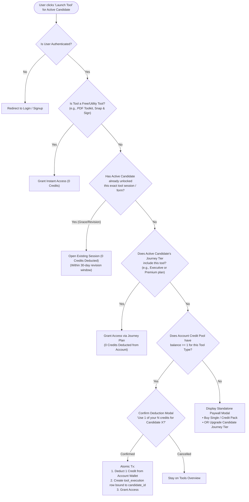
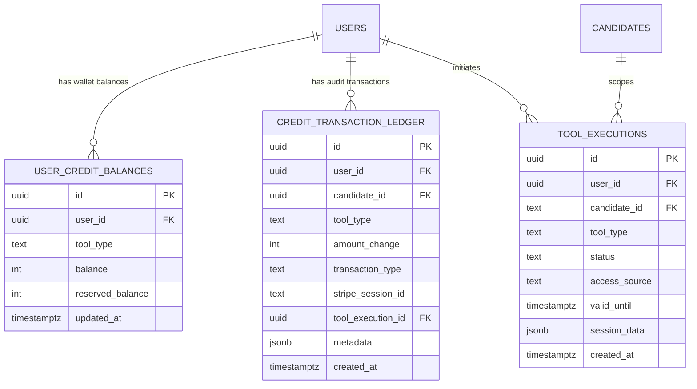
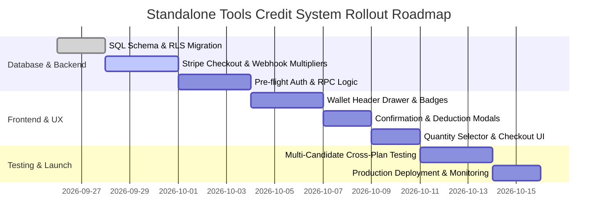

# Architecture & Implementation Plan: Standalone Tools Credit-Based Pricing & Entitlement Engine

**Document Status**: APPROVED SPECIFICATION  
**Target System**: Multi-Candidate & Multi-Visa Category Platform (`IR-1`, `IR-5`, `IR-2`)  
**Scope**: Standalone Tool Pricing, Quantity Packs, Account-Level Credit Pool, and Candidate-Level Journey Entitlements  
**Author**: Engineering & Product Architecture Team  

---

## 1. Executive Summary & Strategic Context

With the rollout of the multi-candidate and multi-visa category architecture, a single petitioner account can manage multiple beneficiaries (e.g., Mother and Father under **IR-5**, multiple children under **IR-2**, or separate **IR-1** petitions). Each candidate operates in their own isolated journey context with dedicated roadmaps, vault documents, guides, and stage progress.

### The Pricing Dilemma
Candidates may hold different **Journey Plans** (`basic`, `premium`, `executive`), which already bundle specific tool entitlements. However, petitioners frequently require standalone access to high-value tools (such as the **221(g) Action Planner**, **Smart Form Filler**, **Mock Interview Prep**, **Sponsorship Calculator**, and **Photo Booth**) without necessarily upgrading the entire candidate roadmap.

This document establishes the architecture for **Account-Level Standalone Tool Credits**:
1. How standalone tools are priced, packaged, and multiplied via e-commerce quantity controls.
2. How account-level credit balances seamlessly interact with candidate-level journey plan entitlements without double-charging or deducting credits when a candidate already has plan-based access.
3. Complete resolution of edge cases, concurrency hazards, idempotency, data models, and API specifications.

---

## 2. Comparative Evaluation of Pricing Strategies

Before finalizing the Credit-Based model, three distinct pricing models were analyzed for feasibility, user experience, engineering overhead, and revenue optimization:

```mermaid
graph TD
    subgraph OptionA ["Option A: Per-Candidate Lock"]
        A1["User buys tool for Candidate 1"] --> A2["Tool permanently locked to Candidate 1"]
        A2 --> A3["Candidate 2 needs tool -> Must purchase again"]
        A3 --> A4["High friction, duplicate charges, user dissatisfaction"]
    end

    subgraph OptionB ["Option B: Account-Wide Unlimited Time Pass"]
        B1["User buys 30-Day Tool Pass"] --> B2["All candidates get unlimited access for 30 days"]
        B2 --> B3["API abuse risk, unpredictable LLM cost, low LTV"]
    end

    subgraph OptionC ["Option C: Account-Level Credit Pool (Recommended)"]
        C1["User buys Tool Credit Pack (Account Level)"] --> C2["Credits stored in central user wallet"]
        C2 --> C3["User allocates credits dynamically across any Candidate"]
        C3 --> C4["Fair, transparent, scalable, high conversion, strict margin control"]
    end
```



### Option A: Candidate-Locked Per-Purchase (Single-Beneficiary License)
* **Mechanics**: When a user purchases a tool session (e.g., $15 for Sponsorship Calculator), the purchase is permanently bound to `candidate_id` (e.g., Mother). If the user needs the same tool for Father (`candidate-2`), they must purchase it again.
* **Limitations**:
  - **Severe User Friction**: Immigrant petitioners filing for both parents (IR-5) share household income, tax returns, and joint assets. Forcing them to pay twice for the same calculation creates frustration and support tickets.
  - **Inflexible**: If a user accidentally buys a tool while having Candidate 1 selected, support must manually transfer licenses.
  - **Low Perceived Value**: Users feel penalized for having multiple family members on one platform.

### Option B: Account-Wide Unlimited Add-on Subscription / Time-Bound Pass
* **Mechanics**: The user pays a flat fee (e.g., $49/month or $99 one-time) to unlock unlimited usage of a tool across all candidates in their account for a given time window.
* **Limitations**:
  - **Margin Risk on AI-Heavy Tools**: High-cost backend operations (e.g., OCR processing on 50-page PDFs in Smart Form Filler, OpenAI voice synthesis in Mock Interview Prep) can be abused with unlimited passes, causing negative unit economics.
  - **Misalignment with Visa Lifecycle**: Immigration is milestone-driven, not subscription-driven. A petitioner needs Form I-130 filled once or twice, not every month.
  - **Cannibalization of Journey Tiers**: Users would buy a cheap tool pass instead of upgrading to Premium/Executive Journey Plans.

### Option C: Account-Level Credit-Based System *(Recommended & Adopted)*
* **Mechanics**: Users purchase discrete **Credits** associated with specific tools (or tool bundles) deposited into an **Account-Level Wallet**. When an action is initiated for a candidate, the system checks whether the candidate already has journey-level entitlements. If not, it deducts 1 credit from the account pool and grants that candidate a persistent, revision-safe execution token.
* **Why This is Recommended**:
  1. **Maximum Flexibility**: A petitioner sponsoring Mother and Father can purchase a 4-Credit Smart Form Filler pack, using 2 forms for Mother (I-130 + DS-260) and 2 forms for Father (I-130 + DS-260).
  2. **Strict Cost & Margin Control**: Every AI generation, PDF rendering, or audio mock interview is strictly backed by paid units.
  3. **Multi-Pack & E-Commerce Scalability**: Enables volume discounts, quantity pickers ($199 for 3 credits $\times$ quantity 2 = 6 credits for $398), and promotional credit grants.
  4. **Clean Decoupling**: Separates financial transactions (Stripe checkout at account level) from workflow execution (scoped per candidate journey).

---

## 3. Tool Catalog & Pricing Matrix

The table below outlines the finalized credit packages, pricing tiers, unit costs, and journey plan inclusions:

| Tool Name | Tool Category | Credit Pack Options | Package Price (USD) | Effective Unit Price | Included in Journey Plans | Standalone Credit Consumption Unit |
| :--- | :--- | :--- | :--- | :--- | :--- | :--- |
| **221(g) Action Planner** | AI & Planning | **3 Credits** *(Base Pack)* | **$199.00** | $66.33 / credit | **Executive** *(Unlimited)* | 1 credit = 1 complete 221(g) strategy analysis & response packet generation |
| **Interview Prep / Mock AI** | AI & Planning | **1 Credit** | **$200.00** | $200.00 / credit | **Premium & Executive** *(Full Access)* | 1 credit = 1 complete live AI consular mock interview session + scorecard report |
| **Smart Form Filler** | Forms & Automation | **Single Form** (1 Credit)<br>**4-Credit Pack** (4 Forms)<br>**7-Credit Pack** (7 Forms) | **$39.00**<br>**$125.00**<br>**$199.00** | $39.00 / form<br>$31.25 / form *(20% off)*<br>$28.43 / form *(27% off)* | **Executive** *(All Forms)*<br>**Premium** *(Key Forms)* | 1 credit = 1 official government form auto-filled & PDF generated (e.g. DS-260, I-130, I-864) |
| **Sponsorship Calculator** | Money & Sponsorship | **3 Credits** *(Base Pack)* | **$15.00** | $5.00 / credit | **Premium & Executive** *(Unlimited)* | 1 credit = 1 comprehensive poverty guideline, household income & joint sponsor assessment |
| **Visa Photo Booth** | Docs & PDFs | **2 Credits** *(Base Pack)* | **$15.00** | $7.50 / credit | **Basic, Premium, Executive** *(Included)* | 1 credit = 1 AI biometric photo crop, background cleanup, and 2x2 printable sheet |
| **PDF Tool Kit** | Docs & PDFs | **one time Fee** | **$49** | Free for all users | **All Users (Basic/Prem/Exec)** | 0 credits (No credits required, client-side utility) |
| **Snap & Sign** | Docs & PDFs | **Free / Utility** | **$0.00** | Free for all users | **All Users (Free/Basic/Prem/Exec)** | 0 credits (Digital signature creator utility) |
| **DQ Status / Queue Watch** | Tracking | **Free / Utility** | **$0.00** | Free for all users | **All Users (Free/Basic/Prem/Exec)** | 0 credits (Public embassy queue tracking) |

---

## 4. E-Commerce Quantity Multipliers & Bulk Purchasing

Users can purchase multiple bundles in a single checkout session via standard e-commerce quantity controls:

```
┌─────────────────────────────────────────────────────────────────────────────┐
│ 🛒 STANDALONE TOOL CHECKOUT                                                │
├─────────────────────────────────────────────────────────────────────────────┤
│ Selected Item: 221(g) Action Planner (3 Credits Base Pack)                 │
│ Unit Price:    $199.00 (3 Credits)                                          │
│                                                                             │
│ Quantity:      [-]  [ 2 ]  [+]                                              │
│                                                                             │
│ Summary:                                                                    │
│ • Total Credits Credited to Account: 6 Credits                              │
│ • Usable Across: Any candidate profile (Mother, Father, Spouse, etc.)       │
│ • Subtotal:                          $398.00                                │
│ • Taxes / Processing:                $0.00                                  │
│ • Total Due:                         $398.00                                │
│                                                                             │
│ [  💳 Pay with Stripe / Card  ]                                             │
└─────────────────────────────────────────────────────────────────────────────┘
```

### Quantity Multiplier Rules
1. **Linear Stacking**: For packs with fixed units (e.g., 221g 3-pack for $199), selecting quantity $N$ charges $N \times \text{Price}$ and credits $N \times \text{Credits}$ (e.g., Quantity $3 \rightarrow \$597 \rightarrow 9$ credits).
2. **Pack Selection vs. Quantity**: If a user needs 4 Smart Forms, they are nudged to select the **4-Credit Pack ($125)** rather than $4 \times \text{Single Form (\$156)}$, saving $31.
3. **Account Wallet Deposit**: Upon successful Stripe webhook `checkout.session.completed`, the system atomically increments `user_credit_balances.balance` by $(\text{CreditsPerUnit} \times \text{Quantity})$.

---

## 5. Credit Deduction & Journey Entitlement Resolution Logic

The critical engineering rule is: **Candidate Journey Plan Entitlements ALWAYS take precedence over Standalone Account Credits.** A user's account credits must NEVER be deducted if the active candidate already qualifies for the tool via their journey tier.

### Access Resolution Decision Tree



---

## 6. Comprehensive Edge Cases & Scenarios

Below is the exhaustive matrix of all potential cross-candidate, plan-upgrade, concurrency, and session lifecycle scenarios:

---

### Scenario 1: Multi-Candidate Plan Asymmetry (The Core Isolation Test)
* **Context**:
  - `Candidate 1 (Mother)` is on the **Basic Plan** (Smart Form Filler locked).
  - `Candidate 2 (Father)` is on the **Executive Plan** (Smart Form Filler unlocked/free).
  - The user purchases a **4-Credit Smart Form Filler Pack ($125)** at the account level. Account balance = 4 credits.
* **Action**:
  - The user selects `Candidate 1` in the switcher and starts Form I-130.
  - The user confirms the deduction modal $\rightarrow$ 1 credit is deducted. Account balance = 3 credits. Form I-130 is now unlocked for `Candidate 1`.
  - Next, the user switches to `Candidate 2 (Father)` and opens Form I-130.
* **Resolution & Expected Behavior**:
  - The system checks `Candidate 2`'s journey tier $\rightarrow$ finds `executive`.
  - Form I-130 opens immediately under `Candidate 2`'s profile.
  - **Account balance remains strictly 3 credits**. No credit is deducted.
  - Form data between `Candidate 1` and `Candidate 2` remains 100% isolated.

---

### Scenario 2: Journey Plan Upgrade After Purchasing Standalone Credits
* **Context**:
  - User has `Candidate 1` on **Basic**. User purchases 3 credits of **221(g) Action Planner ($199)**.
  - User has not yet used the credits (Account balance = 3 credits).
  - 2 days later, user upgrades `Candidate 1` to the **Executive Plan** (which includes unlimited 221(g) Action Planner).
* **Action**:
  - User launches 221(g) Action Planner for `Candidate 1`.
* **Resolution & Expected Behavior**:
  - Tool runs under the Executive Plan entitlement.
  - Account credit balance remains **3 credits**.
  - The 3 standalone credits remain unspent in the user's account wallet and can be used for any other candidate (e.g., `Candidate 2`, `Candidate 3`) or future journeys without expiring.
  - UI displays an informational badge: *"Running under Candidate 1 Executive Plan. Your 3 Account Credits remain available for other candidates."*

---

### Scenario 3: Form Revisions, Drafts, and Re-Generation Grace Period
* **Context**:
  - User uses 1 credit to fill Form DS-260 for `Candidate 1`.
  - 3 days later, the user notices a typo in the passport expiration date and re-opens Form DS-260 for `Candidate 1`.
* **Problem**: Does modifying or re-downloading the form consume another credit?
* **Resolution & Expected Behavior**:
  - **30-Day Free Revision Window**: When a credit is consumed, an immutable `tool_execution` record is created with `status: 'completed'` and `valid_until: NOW() + INTERVAL '30 days'`.
  - Within 30 days, the user can edit answers, re-run validations, and regenerate the PDF for `Candidate 1` an unlimited number of times for **0 credits**.
  - A fresh credit is consumed ONLY if:
    1. The user creates a brand-new form type (e.g., Form I-864 after Form I-130), OR
    2. The user initiates a form for a different candidate (`Candidate 2`), OR
    3. The 30-day revision window for that specific form instance has expired.

---

### Scenario 4: Shared Household Tools (Sponsorship Calculator for IR-5 Parents)
* **Context**:
  - In an **IR-5** petition, the U.S. citizen child sponsors both Mother (`Candidate 1`) and Father (`Candidate 2`).
  - The petitioner's income, household size, W-2s, and tax transcripts are identical for both parents.
  - User buys a **3-Credit Sponsorship Calculator Pack ($15)**.
* **Action**:
  - User runs the Sponsorship Calculator for Mother $\rightarrow$ consumes 1 credit (2 credits remaining).
  - User switches to Father and launches the Sponsorship Calculator.
* **Resolution & Expected Behavior**:
  - The UI presents a prompt:
    > *"We found an active Sponsorship Calculation for your household (created for Mother). Would you like to **Copy & Link** this calculation to Father for free, or start a separate fresh calculation (uses 1 credit)?"*
  - If the user clicks **Copy & Link**, the petitioner's financial inputs are imported into Father's profile without deducting a credit.
  - If the user needs a distinct joint sponsor calculation specifically for Father, they can choose "Start Fresh Calculation" (consumes 1 credit).

---

### Scenario 5: Mid-Generation Network Failure or LLM Error (Atomic Reservation Protocol)
* **Context**:
  - User initiates Mock Interview Prep (1 credit). The AI agent begins generating questions.
  - At question 2, the user's internet disconnects or the LLM provider experiences an outage (504 Gateway Timeout).
* **Problem**: If the credit was deducted immediately, the user loses their credit without getting the service. If the credit is deducted at the end, the user can exploit free sessions by disconnecting before the end.
* **Resolution & Expected Behavior (Two-Phase Commit)**:
  1. **Phase 1 - Reserve**: When session begins, status is set to `reserved` (`hold_expires_at: NOW() + 15 mins`). Balance reflects `pending_deduction`.
  2. **Phase 2 - Commit**: When the session successfully completes (e.g., interview scorecard generated or form PDF created), status changes to `committed` and balance is permanently decremented.
  3. **Auto-Rollback**: If the session fails or is abandoned without completion within 15 minutes, a background cron/DB trigger releases the reservation back to the user's available balance (`status: 'released'`).

---

### Scenario 6: Concurrent Execution / Race Conditions Across Tabs
* **Context**:
  - User has 1 credit remaining for Smart Form Filler.
  - User opens two browser tabs simultaneously: Tab A (`Candidate 1` Form I-130) and Tab B (`Candidate 2` Form I-130).
  - User clicks "Submit & Generate Form" on both tabs at the exact same millisecond.
* **Resolution & Expected Behavior**:
  - Supabase / PostgreSQL uses strict row-level locking:
    ```sql
    SELECT balance FROM user_credit_balances 
    WHERE user_id = $1 AND tool_type = $2 
    FOR UPDATE;
    ```
  - Tab A secures the lock, verifies balance = 1, deducts 1 (balance becomes 0), commits transaction.
  - Tab B acquires the lock next, reads balance = 0, fails the pre-flight check, and displays: *"Insufficient credits. This credit was just allocated in another session. Please purchase additional credits."*
  - No negative balances can ever occur.

---

### Scenario 7: Candidate Profile Deletion / Archiving
* **Context**:
  - User has consumed 1 credit of 221(g) Action Planner on `Candidate 2`.
  - Later, user deletes or archives `Candidate 2` from the system.
* **Resolution & Expected Behavior**:
  - **Consumed Credits Are Non-Transferable Once Executed**: The credit was already spent to generate AI analysis for that person. Deleting the candidate profile does NOT refund the credit to the account pool.
  - **Vault Backup**: Generated PDFs and execution summaries are retained in the user's central historical audit log for compliance, even if the candidate profile is deleted.
  - **Warning Modal**: Before candidate deletion, the modal warns: *"Candidate 2 has 1 completed 221(g) session. Deleting this profile will remove active access, and previously consumed credits will not be refunded."*

---

### Scenario 8: Quantity Selector Edge Cases in Checkout
* **Context**:
  - User attempts to purchase Quantity = 0 or negative quantities, or selects 100+ units.
* **Resolution & Expected Behavior**:
  - Frontend restricts quantity input to integers between `1` and `10`.
  - Backend Stripe session builder enforces schema validation:
    ```ts
    const quantity = Math.max(1, Math.min(10, Math.floor(Number(req.body.quantity) || 1)));
    ```
  - For enterprise/law firm accounts needing $>10$ units, the UI displays a *"Contact Sales for Volume / Law Firm Licensing"* CTA.

---

## 7. Database Architecture & Schema

The credit and standalone entitlement system is implemented via three PostgreSQL tables in Supabase:



### SQL Migration Script

```sql
-- 1. User Credit Balances (Current Wallet State)
CREATE TABLE IF NOT EXISTS public.user_credit_balances (
    id UUID PRIMARY KEY DEFAULT gen_random_uuid(),
    user_id UUID NOT NULL REFERENCES auth.users(id) ON DELETE CASCADE,
    tool_type TEXT NOT NULL, -- '221g', 'interview_prep', 'smart_form_filler', 'sponsorship_calc', 'photo_booth'
    balance INTEGER NOT NULL DEFAULT 0 CHECK (balance >= 0),
    reserved_balance INTEGER NOT NULL DEFAULT 0 CHECK (reserved_balance >= 0),
    created_at TIMESTAMPTZ NOT NULL DEFAULT NOW(),
    updated_at TIMESTAMPTZ NOT NULL DEFAULT NOW(),
    UNIQUE(user_id, tool_type)
);

-- Index for instant wallet balance checks
CREATE INDEX IF NOT EXISTS idx_user_credit_balances_lookup 
ON public.user_credit_balances(user_id, tool_type);


-- 2. Tool Executions (Session & Entitlement Token per Candidate)
CREATE TABLE IF NOT EXISTS public.tool_executions (
    id UUID PRIMARY KEY DEFAULT gen_random_uuid(),
    user_id UUID NOT NULL REFERENCES auth.users(id) ON DELETE CASCADE,
    candidate_id TEXT NOT NULL, -- e.g. 'candidate-1', 'candidate-2'
    tool_type TEXT NOT NULL,
    form_id TEXT, -- e.g. 'i-130', 'ds-260', NULL for general tools
    status TEXT NOT NULL DEFAULT 'reserved' CHECK (status IN ('reserved', 'completed', 'released', 'cancelled')),
    access_source TEXT NOT NULL CHECK (access_source IN ('journey_plan', 'credit_wallet', 'admin_override')),
    valid_until TIMESTAMPTZ, -- For 30-day revision grace periods
    hold_expires_at TIMESTAMPTZ, -- Reservation expiration (e.g. NOW() + 15 mins)
    session_data JSONB DEFAULT '{}'::jsonb,
    created_at TIMESTAMPTZ NOT NULL DEFAULT NOW(),
    updated_at TIMESTAMPTZ NOT NULL DEFAULT NOW()
);

CREATE INDEX IF NOT EXISTS idx_tool_executions_candidate_tool 
ON public.tool_executions(user_id, candidate_id, tool_type, status);


-- 3. Credit Transaction Ledger (Immutable Double-Entry Audit Log)
CREATE TABLE IF NOT EXISTS public.credit_transaction_ledger (
    id UUID PRIMARY KEY DEFAULT gen_random_uuid(),
    user_id UUID NOT NULL REFERENCES auth.users(id) ON DELETE CASCADE,
    candidate_id TEXT, -- NULL if purchase at account level
    tool_type TEXT NOT NULL,
    amount_change INTEGER NOT NULL, -- +3 for purchase, -1 for deduction, +1 for refund/release
    transaction_type TEXT NOT NULL CHECK (transaction_type IN ('purchase', 'deduction', 'reservation', 'release', 'refund', 'admin_grant')),
    stripe_session_id TEXT,
    tool_execution_id UUID REFERENCES public.tool_executions(id) ON DELETE SET NULL,
    metadata JSONB DEFAULT '{}'::jsonb,
    created_at TIMESTAMPTZ NOT NULL DEFAULT NOW()
);

CREATE INDEX IF NOT EXISTS idx_credit_ledger_user 
ON public.credit_transaction_ledger(user_id, created_at DESC);


-- 4. Row Level Security (RLS)
ALTER TABLE public.user_credit_balances ENABLE ROW LEVEL SECURITY;
ALTER TABLE public.tool_executions ENABLE ROW LEVEL SECURITY;
ALTER TABLE public.credit_transaction_ledger ENABLE ROW LEVEL SECURITY;

CREATE POLICY "Users view their own credit balances" 
ON public.user_credit_balances FOR SELECT 
USING (auth.uid() = user_id);

CREATE POLICY "Users view their own tool executions" 
ON public.tool_executions FOR SELECT 
USING (auth.uid() = user_id);

CREATE POLICY "Users view their own credit transaction history" 
ON public.credit_transaction_ledger FOR SELECT 
USING (auth.uid() = user_id);
```

---

## 8. API Specifications & Service Contracts

### 8.1 Pre-Flight Check & Authorization API
`POST /api/tools/authorize`

Called before launching any tool to determine whether the candidate can open it, whether credits will be deducted, or if a paywall must be shown.

**Request**:
```json
{
  "toolType": "smart_form_filler",
  "candidateId": "candidate-1",
  "formId": "i-130"
}
```

**Response (Case A: Included in Journey Plan)**:
```json
{
  "authorized": true,
  "accessSource": "journey_plan",
  "planTier": "executive",
  "deductionRequired": false,
  "availableAccountCredits": 3,
  "message": "Access included with Candidate 1's Executive Plan."
}
```

**Response (Case B: Deductible from Account Credit Pool)**:
```json
{
  "authorized": true,
  "accessSource": "credit_wallet",
  "deductionRequired": true,
  "availableAccountCredits": 3,
  "promptConfirmation": {
    "title": "Use 1 Smart Form Filler Credit?",
    "description": "You have 3 credits in your account. This will use 1 credit for Candidate 1 (Mother) with 30 days of free revisions."
  }
}
```

**Response (Case C: Insufficient Credits / Paywall Trigger)**:
```json
{
  "authorized": false,
  "accessSource": "none",
  "deductionRequired": false,
  "availableAccountCredits": 0,
  "pricingOptions": [
    { "packageId": "form_single", "credits": 1, "price": 39, "label": "Single Form" },
    { "packageId": "form_pack_4", "credits": 4, "price": 125, "popular": true, "label": "4-Form Package ($31.25/form)" },
    { "packageId": "form_pack_7", "credits": 7, "price": 199, "label": "7-Form Package ($28.43/form)" }
  ],
  "upgradeOption": {
    "candidateId": "candidate-1",
    "recommendedPlan": "executive",
    "upgradePrice": 299
  }
}
```

---

### 8.2 Stripe Checkout Session API with Quantity Support
`POST /api/tools/checkout`

Generates a Stripe Checkout session supporting tool packages and user-selected quantities.

**Request**:
```json
{
  "toolType": "221g",
  "packageId": "221g_base_3pack",
  "quantity": 2,
  "candidateId": "candidate-1",
  "successUrl": "https://app.rahvana.com/221g-action-planner?session_id={CHECKOUT_SESSION_ID}",
  "cancelUrl": "https://app.rahvana.com/tools"
}
```

**Backend Webhook Execution (`checkout.session.completed`)**:
```ts
// Atomic credit grant on Stripe webhook
const { toolType, creditsPerPack, quantity, userId } = session.metadata;
const totalCreditsToAdd = Number(creditsPerPack) * Number(quantity);

await supabase.rpc('grant_user_credits', {
  p_user_id: userId,
  p_tool_type: toolType,
  p_credits: totalCreditsToAdd,
  p_stripe_session_id: session.id,
  p_amount_paid_cents: session.amount_total
});
```

---

### 8.3 Atomic Database Function for Credit Deduction (`rpc/consume_tool_credit`)

```sql
CREATE OR REPLACE FUNCTION public.consume_tool_credit(
    p_user_id UUID,
    p_candidate_id TEXT,
    p_tool_type TEXT,
    p_form_id TEXT DEFAULT NULL
)
RETURNS JSONB
LANGUAGE plpgsql
SECURITY DEFINER
AS $$
DECLARE
    v_balance INTEGER;
    v_execution_id UUID;
BEGIN
    -- 1. Lock user credit balance row
    SELECT balance INTO v_balance
    FROM public.user_credit_balances
    WHERE user_id = p_user_id AND tool_type = p_tool_type
    FOR UPDATE;

    -- 2. Check sufficient balance
    IF v_balance IS NULL OR v_balance < 1 THEN
        RETURN jsonb_build_object(
            'success', false,
            'error', 'INSUFFICIENT_CREDITS',
            'current_balance', COALESCE(v_balance, 0)
        );
    END IF;

    -- 3. Decrement credit balance
    UPDATE public.user_credit_balances
    SET balance = balance - 1,
        updated_at = NOW()
    WHERE user_id = p_user_id AND tool_type = p_tool_type;

    -- 4. Create tool execution record with 30-day grace period
    INSERT INTO public.tool_executions (
        user_id,
        candidate_id,
        tool_type,
        form_id,
        status,
        access_source,
        valid_until
    ) VALUES (
        p_user_id,
        p_candidate_id,
        p_tool_type,
        p_form_id,
        'completed',
        'credit_wallet',
        NOW() + INTERVAL '30 days'
    ) RETURNING id INTO v_execution_id;

    -- 5. Record in immutable transaction ledger
    INSERT INTO public.credit_transaction_ledger (
        user_id,
        candidate_id,
        tool_type,
        amount_change,
        transaction_type,
        tool_execution_id,
        metadata
    ) VALUES (
        p_user_id,
        p_candidate_id,
        p_tool_type,
        -1,
        'deduction',
        v_execution_id,
        jsonb_build_object('form_id', p_form_id, 'valid_until', NOW() + INTERVAL '30 days')
    );

    RETURN jsonb_build_object(
        'success', true,
        'execution_id', v_execution_id,
        'remaining_balance', v_balance - 1
    );
END;
$$;
```

---

## 9. Frontend UI & UX Component Specifications

### 9.1 Global SiteHeader & Tools Navigation Credit Widget
A credit wallet pill will be integrated into the navigation header and Tools page:
- **Badge State**: `🪙 3 Form Credits | 🪙 2 Photo Credits`
- **Click Interaction**: Opens a lightweight slide-over drawer displaying:
  - Total credits available per tool category.
  - Quick purchase / reload button.
  - Recent consumption history tagged by candidate (e.g., *"1 Form Credit used for Mother on Sept 24"*).

```
┌─────────────────────────────────────────────────────────────────────────────┐
│ 🪙 Account Tool Wallet                                                [ ✕ ] │
├─────────────────────────────────────────────────────────────────────────────┤
│ 221(g) Action Planner:    3 Credits Available       [ + Buy More ($199) ]   │
│ Smart Form Filler:        4 Credits Available       [ + Buy More ($125) ]   │
│ Mock Interview Prep:      0 Credits Available       [ + Buy Credit ($200) ] │
│ Sponsorship Calculator:   3 Credits Available       [ + Buy More ($15)  ]   │
│ Photo Booth:              2 Credits Available       [ + Buy More ($15)  ]   │
├─────────────────────────────────────────────────────────────────────────────┤
│ Recent Activity:                                                            │
│ • Sept 24: Form I-130 generated for Candidate 1 (Mother)       [-1 Credit]  │
│ • Sept 20: 3-Credit 221(g) Pack Purchased via Stripe           [+3 Credits] │
└─────────────────────────────────────────────────────────────────────────────┘
```

### 9.2 Pre-Execution Deduction Confirmation Modal
When a user launches a standalone tool that requires credit deduction, they receive an explicit confirmation dialog:

```
┌─────────────────────────────────────────────────────────────────────────────┐
│ 🚀 Launch Smart Form Filler                                                │
├─────────────────────────────────────────────────────────────────────────────┤
│ Active Beneficiary: 👩 Candidate 1 (Mother - IR-5)                          │
│ Tool Selected:      Form I-130 (Petition for Alien Relative)                │
│                                                                             │
│ Entitlement Status:                                                         │
│ • Candidate 1 Plan: Basic (Forms not bundled)                               │
│ • Account Balance:  3 Credits Available                                     │
│                                                                             │
│ ℹ️ This action will use 1 of your 3 credits. Once generated, you will have  │
│ 30 days of unlimited edits, re-validations, and PDF downloads for Mother.   │
│                                                                             │
│ [ Cancel ]                               [ Confirm & Use 1 Credit ]         │
└─────────────────────────────────────────────────────────────────────────────┘
```

---

## 10. Summary & Implementation Roadmap



### Key Takeaways
1. **Account-Level Wallet**: All standalone purchases credit the user's primary account, granting full freedom to allocate credits to Mother, Father, Children, or Spouse.
2. **Strict Plan-First Precedence**: If a candidate's journey plan includes the tool (e.g. Executive tier), account credits are **never** deducted.
3. **E-Commerce Quantity Picker**: Users can easily buy multiple packs (e.g., $2 \times 3$ credits of 221(g) = 6 credits for $398).
4. **Idempotency & Revisions**: 30-day grace periods protect users from duplicate deductions when editing existing forms.
5. **Zero Concurrency Hazards**: PostgreSQL `FOR UPDATE` row-level locks prevent race conditions across browser tabs.
